<div align="center">


# 🏥 Phân tích & Thiết kế Phần mềm — Website Nhà thuốc FPT Long Châu

**Đồ án môn *Phân tích và Thiết kế Phần mềm* (PTTKPM)**
Trường Công nghệ Thông tin Phenikaa · GV hướng dẫn: **TS. Trương Đức Phương** · Học kỳ 2026

[](diagrams/png/)
[](diagrams/)
[](docs/BaoCao_LongChau_PTTKPM.md)
[](diagrams/drawio/Hinh_1_1_Bieu_do_Use_Case.drawio)
[](reference/FACTS.md)
[](LICENSE)

[**Báo cáo đầy đủ**](docs/BaoCao_LongChau_PTTKPM.md) · [**Mã nguồn DOCX**](docs/BaoCao_LongChau_PTTKPM.docx) · [**Danh mục hình**](docs/DANH_MUC_HINH.md) · [**Kịch bản thuyết trình**](docs/KICH_BAN_THUYET_TRINH.docx) · [**Đặc tả slide**](slides/PROMPT_TAO_SLIDE_LONG_CHAU.md) · [**Sự thật đã kiểm chứng**](reference/FACTS.md)

</div>

---

## 📋 Về đồ án

Đồ án phân tích và thiết kế phần mềm cho **website Nhà thuốc FPT Long Châu** ([nhathuoclongchau.com.vn](https://nhathuoclongchau.com.vn/)) — chuỗi nhà thuốc bán lẻ có kênh trực tuyến. Hệ thống phục vụ **5 nhóm sản phẩm** với cây danh mục 3 cấp, bán theo **nhiều đơn vị tính** (Hộp / Vỉ / Chai / Tuýp), hỗ trợ **6 phương thức thanh toán**, và có nghiệp vụ **đơn thuốc kê đơn (Rx)** cần dược sĩ tư vấn.

Toàn bộ tài liệu được chia làm 4 phần theo chuẩn phân tích & thiết kế phần mềm:

| Phần | Nội dung | Quy mô |
|:--|:--|:--|
| **1. Xác định yêu cầu** | Khảo sát thực tế, thuật ngữ, yêu cầu chức năng & phi chức năng, tác nhân, Use Case | 35 thuật ngữ · 52 FR · 18 NFR · 6 tác nhân · 27 UC |
| **2. Phân tích hệ thống** | Kiến trúc mức cao, phân hệ nghiệp vụ, mô hình đối tượng, hiện thực hoá Use Case | 4 tầng · 9 phân hệ · 33 đối tượng / 7 cụm · 9 sequence · 10 activity · 4 BCE |
| **3. Thiết kế hệ thống** | Lớp thiết kế, hệ thống con & interface, biểu đồ lớp, thiết kế CSDL, giao diện | 21 nhóm lớp · 35 bảng CSDL · 4 class diagram · ERD 3 phần |
| **4–5. Kết luận & TLTK** | Tổng kết kết quả, ưu điểm, hạn chế, tài liệu tham khảo | 3 ưu điểm · 2 hạn chế · 4 tài liệu |

---

## 🏗️ Kiến trúc hệ thống

Mô hình **phân lớp (Layered Architecture)** kết hợp **monolith phân hệ** — mỗi phân hệ giao tiếp qua interface công khai, mọi truy xuất dữ liệu đi qua Repository.

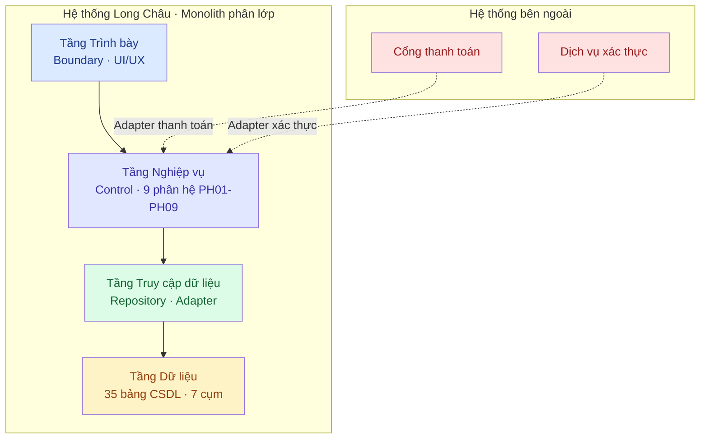

<details>
<summary><b>🗂️ 9 phân hệ nghiệp vụ (PH01–PH09)</b></summary>

| Mã | Phân hệ | Use Case |
|:--|:--|:--|
| PH01 | Tài khoản & Xác thực | UC01, UC02, UC26 |
| PH02 | Danh mục & Sản phẩm | UC03–UC06, UC16, UC22, UC23 |
| PH03 | Tìm kiếm & Tra cứu | UC07, UC08 |
| PH04 | Giỏ hàng & Đơn hàng | UC10, UC11, UC14, UC15, UC24 |
| PH05 | Thanh toán | UC13 |
| PH06 | Khuyến mãi | UC09, UC12, UC25 |
| PH07 | Đơn thuốc & Tư vấn | UC17, UC18 |
| PH08 | Thông tin bổ trợ | UC19, UC20, UC21 |
| PH09 | Thống kê báo cáo | UC27 |

</details>

---

## 📊 Những con số chính

<div align="center">

| 🧩 Yêu cầu | 📐 Mô hình | 🗄️ Dữ liệu | 🎨 Thiết kế |
|:--|:--|:--|:--|
| **52** yêu cầu chức năng | **33** đối tượng nghiệp vụ | **35** bảng CSDL | **21** nhóm lớp thiết kế |
| **18** yêu cầu phi chức năng | **7** cụm đối tượng | **7** cụm bảng | **6** Use Case trọng tâm |
| **27** Use Case · **6** tác nhân | **9** phân hệ | **6** Use Case trọng tâm | **6** phương thức thanh toán |

</div>

### 6 Use Case trọng tâm

> `UC03` Xem danh mục · `UC04` Xem danh sách sản phẩm · `UC05` Lọc & sắp xếp · `UC06` Xem chi tiết · `UC07` Tìm kiếm · `UC11` Đặt hàng

Mỗi Use Case trọng tâm đều được hiện thực hoá đầy đủ qua **3 loại biểu đồ**: trình tự (sequence) → hoạt động (activity) → lớp phân tích BCE.

---

## 🖼️ Gallery sơ đồ

<details open>
<summary><b>📌 Hình 1.1 — Biểu đồ Use Case tổng quát</b> (6 tác nhân, 27 UC)</summary>

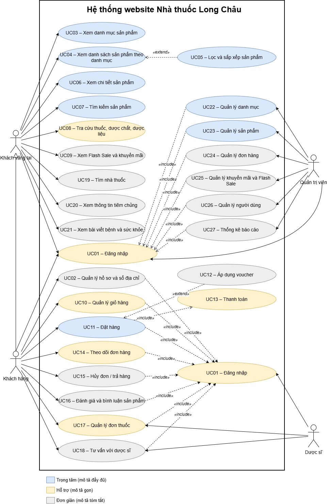

</details>

<details>
<summary><b>🏛️ Hình 2.1 — Kiến trúc mức cao</b> (4 tầng + thành phần xuyên suốt)</summary>

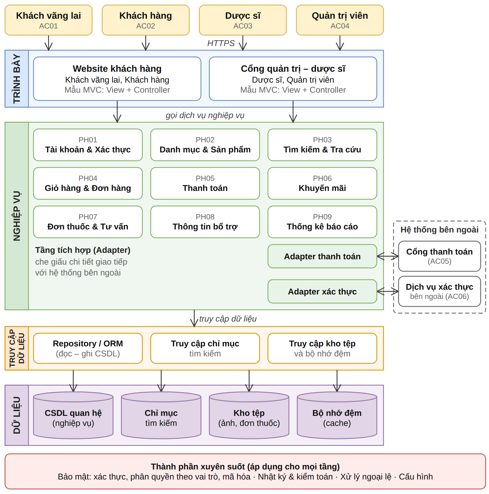

</details>

<details>
<summary><b>🔄 Hình 2.11 — Biểu đồ trình tự UC11 Đặt hàng</b></summary>

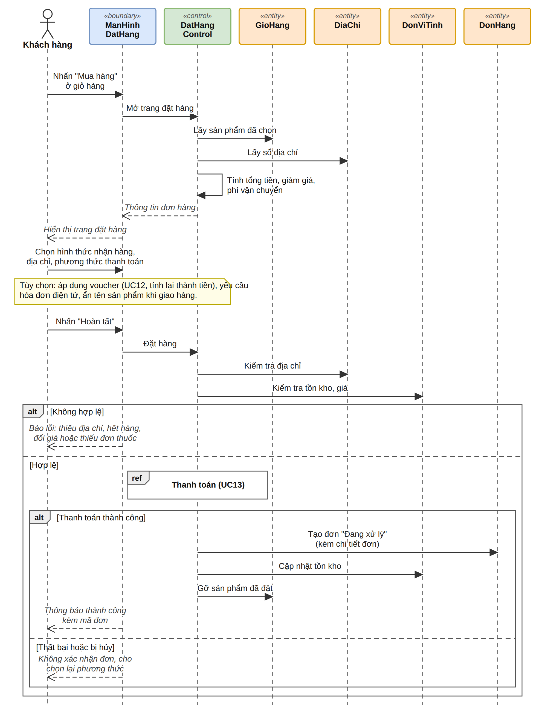

</details>

<details>
<summary><b>⚡ Hình 2.20 — Biểu đồ hoạt động UC11 Đặt hàng</b></summary>

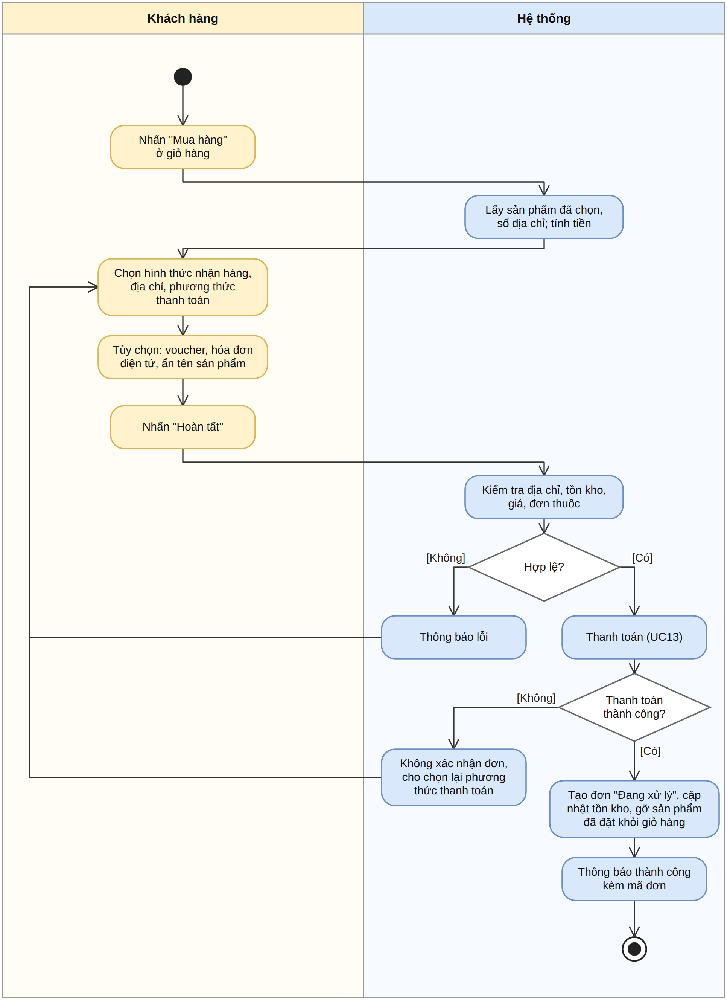

</details>

<details>
<summary><b>🧱 Hình 2.27 — Biểu đồ lớp phân tích BCE: Đặt hàng & Thanh toán</b></summary>

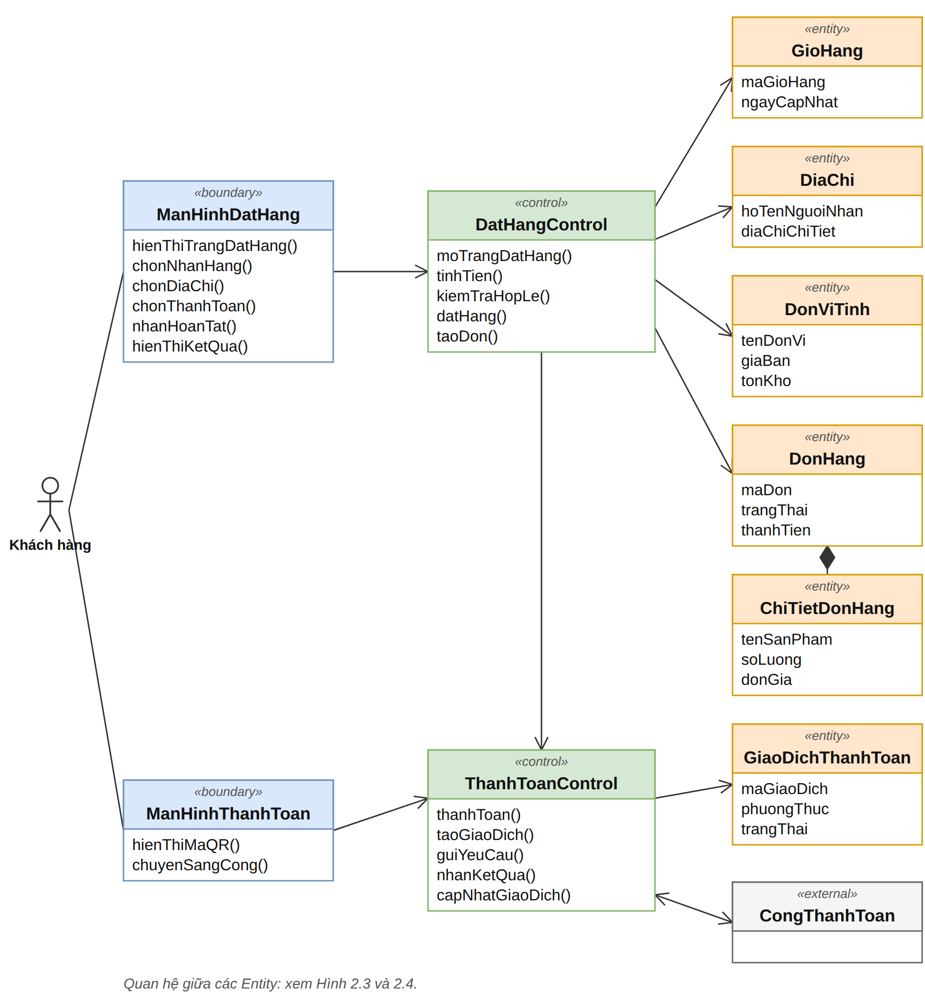

</details>

<details>
<summary><b>🎯 Hình 3.1 — Biểu đồ lớp thiết kế: Duyệt danh mục & sản phẩm</b></summary>

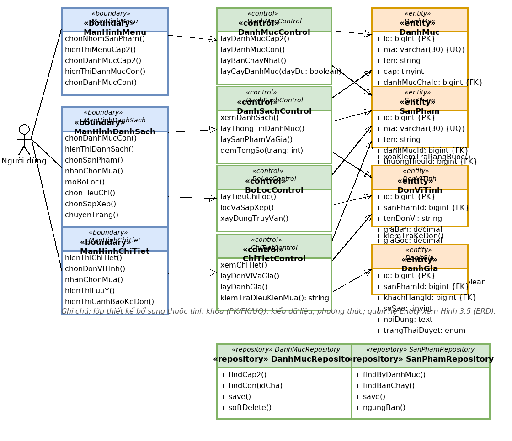

</details>

<details>
<summary><b>🧾 Hình 3.3 — Biểu đồ lớp thiết kế: Đặt hàng & Thanh toán</b></summary>

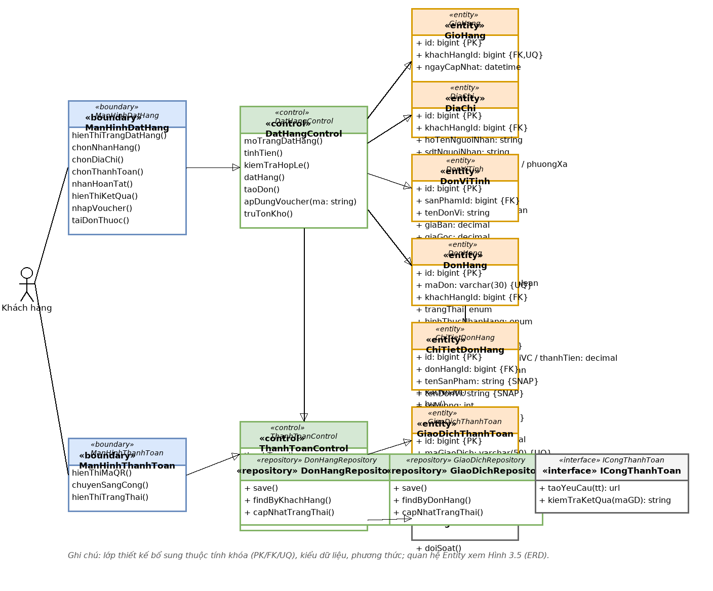

</details>

<details>
<summary><b>🗃️ Hình 3.5 — ERD vật lý phần 1/3</b> (35 bảng · 7 cụm)</summary>

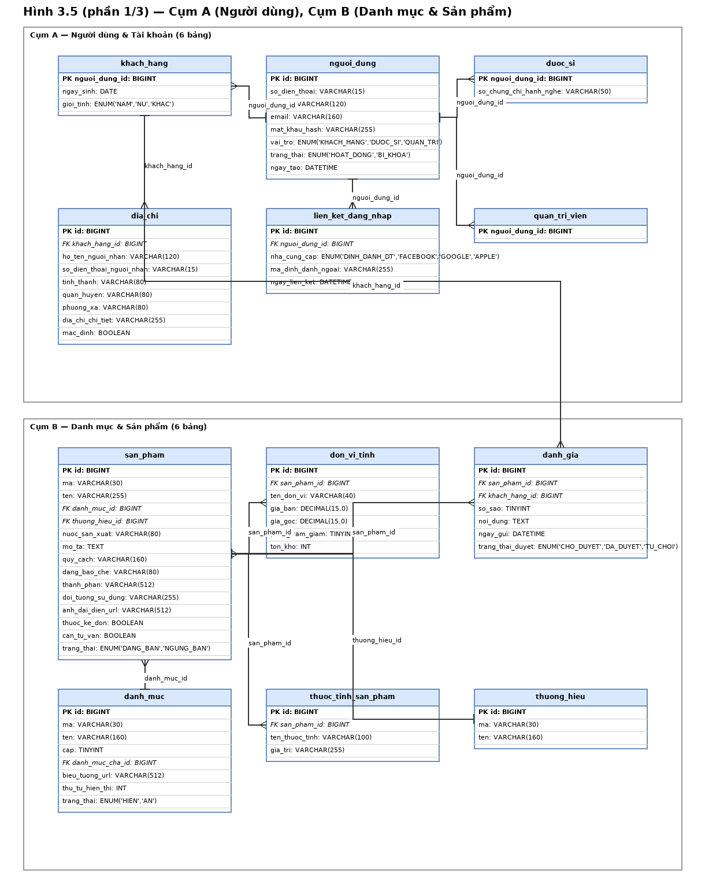

</details>

<details>
<summary><b>🗃️ Hình 3.5 — ERD vật lý phần 2/3</b></summary>

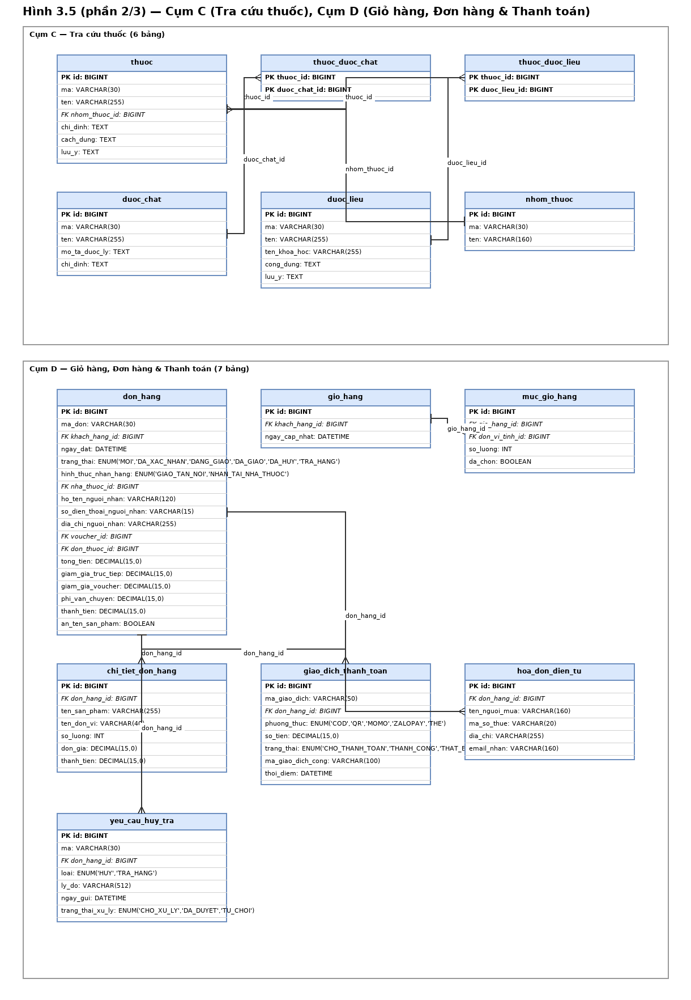

</details>

<details>
<summary><b>🗃️ Hình 3.5 — ERD vật lý phần 3/3</b></summary>

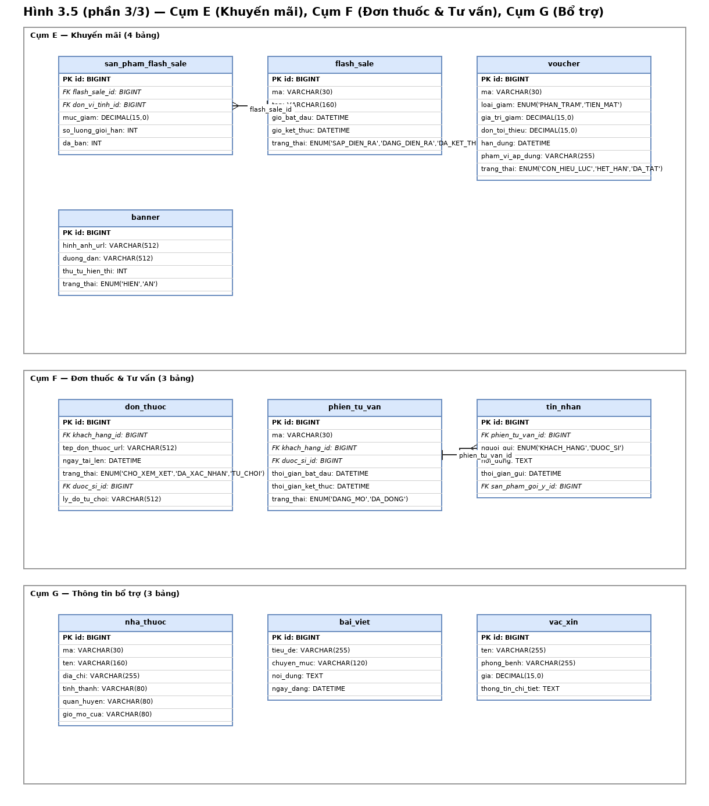

</details>

<details>
<summary><b>🖥️ Mục 3.4 — Giao diện người dùng</b> (wireframe + UI thực tế)</summary>

| Wireframe chuẩn | Đặt hàng | Thanh toán |
|:--|:--|:--|
| 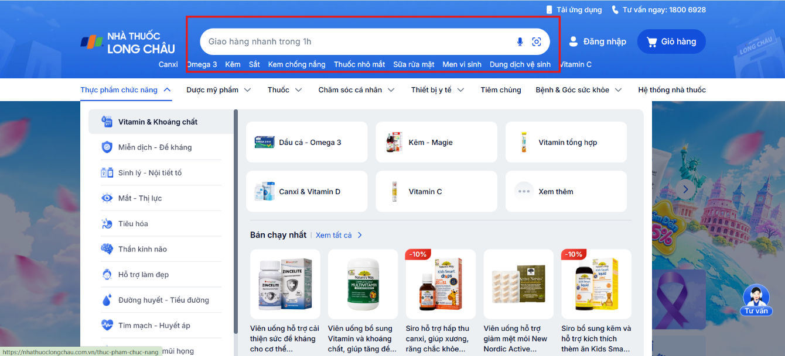 | 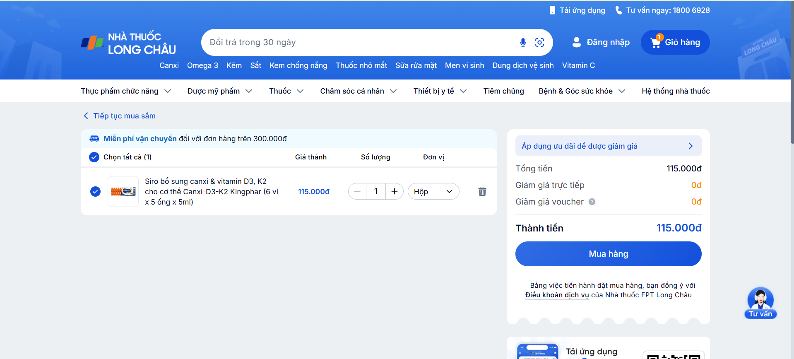 | 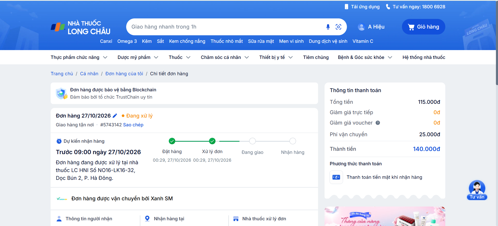 |

</details>

> Xem **toàn bộ 40 sơ đồ** tại [`docs/DANH_MUC_HINH.md`](docs/DANH_MUC_HINH.md).

---

## 🗂️ Cấu trúc repo

```text
bao-cao-long-chau/
├── 📄 README.md                      # File bạn đang đọc
├── 📄 LICENSE                        # MIT
├── 📄 .gitignore
│
├── 📁 docs/                          # Báo cáo & tài liệu
│   ├── BaoCao_LongChau_PTTKPM.docx   # ★ Báo cáo gốc (Word)
│   ├── BaoCao_LongChau_PTTKPM.md     # ★ Bản Markdown (đọc online)
│   ├── BaoCao_LongChau_Phan3_Design.docx
│   ├── DANH_MUC_HINH.md             # ★ Bảng tra cứu 40 hình
│   ├── KICH_BAN_THUYET_TRINH.docx   # ★ Kịch bản thuyết trình 30 slide
│   └── TAI_LIEU_THAM_KHAO.md
│
├── 📁 diagrams/                      # ★ Toàn bộ sơ đồ UML
│   ├── drawio/                      # Nguồn .drawio (13 file, mở/sửa được)
│   └── png/                         # Ảnh xuất (40 file, theo 3 phần)
│       ├── 01-phan-1-yeu-cau/
│       ├── 02-phan-2-phan-tich/
│       └── 03-phan-3-thiet-ke/
│
├── 📁 slides/                        # Đặc tả 30 slide + lời thuyết trình
│   └── PROMPT_TAO_SLIDE_LONG_CHAU.md
│
├── 📁 reference/                     # Dữ liệu đã kiểm chứng
│   └── FACTS.md
│
└── 📁 tools/                         # Script tự động hoá
    ├── docx_to_md.py                 # DOCX → Markdown
    └── export_drawio_to_png.py       # drawio → PNG
```

---

## 🛠️ Công cụ

Repo đi kèm 2 script để bạn tái tạo lại tài liệu khi chỉnh sửa:

### Chuyển báo cáo Word → Markdown

```bash
pip install python-docx
python tools/docx_to_md.py
```

### Xuất lại ảnh từ nguồn draw.io

```bash
# Cần cài draw.io Desktop: https://www.drawio.com
python tools/export_drawio_to_png.py --check     # kiểm tra CLI
python tools/export_drawio_to_png.py             # xuất toàn bộ
python tools/export_drawio_to_png.py --only ERD  # chỉ xuất nhóm ERD
```

---

## 🧭 Mở & chỉnh sửa sơ đồ

<details>
<summary><b>Cách 1 — Mở trực tiếp trên web (không cài gì)</b></summary>

1. Mở [app.diagrams.net](https://app.diagrams.net/)
2. **File → Open From → Device**
3. Chọn file `.drawio` trong thư mục `diagrams/drawio/`

> Nhấn **Ctrl/Cmd + Shift + S** để xuất ảnh PNG khi cần chèn vào slide.

</details>

<details>
<summary><b>Cách 2 — Clone & chỉnh sửa cục bộ</b></summary>

```bash
git clone git@github.com:hung123-alt/bao-cao-long-chau.git
cd bao-cao-long-chau
```

Mở bằng [draw.io Desktop](https://www.drawio.com) hoặc VS Code extension
[Draw.io Integration](https://marketplace.visualstudio.com/items?itemName=hediet.vscode-drawio).

</details>

---

## 📌 Ghi chú về tính nhất quán số liệu

> [!IMPORTANT]
> **33 đối tượng nghiệp vụ ≠ 35 bảng CSDL.** Chênh lệch có chủ đích, không phải sai sót:
>
> - **−3 bảng**: 3 lớp con `KhachHang` / `DuocSi` / `QuanTriVien` được gộp thành bảng con 1–1 với `PK = FK = nguoi_dung_id`.
> - **+2 bảng**: giữ nguyên 2 bảng nối N–M `thuoc_duoc_chat` và `thuoc_duoc_lieu`.
>
> Mọi con số trong README và báo cáo đều được đối chiếu trực tiếp với file Word gốc —
> xem [`reference/FACTS.md`](reference/FACTS.md) để kiểm chứng độc lập.

---

## 📚 Tài liệu tham khảo

| # | Nguồn |
|:--|:--|
| 1 | Bài giảng môn Phân tích và Thiết kế Phần mềm — TS. Trương Đức Phương, Trường CNTT Phenikaa, 2026 |
| 2 | [FPT Long Châu](https://nhathuoclongchau.com.vn/) — Website chính thức, khảo sát tháng 10/2026 |
| 3 | [OWASP Foundation](https://owasp.org/) — *OWASP Top 10 Web Application Security Risks* |
| 4 | Bộ Y tế — *Luật Dược số 105/2016/QH13* |

Chi tiết tại [`docs/TAI_LIEU_THAM_KHAO.md`](docs/TAI_LIEU_THAM_KHAO.md).

---

<div align="center">

**Trường Công nghệ Thông tin Phenikaa**
*Học kỳ 2026 · Môn Phân tích và Thiết kế Phần mềm*

</div>
