ĐẠI HỌC PHENIKAA

TRƯỜNG CÔNG NGHỆ THÔNG TIN PHENIKAA

PHÂN TÍCH VÀ THIẾT KẾ PHẦN MỀM

<TÊN ĐỀ TÀI>

| Lớp: | Tên lớp học phần |
| --- | --- |
| Nhóm: |  |
| Thành viên: | Họ và tên – MSSV Họ và tên – MSSV Họ và tên – MSSV Họ và tên – MSSV |
| Giảng viên hướng dẫn: | TS. Trương Đức Phương |

Hà Nội, tháng …. năm 2026

MỤC LỤC

DANH MỤC BẢNG

**Bảng 1.1 Công cụ sử dụng	5**

**Bảng 2. 1: Quy ước phương thức HTTP theo kiến trúc RESTful	11**

**Bảng 3. 1 So sánh các mô hình phát triển phần mềm	12**

**Bảng 3. 2: Lựa chọn công nghệ cho các thành phần hệ thống	13**

**Bảng 3. 3: Các sự kiện Scrum và nội dung thực hiện	16**

**Bảng 3. 4: Nhận diện và đánh giá rủi ro dự án	17**

**Bảng 4. 1: Danh sách Actor và quyền hạn	20**

**Bảng 4. 2: Module Xác thực	20**

**Bảng 4. 3: Module Phim và Tập phim	21**

**Bảng 4. 4: Module Tương tác cộng đồng	21**

**Bảng 4. 5: Module Thông báo và Quản trị	22**

**Bảng 4. 6: Yêu cầu phi chức năng	22**

**Bảng 4. 7: Ma trận truy vết yêu cầu chức năng với module và use case	23**

**Bảng 4. 8: Quy tắc nghiệp vụ	24**

**Bảng 4. 9: Danh sách Use Case và Actor thực hiện	25**

**Bảng 4. 10: Đặc tả Use Case Đăng nhập	26**

**Bảng 4. 11: Đặc tả Use Case UC07 - Xem phim	27**

**Bảng 4. 12: Đặc tả Use Case UC08 - Bình luận và trả lời	27**

**Bảng 4. 13: Đặc tả Use Case UC10/UC11 - Yêu thích / Xem sau	28**

**Bảng 4. 14: Đặc tả Use Case UC17 - Quản lý phim	28**

**Bảng 4. 15: Thuộc tính và phương thức của các Entity trung tâm	29**

**Bảng 5. 1: Cấu trúc bảng users - Tài khoản người dùng	35**

**Bảng 5. 2: Cấu trúc bảng refresh_tokens - Token làm mới phiên đăng nhập	36**

**Bảng 5. 3: Cấu trúc bảng movies - Thông tin phim	36**

**Bảng 5. 4: Danh sách thể loại phim	37**

**Bảng 5. 5: : Cấu trúc bảng episodes - Tập phim	38**

**Bảng 5. 6: Cấu trúc bảng comments - Bình luận	39**

**Bảng 5. 7: Cấu trúc các bảng ratings, favorites, watchlist	39**

**Bảng 5. 8: Cấu trúc bảng watch_history - Lịch sử xem	40**

**Bảng 5. 9: Cấu trúc bảng notifications và error_reports	40**

**Bảng 5. 10: Tổng hợp toàn bộ 14 bảng dữ liệu	41**

# Xác định yêu cầu

## Mô tả bài toán

Bối cảnh. Nhà thuốc FPT Long Châu là chuỗi nhà thuốc bán lẻ có kênh bán hàng trực tuyến tại website nhathuoclongchau.com.vn. Website cho phép người dùng tra cứu thông tin, lựa chọn và đặt mua thuốc, thực phẩm chức năng, dược mỹ phẩm, sản phẩm chăm sóc cá nhân và thiết bị y tế; đồng thời hỗ trợ tư vấn với dược sĩ, tìm nhà thuốc gần nhất và tiêm chủng. Nhóm chọn website này làm đối tượng khảo sát để phân tích và thiết kế lại hệ thống trong môn Phân tích và Thiết kế phần mềm.

Vấn đề cần giải quyết. Khi đưa hoạt động bán thuốc và sản phẩm sức khỏe lên môi trường trực tuyến, hệ thống phải giải quyết các vấn đề chính sau:

Số lượng sản phẩm rất lớn, chia thành nhiều nhóm và nhiều cấp danh mục; người dùng cần cách duyệt, lọc và tìm kiếm nhanh để tìm đúng sản phẩm.

Thông tin sản phẩm mang tính chuyên môn (thành phần, dạng bào chế, quy cách, nước sản xuất...) và khác nhau giữa các nhóm nên cần được tổ chức, hiển thị nhất quán.

Một số sản phẩm, đặc biệt là thuốc kê đơn, cần dược sĩ tư vấn; hệ thống phải hỗ trợ người dùng liên hệ dược sĩ và quản lý đơn thuốc.

Quy trình mua hàng phải thuận tiện: giỏ hàng, nhiều hình thức nhận hàng, nhiều phương thức thanh toán, mã giảm giá và theo dõi đơn hàng.

Phía quản trị cần quản lý tập trung danh mục, sản phẩm, giá, tồn kho, đơn hàng và các chương trình khuyến mãi.

Mục tiêu của hệ thống.

Cung cấp cho khách hàng một kênh trực tuyến để xem, tìm, lựa chọn và mua sản phẩm y tế – sức khỏe một cách nhanh chóng, rõ ràng.

Hỗ trợ khách hàng tra cứu thông tin thuốc và được dược sĩ tư vấn.

Giúp quản trị viên và dược sĩ quản lý danh mục, sản phẩm, đơn hàng, đơn thuốc và khuyến mãi hiệu quả.

Bảo đảm an toàn thông tin cá nhân và dữ liệu giao dịch của người dùng.

Đối tượng sử dụng. Hệ thống có bốn nhóm người dùng là Khách vãng lai, Khách hàng (thành viên), Dược sĩ và Quản trị viên; ngoài ra hệ thống tương tác với hai hệ thống bên ngoài là Cổng thanh toán và Dịch vụ xác thực bên ngoài. Mô tả chi tiết ở mục 1.5.1.

Phạm vi của hệ thống. Website Long Châu có quy mô lớn nên nhóm chia phạm vi thành bốn mức, nhằm tập trung phân tích sâu vào nhóm chức năng liên quan trực tiếp đến danh mục và sản phẩm (Bảng 1.1).

**Bảng 1.1: Phạm vi và mức độ chi tiết của hệ thống**

| Mức | Nội dung | Cách trình bày trong báo cáo |
| --- | --- | --- |
| Trọng tâm | Duyệt danh mục, danh sách, lọc – sắp xếp, tìm kiếm và xem chi tiết sản phẩm của 5 nhóm: Thực phẩm chức năng, Dược mỹ phẩm, Thuốc, Chăm sóc cá nhân, Thiết bị y tế; đặt hàng; quản lý danh mục và sản phẩm (quản trị). | Mô tả Use Case đầy đủ (luồng chính, luồng thay thế, luồng ngoại lệ). |
| Hỗ trợ | Đăng nhập; giỏ hàng; thanh toán; theo dõi đơn hàng; tra cứu thuốc, dược chất, dược liệu; quản lý đơn thuốc. | Mô tả Use Case gọn, đủ luồng chính và ngoại lệ quan trọng. |
| Đơn giản | Hồ sơ và sổ địa chỉ; Flash Sale và khuyến mãi; voucher; hủy/trả hàng; đánh giá và bình luận; tư vấn dược sĩ; tìm nhà thuốc; tiêm chủng; bài viết sức khỏe; quản lý đơn hàng, khuyến mãi, người dùng và thống kê. | Chỉ nêu và mô tả tóm tắt trong một bảng tổng hợp. |
| Ngoài phạm vi | Ứng dụng di động; quản lý nhập hàng – kho – chuỗi cung ứng tại các nhà thuốc; nghiệp vụ tiêm chủng chi tiết (đặt lịch, đơn hàng tiêm chủng); tích hợp kỹ thuật thực tế với cổng thanh toán và đơn vị vận chuyển; chương trình khách hàng thân thiết. | Chỉ nhắc đến, không phân tích. |

Cấu trúc danh mục sản phẩm. Thanh menu của website chia sản phẩm thành 5 nhóm chính. Mỗi nhóm có danh mục cấp 2 (cột bên trái của menu) và danh mục con cấp 3 (các ô bên phải menu), kèm khối “Bán chạy nhất”. Như vậy cấu trúc danh mục là cây nhiều cấp: Nhóm sản phẩm → Danh mục → Danh mục con → Sản phẩm. Riêng nhóm Thuốc được tổ chức theo hướng tra cứu thông tin (tra cứu thuốc, dược chất, dược liệu; xem theo nhóm thuốc và theo chữ cái A–Z) thay vì chỉ liệt kê sản phẩm để mua (Bảng 1.2).

**Bảng 1.2: Cấu trúc danh mục của 5 nhóm sản phẩm chính (theo menu website)**

| Nhóm sản phẩm | Danh mục cấp 2 (rút gọn) | Danh mục con cấp 3 (ví dụ) |
| --- | --- | --- |
| Thực phẩm chức năng | Vitamin & Khoáng chất; Miễn dịch – Đề kháng; Sinh lý – Nội tiết tố; Mắt – Thị lực; Tiêu hóa; Thần kinh não; Hỗ trợ làm đẹp; Đường huyết – Tiểu đường; Tim mạch – Huyết áp; Hô hấp – Tai mũi họng; Cơ xương khớp... | Dầu cá – Omega 3; Kẽm – Magie; Vitamin tổng hợp; Canxi & Vitamin D; Vitamin C |
| Dược mỹ phẩm | Chăm sóc da mặt; Hỗ trợ điều trị da mặt; Chăm sóc cơ thể; Chăm sóc tóc – da đầu; Chăm sóc da vùng mắt; Mỹ phẩm trang điểm | Kem chống nắng da mặt; Nước tẩy trang, dầu tẩy trang; Sữa rửa mặt; Tẩy tế bào chết mặt; Toner & Lotion |
| Thuốc | Tra cứu thuốc; Tra cứu dược chất; Tra cứu dược liệu | Nhóm thuốc: kháng sinh – kháng nấm; điều trị ung thư; tim mạch & máu; thần kinh; tiêu hóa & gan mật. Xem theo chữ cái A–Z |
| Chăm sóc cá nhân | Chăm sóc vùng kín; Hỗ trợ tình dục; Chăm sóc răng miệng; Thực phẩm – Đồ uống; Vệ sinh hằng ngày; Chăm sóc mẹ và bé; Tã – bỉm; Tinh dầu & hương liệu; Thiết bị làm đẹp; Hỗ trợ điều trị da cơ thể | Dung dịch vệ sinh phụ nữ; Băng vệ sinh; Gel và viên đặt phụ khoa; Dung dịch vệ sinh nam giới |
| Thiết bị y tế | Theo dõi sức khỏe; Sơ cứu, giảm đau tại chỗ; Bảo hộ – Phòng ngừa; Hỗ trợ hô hấp, tai mũi họng; Chăm sóc mắt; Phục hồi & giảm đau cơ khớp; Vận động – Chỉnh hình; Dụng cụ tiêm & lấy mẫu; Chăm sóc tiêu hóa tại nhà; Dụng cụ y tế | Máy đo huyết áp; Máy, que thử đường huyết; Nhiệt kế; Que thử thai, rụng trứng; Kit xét nghiệm nhanh; Máy đo SpO2 |

Đặc thù nghiệp vụ cần lưu ý.

Thuốc kê đơn và một số sản phẩm cần tư vấn của dược sĩ; trang danh sách sản phẩm có dòng lưu ý về điều này.

Một sản phẩm được bán theo một hoặc nhiều đơn vị tính (Hộp, Vỉ, Chai, Tuýp...), người dùng chọn đơn vị tính và số lượng khi mua.

Mỗi sản phẩm hiển thị thông tin nguồn gốc (thương hiệu, nước sản xuất) và các nhãn khuyến mãi (giảm giá theo phần trăm, mua 1 tặng 1, quà tặng).

Đơn hàng có hai hình thức nhận hàng (giao tận nơi hoặc nhận tại nhà thuốc), miễn phí vận chuyển cho đơn trên 300.000đ và có tùy chọn ẩn tên sản phẩm khi giao hàng.

Hệ thống hỗ trợ nhiều phương thức thanh toán: tiền mặt khi nhận hàng, chuyển khoản QR, ví MoMo, ví ZaloPay, thẻ quốc tế/Apple Pay và thẻ ATM nội địa NAPAS.

Phương pháp thu thập yêu cầu. Nhóm khảo sát trực tiếp website nhathuoclongchau.com.vn vào tháng 10/2026, gồm các màn hình: trang chủ, menu của 5 nhóm sản phẩm, trang danh sách sản phẩm, trang chi tiết sản phẩm, giỏ hàng, trang đặt hàng, cửa sổ đăng nhập và trang “Đơn hàng của tôi”. Những nội dung không thể quan sát từ phía người dùng (ví dụ cơ chế xác thực qua mã OTP, quy trình duyệt đơn thuốc, toàn bộ chức năng phía quản trị viên và dược sĩ) là do nhóm đề xuất dựa trên nghiệp vụ của nhà thuốc trực tuyến và được đánh dấu “(đề xuất)” trong báo cáo.

## Thuật ngữ (Glossary)

**Bảng 1.3 liệt kê các thuật ngữ được dùng xuyên suốt trong báo cáo.**

**Bảng 1.3: Danh sách thuật ngữ**

| STT | Thuật ngữ | Giải thích |
| --- | --- | --- |
| 1 | Khách vãng lai | Người truy cập website nhưng chưa đăng nhập; chỉ xem thông tin, tìm kiếm và tra cứu. |
| 2 | Khách hàng | Người dùng đã đăng nhập (thành viên); có thể đặt hàng, theo dõi đơn hàng, quản lý hồ sơ và đơn thuốc. |
| 3 | Dược sĩ | Nhân sự chuyên môn của nhà thuốc, tư vấn cho khách hàng và xử lý đơn thuốc. |
| 4 | Quản trị viên | Người quản lý nội dung và vận hành website: danh mục, sản phẩm, đơn hàng, khuyến mãi, người dùng. |
| 5 | Nhóm sản phẩm | Danh mục cấp 1 trên thanh menu: Thực phẩm chức năng, Dược mỹ phẩm, Thuốc, Chăm sóc cá nhân, Thiết bị y tế. |
| 6 | Danh mục | Danh mục cấp 2 nằm trong một nhóm sản phẩm (ví dụ: Vitamin & Khoáng chất). |
| 7 | Danh mục con | Danh mục cấp 3 nằm trong một danh mục (ví dụ: Canxi & Vitamin D); trang danh sách sản phẩm hiển thị theo danh mục con. |
| 8 | Sản phẩm | Mặt hàng được bán hoặc tra cứu trên website, thuộc đúng một danh mục con. |
| 9 | Thương hiệu | Tên nhãn hiệu của nhà sản xuất hoặc nhà phân phối sản phẩm (ví dụ: Nature’s Way, Omron). |
| 10 | Nước sản xuất | Quốc gia sản xuất sản phẩm, hiển thị trên thẻ sản phẩm và trang chi tiết. |
| 11 | Đơn vị tính | Đơn vị bán của sản phẩm (Hộp, Vỉ, Chai, Tuýp...); mỗi đơn vị có giá riêng. |
| 12 | Quy cách | Cách đóng gói của sản phẩm (ví dụ: Hộp 6 vỉ x 5 ống x 5ml). |
| 13 | Dạng bào chế | Dạng thành phẩm của thuốc/sản phẩm (viên nén, siro, dung dịch, gel, kem...). |
| 14 | Dược chất | Hoạt chất có tác dụng dược lý trong thuốc. |
| 15 | Dược liệu | Nguyên liệu có nguồn gốc tự nhiên (thực vật, động vật, khoáng vật) dùng làm thuốc. |
| 16 | Nhóm thuốc | Cách phân loại thuốc theo tác dụng điều trị (kháng sinh – kháng nấm, tim mạch & máu, thần kinh...). |
| 17 | Thuốc kê đơn (Rx) | Thuốc chỉ được bán/cấp khi có chỉ định của bác sĩ và cần dược sĩ tư vấn. |
| 18 | Thuốc không kê đơn (OTC) | Thuốc có thể mua mà không cần đơn của bác sĩ. |
| 19 | Thực phẩm chức năng (TPCN) | Sản phẩm bổ sung dinh dưỡng, hỗ trợ sức khỏe, không phải là thuốc. |
| 20 | Dược mỹ phẩm | Mỹ phẩm chăm sóc da, tóc, cơ thể có thành phần hoạt tính, thường dùng hỗ trợ điều trị các vấn đề về da. |
| 21 | Thiết bị y tế | Dụng cụ, máy móc phục vụ theo dõi sức khỏe, sơ cứu và chăm sóc y tế tại nhà (máy đo huyết áp, nhiệt kế...). |
| 22 | Bộ lọc nâng cao | Công cụ thu hẹp danh sách sản phẩm theo tiêu chí như đối tượng sử dụng, khoảng giá. |
| 23 | Giỏ hàng | Danh sách tạm các sản phẩm khách hàng đã chọn mua trước khi đặt hàng. |
| 24 | Đơn hàng | Yêu cầu mua hàng đã được xác nhận, có mã đơn và trạng thái (Đang xử lý, Đang giao, Đã giao, Đã hủy, Trả hàng). |
| 25 | Đơn thuốc | Chỉ định dùng thuốc của bác sĩ do khách hàng cung cấp để dược sĩ xem xét. |
| 26 | Voucher | Mã/ưu đãi giảm giá áp dụng khi đặt hàng nếu thỏa điều kiện. |
| 27 | Flash Sale | Chương trình giảm giá trong khung giờ giới hạn, có đồng hồ đếm ngược. |
| 28 | Hóa đơn điện tử | Hóa đơn bán hàng dạng điện tử, xuất theo yêu cầu của khách hàng. |
| 29 | COD | Hình thức thanh toán bằng tiền mặt khi nhận hàng. |
| 30 | Cổng thanh toán | Dịch vụ bên ngoài xử lý giao dịch thanh toán trực tuyến (QR, ví điện tử, thẻ). |
| 31 | OTP | Mã xác thực dùng một lần gửi tới số điện thoại để xác nhận người dùng. |
| 32 | Tài khoản định danh điện tử | Tài khoản định danh của công dân dùng để xác thực khi đăng nhập (VNeID). |
| 33 | Nhà thuốc | Cửa hàng thuộc hệ thống Long Châu, nơi khách có thể nhận hàng hoặc được tư vấn trực tiếp. |
| 34 | Actor (Tác nhân) | Người hoặc hệ thống bên ngoài tương tác với hệ thống. |
| 35 | Use Case | Một chức năng của hệ thống mang lại giá trị cho tác nhân, mô tả bằng chuỗi tương tác. |

## Yêu cầu chức năng

Các yêu cầu chức năng được đánh mã FR-xx, nhóm theo module và đối chiếu với Use Case ở mục 1.5 (cột “Use Case”). Yêu cầu có ghi “(đề xuất)” là chức năng nhóm bổ sung dựa trên nghiệp vụ, chưa quan sát được trực tiếp trên website.

**Bảng 1.4: Danh sách yêu cầu chức năng**

| Mã | Yêu cầu chức năng | Use Case |
| --- | --- | --- |
| Module 1 – Tài khoản |  |  |
| FR-01 | Cho phép đăng nhập bằng số điện thoại; số điện thoại được xác thực qua mã OTP (đề xuất). | UC01 |
| FR-02 | Cho phép đăng nhập bằng tài khoản định danh điện tử và bằng tài khoản mạng xã hội (Facebook, Google, Apple). | UC01 |
| FR-03 | Số điện thoại chưa có tài khoản sẽ được tạo tài khoản khi đăng nhập lần đầu (đề xuất). | UC01 |
| FR-04 | Cho phép đăng xuất khỏi hệ thống. | UC01 |
| FR-05 | Cho phép khách hàng xem và cập nhật thông tin cá nhân. | UC02 |
| FR-06 | Cho phép khách hàng quản lý sổ địa chỉ nhận hàng (thêm, sửa, xóa). | UC02 |
| Module 2 – Duyệt danh mục và sản phẩm |  |  |
| FR-07 | Hiển thị menu danh mục nhiều cấp (nhóm → danh mục → danh mục con) cho 5 nhóm sản phẩm. | UC03 |
| FR-08 | Hiển thị khối sản phẩm “Bán chạy nhất” theo từng danh mục trong menu. | UC03 |
| FR-09 | Hiển thị danh sách sản phẩm theo danh mục con đã chọn, kèm đường dẫn phân cấp (breadcrumb). | UC04 |
| FR-10 | Mỗi sản phẩm trong danh sách hiển thị: hình ảnh, tên, nước sản xuất, giá, giá gốc, phần trăm giảm, quy cách, nhãn khuyến mãi và nút “Chọn mua”. | UC04 |
| FR-11 | Hiển thị lưu ý: thuốc kê đơn và một số sản phẩm cần tư vấn từ dược sĩ. | UC04, UC06 |
| FR-12 | Lọc sản phẩm bằng bộ lọc nâng cao theo đối tượng sử dụng, khoảng giá và các tiêu chí riêng của từng danh mục. | UC05 |
| FR-13 | Sắp xếp sản phẩm theo Bán chạy, Giá thấp, Giá cao. | UC05 |
| FR-14 | Hiển thị trang chi tiết sản phẩm: nhiều hình ảnh, thương hiệu, nước sản xuất, mã sản phẩm, điểm đánh giá, số đánh giá, số bình luận, giá, mô tả, quy cách, dạng bào chế, thành phần. | UC06 |
| FR-15 | Cho phép chọn đơn vị tính và số lượng, sau đó “Chọn mua” để thêm vào giỏ hàng. | UC06, UC10 |
| FR-16 | Từ trang chi tiết sản phẩm, cho phép chuyển sang tìm nhà thuốc có sản phẩm. | UC06, UC19 |
| Module 3 – Tìm kiếm và tra cứu |  |  |
| FR-17 | Tìm kiếm sản phẩm theo từ khóa (tên sản phẩm, thuốc, bệnh, thương hiệu) và hiển thị các từ khóa gợi ý. | UC07 |
| FR-18 | Hỗ trợ tìm kiếm bằng giọng nói. | UC07 |
| FR-19 | Hỗ trợ tìm kiếm bằng hình ảnh. | UC07 |
| FR-20 | Tra cứu thuốc theo nhóm thuốc và theo bảng chữ cái A–Z. | UC08 |
| FR-21 | Tra cứu thông tin dược chất và dược liệu. | UC08 |
| Module 4 – Giỏ hàng, đặt hàng và thanh toán |  |  |
| FR-22 | Cho phép thêm, thay đổi số lượng, đổi đơn vị tính và xóa sản phẩm trong giỏ hàng. | UC10 |
| FR-23 | Cho phép chọn từng sản phẩm hoặc chọn tất cả để đặt hàng. | UC10 |
| FR-24 | Hiển thị tổng tiền, giảm giá trực tiếp, giảm giá voucher, phí vận chuyển và thành tiền. | UC10, UC11 |
| FR-25 | Miễn phí vận chuyển với đơn hàng trên 300.000đ. | UC11 |
| FR-26 | Cho phép chọn hình thức nhận hàng: giao hàng tận nơi hoặc nhận tại nhà thuốc. | UC11 |
| FR-27 | Cho phép chọn hoặc thêm địa chỉ nhận hàng. | UC11 |
| FR-28 | Cho phép áp dụng ưu đãi/voucher cho đơn hàng. | UC12 |
| FR-29 | Cho phép yêu cầu xuất hóa đơn điện tử. | UC11 |
| FR-30 | Cho phép chọn ẩn tên sản phẩm khi giao hàng. | UC11 |
| FR-31 | Hỗ trợ các phương thức thanh toán: tiền mặt khi nhận hàng, chuyển khoản QR, ví MoMo, ví ZaloPay, thẻ quốc tế/Apple Pay, thẻ ATM nội địa NAPAS. | UC13 |
| FR-32 | Tạo đơn hàng và thông báo mã đơn khi đặt hàng thành công. | UC11 |
| Module 5 – Đơn hàng và đánh giá |  |  |
| FR-33 | Hiển thị danh sách đơn hàng theo trạng thái: Tất cả, Đang xử lý, Đang giao, Đã giao, Đã hủy, Trả hàng. | UC14 |
| FR-34 | Cho phép xem chi tiết đơn hàng và tìm kiếm đơn hàng. | UC14 |
| FR-35 | Cho phép “Mua lại” sản phẩm của đơn hàng đã đặt. | UC14 |
| FR-36 | Cho phép hủy đơn hoặc yêu cầu trả hàng theo chính sách đổi trả của website. | UC15 |
| FR-37 | Cho phép khách hàng đánh giá và bình luận về sản phẩm. | UC16 |
| Module 6 – Đơn thuốc và tư vấn |  |  |
| FR-38 | Cho phép khách hàng quản lý đơn thuốc cá nhân (“Đơn thuốc của tôi”): xem, tải lên, xóa. | UC17 |
| FR-39 | Cho phép dược sĩ xem, duyệt hoặc từ chối đơn thuốc của khách hàng (đề xuất). | UC17 |
| FR-40 | Cho phép khách hàng trò chuyện, nhận tư vấn từ dược sĩ. | UC18 |
| Module 7 – Khuyến mãi |  |  |
| FR-41 | Hiển thị chương trình Flash Sale theo khung giờ, có đồng hồ đếm ngược và danh sách sản phẩm giảm giá. | UC09 |
| FR-42 | Hiển thị banner khuyến mãi, phần trăm giảm giá và nhãn khuyến mãi trên sản phẩm. | UC09 |
| Module 8 – Thông tin bổ trợ |  |  |
| FR-43 | Cho phép tìm nhà thuốc theo khu vực và xem địa chỉ, giờ mở cửa. | UC19 |
| FR-44 | Cho phép xem thông tin tiêm chủng (vắc xin, giá, thông tin chi tiết). | UC20 |
| FR-45 | Cho phép xem các bài viết về bệnh và sức khỏe. | UC21 |
| Module 9 – Quản trị (đề xuất) |  |  |
| FR-46 | Quản lý danh mục nhiều cấp: thêm, sửa, ẩn/hiện, xóa, sắp xếp thứ tự. | UC22 |
| FR-47 | Quản lý sản phẩm: thêm, sửa, xóa, ẩn/hiện, gán sản phẩm vào danh mục con. | UC23 |
| FR-48 | Quản lý thông tin chi tiết sản phẩm: hình ảnh, đơn vị tính và giá, tồn kho, thuộc tính riêng theo nhóm sản phẩm. | UC23 |
| FR-49 | Quản lý đơn hàng: xem, tìm kiếm, cập nhật trạng thái, xử lý yêu cầu hủy/trả hàng. | UC24 |
| FR-50 | Quản lý voucher, chương trình Flash Sale và banner khuyến mãi. | UC25 |
| FR-51 | Quản lý người dùng: xem, khóa/mở khóa tài khoản, phân quyền theo vai trò. | UC26 |
| FR-52 | Thống kê báo cáo: doanh thu, số đơn hàng, sản phẩm bán chạy. | UC27 |

## Yêu cầu phi chức năng

Các yêu cầu phi chức năng được đánh mã NFR-xx. Mỗi yêu cầu có tiêu chí đo được để kiểm tra; các chỉ tiêu số liệu là mục tiêu do nhóm đề xuất.

**Bảng 1.5: Danh sách yêu cầu phi chức năng**

| Mã | Nhóm | Yêu cầu | Tiêu chí đo |
| --- | --- | --- | --- |
| NFR-01 | Hiệu năng | Trang chủ và trang danh sách sản phẩm tải nhanh. | Thời gian tải đầy đủ ≤ 3 giây với 95% lượt truy cập trên đường truyền thông thường. |
| NFR-02 | Hiệu năng | Tìm kiếm phản hồi nhanh. | Kết quả tìm kiếm ≤ 2 giây; từ khóa gợi ý khi gõ ≤ 0,5 giây. |
| NFR-03 | Hiệu năng | Chịu tải khi có Flash Sale hoặc khuyến mãi lớn. | Phục vụ ≥ 1.000 người dùng đồng thời mà không phát sinh lỗi hệ thống. |
| NFR-04 | Bảo mật | Mã hóa dữ liệu khi truyền tải. | Toàn bộ website dùng HTTPS (TLS 1.2 trở lên). |
| NFR-05 | Bảo mật | Bảo vệ dữ liệu cá nhân và đơn thuốc. | Mã hóa dữ liệu nhạy cảm (số điện thoại, địa chỉ, đơn thuốc) khi lưu trữ; chỉ chủ tài khoản và dược sĩ phụ trách được xem đơn thuốc. |
| NFR-06 | Bảo mật | Xác thực và phân quyền theo vai trò. | Phân quyền Khách hàng – Dược sĩ – Quản trị viên; phiên đăng nhập tự hết hạn sau thời gian không hoạt động (ví dụ 30 phút với trang quản trị). |
| NFR-07 | Bảo mật | Thanh toán an toàn. | Hệ thống không lưu số thẻ; giao dịch trực tuyến được xử lý qua cổng thanh toán. |
| NFR-08 | Bảo mật | Chống các tấn công phổ biến. | Chống SQL Injection, XSS, CSRF; giới hạn số lần yêu cầu mã xác thực và số lần đăng nhập sai. |
| NFR-09 | Tính sẵn sàng | Hoạt động liên tục. | Sẵn sàng ≥ 99% thời gian trong tháng (không tính bảo trì có báo trước). |
| NFR-10 | Độ tin cậy | Sao lưu và khôi phục dữ liệu. | Sao lưu cơ sở dữ liệu hằng ngày; khôi phục được trong ≤ 4 giờ khi có sự cố. |
| NFR-11 | Độ tin cậy | Toàn vẹn dữ liệu đơn hàng và tồn kho. | Không mất hoặc trùng đơn khi lỗi thanh toán/mất kết nối; tồn kho được cập nhật nhất quán. |
| NFR-12 | Khả năng sử dụng | Giao diện dễ dùng, phù hợp mọi lứa tuổi. | Người dùng mới hoàn tất mua hàng từ giỏ hàng trong ≤ 5 bước chính; chữ rõ ràng, độ tương phản đủ cho người lớn tuổi. |
| NFR-13 | Khả năng sử dụng | Ngôn ngữ và định dạng hiển thị. | Tiếng Việt có dấu; tiền tệ dạng 185.000đ; ngày dạng dd/MM/yyyy. |
| NFR-14 | Tính tương thích | Chạy trên nhiều trình duyệt và thiết bị. | Hoạt động đúng trên Chrome, Edge, Firefox, Safari bản mới; giao diện co giãn (responsive) cho máy tính, máy tính bảng, điện thoại. |
| NFR-15 | Khả năng bảo trì | Dễ bổ sung nhóm/danh mục và phương thức thanh toán. | Thêm danh mục, nhóm sản phẩm hoặc phương thức thanh toán mới bằng cấu hình/module, không phải sửa lõi hệ thống. |
| NFR-16 | Khả năng mở rộng | Mở rộng theo lượng dữ liệu. | Hỗ trợ ≥ 100.000 sản phẩm mà thời gian phản hồi không suy giảm đáng kể. |
| NFR-17 | Tuân thủ | Tuân thủ quy định pháp luật. | Tuân thủ quy định hiện hành về kinh doanh dược, thương mại điện tử và bảo vệ dữ liệu cá nhân; hiển thị cảnh báo với thuốc kê đơn. |
| NFR-18 | Tính nhất quán | Thông tin sản phẩm đồng nhất. | Giá, khuyến mãi và tồn kho hiển thị nhất quán giữa trang danh sách, chi tiết, giỏ hàng và đơn hàng. |

## Mô hình sử dụng hệ thống (Use-case models)

Mô hình Use Case mô tả hệ thống từ góc nhìn người dùng: ai sử dụng hệ thống (tác nhân), họ làm được những gì (Use Case) và các chức năng liên hệ với nhau ra sao. Mục 1.5.1 liệt kê tác nhân, mục 1.5.2 trình bày danh sách và biểu đồ Use Case, mục 1.5.3 mô tả chi tiết từng Use Case.

Theo phạm vi ở mục 1.1, các Use Case được phân thành ba mức chi tiết: Trọng tâm (mô tả đầy đủ), Hỗ trợ (mô tả gọn) và Đơn giản (mô tả tóm tắt). Ba mức này được tô màu khác nhau trên biểu đồ Use Case (Hình 1.1).

### Các tác nhân của hệ thống (Actors)

Hệ thống có 4 tác nhân người dùng và 2 tác nhân là hệ thống bên ngoài (Bảng 1.6).

**Bảng 1.6: Danh sách tác nhân**

| Mã | Tác nhân | Loại | Mô tả | Use Case chính |
| --- | --- | --- | --- | --- |
| AC01 | Khách vãng lai | Chính | Người truy cập website chưa đăng nhập. Được xem danh mục, danh sách và chi tiết sản phẩm, tìm kiếm, tra cứu thuốc, xem khuyến mãi, tìm nhà thuốc, xem thông tin tiêm chủng và bài viết sức khỏe. | UC01, UC03–UC09, UC19–UC21 |
| AC02 | Khách hàng | Chính | Người dùng đã đăng nhập. Kế thừa toàn bộ chức năng của Khách vãng lai và có thêm các chức năng mua sắm, theo dõi đơn hàng, đơn thuốc, hồ sơ cá nhân và tư vấn. | UC02, UC10–UC18 |
| AC03 | Dược sĩ | Chính | Nhân sự chuyên môn của nhà thuốc; tiếp nhận tư vấn và xem xét đơn thuốc của khách hàng. | UC01, UC17, UC18 |
| AC04 | Quản trị viên | Chính | Người vận hành website; quản lý danh mục, sản phẩm, đơn hàng, khuyến mãi, người dùng và xem thống kê. | UC01, UC22–UC27 |
| AC05 | Cổng thanh toán | Phụ (hệ thống ngoài) | Hệ thống bên ngoài xử lý thanh toán trực tuyến: chuyển khoản QR, ví MoMo, ví ZaloPay, thẻ quốc tế/Apple Pay, thẻ ATM nội địa NAPAS. | UC13 |
| AC06 | Dịch vụ xác thực bên ngoài | Phụ (hệ thống ngoài) | Hệ thống bên ngoài xác thực danh tính khi đăng nhập: gửi mã OTP, tài khoản định danh điện tử, Facebook, Google, Apple. | UC01 |

Quan hệ giữa các tác nhân: Khách hàng là tác nhân chuyên biệt hóa (kế thừa) của Khách vãng lai, tức là Khách hàng làm được mọi việc mà Khách vãng lai làm được, và các Use Case của Khách hàng đều yêu cầu đã đăng nhập (UC01).

### Biểu đồ Use Case

Hệ thống gồm 27 Use Case, chia thành 4 nhóm chức năng: Tài khoản, Mua sắm sản phẩm, Thông tin bổ trợ và Quản trị hệ thống (Bảng 1.7). Biểu đồ Use Case tổng quát thể hiện toàn bộ các Use Case, các tác nhân và quan hệ giữa chúng (Hình 1.1).

**Bảng 1.7: Danh sách Use Case**

| Mã | Use Case | Tác nhân | Nhóm | Mức |
| --- | --- | --- | --- | --- |
| UC01 | Đăng nhập | Khách vãng lai, Dược sĩ, Quản trị viên; phụ: Dịch vụ xác thực bên ngoài | Tài khoản | Hỗ trợ |
| UC02 | Quản lý hồ sơ và sổ địa chỉ | Khách hàng | Tài khoản | Đơn giản |
| UC03 | Xem danh mục sản phẩm | Khách vãng lai (Khách hàng kế thừa) | Mua sắm sản phẩm | Trọng tâm |
| UC04 | Xem danh sách sản phẩm theo danh mục | Khách vãng lai (Khách hàng kế thừa) | Mua sắm sản phẩm | Trọng tâm |
| UC05 | Lọc và sắp xếp sản phẩm | Khách vãng lai (Khách hàng kế thừa) | Mua sắm sản phẩm | Trọng tâm |
| UC06 | Xem chi tiết sản phẩm | Khách vãng lai (Khách hàng kế thừa) | Mua sắm sản phẩm | Trọng tâm |
| UC07 | Tìm kiếm sản phẩm | Khách vãng lai (Khách hàng kế thừa) | Mua sắm sản phẩm | Trọng tâm |
| UC08 | Tra cứu thuốc, dược chất, dược liệu | Khách vãng lai (Khách hàng kế thừa) | Mua sắm sản phẩm | Hỗ trợ |
| UC09 | Xem Flash Sale và khuyến mãi | Khách vãng lai (Khách hàng kế thừa) | Mua sắm sản phẩm | Đơn giản |
| UC10 | Quản lý giỏ hàng | Khách hàng | Mua sắm sản phẩm | Hỗ trợ |
| UC11 | Đặt hàng | Khách hàng | Mua sắm sản phẩm | Trọng tâm |
| UC12 | Áp dụng voucher | Khách hàng | Mua sắm sản phẩm | Đơn giản |
| UC13 | Thanh toán | Khách hàng; phụ: Cổng thanh toán | Mua sắm sản phẩm | Hỗ trợ |
| UC14 | Theo dõi đơn hàng | Khách hàng | Mua sắm sản phẩm | Hỗ trợ |
| UC15 | Hủy đơn / trả hàng | Khách hàng | Mua sắm sản phẩm | Đơn giản |
| UC16 | Đánh giá và bình luận sản phẩm | Khách hàng | Mua sắm sản phẩm | Đơn giản |
| UC17 | Quản lý đơn thuốc | Khách hàng, Dược sĩ | Mua sắm sản phẩm | Hỗ trợ |
| UC18 | Tư vấn với dược sĩ | Khách hàng, Dược sĩ | Mua sắm sản phẩm | Đơn giản |
| UC19 | Tìm nhà thuốc | Khách vãng lai (Khách hàng kế thừa) | Thông tin bổ trợ | Đơn giản |
| UC20 | Xem thông tin tiêm chủng | Khách vãng lai (Khách hàng kế thừa) | Thông tin bổ trợ | Đơn giản |
| UC21 | Xem bài viết bệnh và sức khỏe | Khách vãng lai (Khách hàng kế thừa) | Thông tin bổ trợ | Đơn giản |
| UC22 | Quản lý danh mục | Quản trị viên | Quản trị hệ thống | Trọng tâm |
| UC23 | Quản lý sản phẩm | Quản trị viên | Quản trị hệ thống | Trọng tâm |
| UC24 | Quản lý đơn hàng | Quản trị viên | Quản trị hệ thống | Đơn giản |
| UC25 | Quản lý khuyến mãi và Flash Sale | Quản trị viên | Quản trị hệ thống | Đơn giản |
| UC26 | Quản lý người dùng | Quản trị viên | Quản trị hệ thống | Đơn giản |
| UC27 | Thống kê báo cáo | Quản trị viên | Quản trị hệ thống | Đơn giản |

**Hình 1.1: Biểu đồ Use Case tổng quát của hệ thống website Nhà thuốc Long Châu**

Cách đọc biểu đồ (Hình 1.1):

Khung chữ nhật lớn là phạm vi của hệ thống; mỗi hình elip bên trong là một Use Case. Màu xanh là Use Case mức Trọng tâm, màu vàng là mức Hỗ trợ, màu xám là mức Đơn giản.

Hình người là tác nhân. Bên trái là người dùng website (Khách vãng lai, Khách hàng); bên phải là Quản trị viên, Dược sĩ và hai hệ thống bên ngoài (Dịch vụ xác thực, Cổng thanh toán).

Đường thẳng nối tác nhân với Use Case biểu thị tác nhân đó sử dụng Use Case. Mũi tên đầu rỗng từ Khách hàng đến Khách vãng lai biểu thị quan hệ kế thừa.

Mũi tên nét đứt «extend» và «include» biểu thị quan hệ giữa các Use Case (Bảng 1.8).

Để biểu đồ không bị rối, các mũi tên «include» từ các Use Case của Khách hàng đến UC01 – Đăng nhập không được vẽ; thay vào đó biểu đồ có ghi chú rằng mọi Use Case của Khách hàng, Dược sĩ và Quản trị viên đều yêu cầu đã đăng nhập.

**Bảng 1.8: Các quan hệ giữa các Use Case**

| Quan hệ | Use Case | Ý nghĩa |
| --- | --- | --- |
| «extend» | UC05 Lọc và sắp xếp sản phẩm → UC04 Xem danh sách sản phẩm | Lọc và sắp xếp là tùy chọn, chỉ xảy ra khi người dùng muốn thu hẹp danh sách. |
| «extend» | UC12 Áp dụng voucher → UC11 Đặt hàng | Áp dụng voucher là tùy chọn khi đặt hàng, chỉ xảy ra khi khách có ưu đãi. |
| «include» | UC11 Đặt hàng → UC13 Thanh toán | Mọi lần đặt hàng đều phải thực hiện bước thanh toán (kể cả thanh toán khi nhận hàng). |
| Kế thừa | Khách hàng → Khách vãng lai | Khách hàng làm được mọi chức năng của Khách vãng lai. |

### Mô tả chi tiết Use Case

Mỗi Use Case được mô tả bằng một bảng gồm: tác nhân, mô tả, tiền điều kiện, hậu điều kiện, luồng sự kiện chính, luồng thay thế, luồng ngoại lệ và ghi chú. Ký hiệu trong luồng thay thế: “5a” là phương án thay cho bước 5 của luồng chính. Chữ “KH” là Khách hàng, “QT” là Quản trị viên. Các Use Case được trình bày theo ba nhóm: Trọng tâm (A), Hỗ trợ (B) và Đơn giản (C).

A. Nhóm Use Case trọng tâm

Nhóm này gồm 8 Use Case liên quan trực tiếp đến danh mục, sản phẩm và việc đặt hàng, được mô tả đầy đủ luồng chính, luồng thay thế và luồng ngoại lệ.

**Bảng 1.9: Mô tả Use Case UC03 – Xem danh mục sản phẩm**

| Tác nhân | Khách vãng lai, Khách hàng |
| --- | --- |
| Mô tả | Người dùng duyệt cấu trúc danh mục nhiều cấp của 5 nhóm sản phẩm trên thanh menu để chọn nhóm sản phẩm cần xem. |
| Tiền điều kiện | Người dùng đã truy cập website. |
| Hậu điều kiện | Hệ thống chuyển người dùng tới danh sách sản phẩm của danh mục con đã chọn (UC04), hoặc tới trang tra cứu nếu chọn nhóm Thuốc (UC08). |
| Luồng sự kiện chính | 1. Người dùng rê chuột hoặc nhấn vào một nhóm sản phẩm trên thanh menu (Thực phẩm chức năng, Dược mỹ phẩm, Thuốc, Chăm sóc cá nhân, Thiết bị y tế). 2. Hệ thống hiển thị bảng menu với danh sách danh mục cấp 2 ở cột bên trái. 3. Người dùng chọn một danh mục cấp 2. 4. Hệ thống hiển thị các danh mục con (cấp 3) và khối “Bán chạy nhất” của danh mục đó. 5. Người dùng chọn một danh mục con. 6. Hệ thống chuyển đến trang danh sách sản phẩm của danh mục con (UC04). |
| Luồng thay thế | 1a. Người dùng chọn nhóm “Thuốc”: hệ thống hiển thị menu tra cứu (thuốc, dược chất, dược liệu) và chuyển sang UC08. 5a. Người dùng chọn “Xem thêm”: hệ thống hiển thị đầy đủ các danh mục con. 5b. Người dùng chọn một sản phẩm trong khối “Bán chạy nhất” hoặc “Xem tất cả”: hệ thống chuyển đến chi tiết sản phẩm (UC06) hoặc danh sách sản phẩm bán chạy (UC04). |
| Luồng ngoại lệ | 2a. Không tải được menu: hệ thống hiển thị thông báo lỗi và cho phép tải lại. 4a. Danh mục chưa có danh mục con hoặc sản phẩm: hệ thống hiển thị thông báo “Chưa có sản phẩm”. |
| Ghi chú | Cấu trúc danh mục do Quản trị viên cấu hình (UC22). |

**Bảng 1.10: Mô tả Use Case UC04 – Xem danh sách sản phẩm theo danh mục**

| Tác nhân | Khách vãng lai, Khách hàng |
| --- | --- |
| Mô tả | Hệ thống hiển thị các sản phẩm thuộc danh mục con đã chọn dưới dạng thẻ sản phẩm, kèm bộ lọc và sắp xếp. |
| Tiền điều kiện | Người dùng đã chọn một danh mục con (UC03) hoặc nhập từ khóa tìm kiếm (UC07). |
| Hậu điều kiện | Danh sách sản phẩm được hiển thị, mặc định sắp xếp theo “Bán chạy”. |
| Luồng sự kiện chính | 1. Hệ thống nhận danh mục con được chọn. 2. Hệ thống hiển thị đường dẫn phân cấp (Trang chủ / Nhóm / Danh mục / Danh mục con) và tiêu đề danh mục. 3. Hệ thống hiển thị bộ lọc nâng cao phù hợp với danh mục. 4. Hệ thống hiển thị lưu ý: thuốc kê đơn và một số sản phẩm cần tư vấn từ dược sĩ. 5. Hệ thống hiển thị danh sách sản phẩm; mỗi thẻ gồm hình ảnh, nước sản xuất, % giảm, tên, giá, giá gốc, quy cách và nút “Chọn mua”. 6. Người dùng chọn một sản phẩm để xem chi tiết (UC06). |
| Luồng thay thế | 3a. Người dùng lọc hoặc sắp xếp danh sách: thực hiện UC05. 6a. Người dùng nhấn “Chọn mua” trên thẻ sản phẩm: hệ thống thêm sản phẩm vào giỏ hàng (UC10). 6b. Người dùng nhấn một mục trong đường dẫn phân cấp: hệ thống quay về danh sách của cấp danh mục tương ứng. |
| Luồng ngoại lệ | 5a. Danh mục chưa có sản phẩm: hệ thống hiển thị thông báo “Chưa có sản phẩm trong danh mục này”. 5b. Lỗi tải dữ liệu: hệ thống hiển thị thông báo và cho phép tải lại. |
| Ghi chú | Danh sách có thể phân trang hoặc tải thêm khi số sản phẩm lớn (đề xuất). |

**Bảng 1.11: Mô tả Use Case UC05 – Lọc và sắp xếp sản phẩm**

| Tác nhân | Khách vãng lai, Khách hàng |
| --- | --- |
| Mô tả | Người dùng thu hẹp danh sách bằng bộ lọc nâng cao (đối tượng sử dụng, khoảng giá...) và sắp xếp theo Bán chạy, Giá thấp, Giá cao. |
| Tiền điều kiện | Người dùng đang xem danh sách sản phẩm (UC04) hoặc kết quả tìm kiếm (UC07). |
| Hậu điều kiện | Danh sách sản phẩm hiển thị đúng theo các tiêu chí lọc và sắp xếp đã chọn. |
| Luồng sự kiện chính | 1. Người dùng mở “Bộ lọc nâng cao”. 2. Hệ thống hiển thị các nhóm tiêu chí: Đối tượng sử dụng (Tất cả, Trẻ em, Người lớn, Người trưởng thành, Phụ nữ cho con bú...) và Giá bán (Dưới 100.000đ, 100.000đ – 300.000đ...). 3. Người dùng chọn một hoặc nhiều tiêu chí. 4. Hệ thống áp dụng bộ lọc và cập nhật danh sách sản phẩm. 5. Người dùng chọn cách sắp xếp: Bán chạy, Giá thấp hoặc Giá cao. 6. Hệ thống sắp xếp lại danh sách theo lựa chọn. |
| Luồng thay thế | 3a. Người dùng nhập tên vào ô “Tìm theo tên” của bộ lọc: hệ thống rút gọn các lựa chọn trong nhóm tiêu chí. 3b. Người dùng chọn “Tất cả” hoặc bỏ chọn tiêu chí: hệ thống bỏ bộ lọc tương ứng. 3c. Người dùng chọn “Xem thêm”: hệ thống hiển thị thêm các lựa chọn của tiêu chí. |
| Luồng ngoại lệ | 4a. Không có sản phẩm thỏa tiêu chí: hệ thống hiển thị thông báo không tìm thấy và gợi ý bỏ bớt bộ lọc. |
| Ghi chú | Tiêu chí lọc phụ thuộc vào danh mục; các tiêu chí riêng của từng nhóm (ví dụ loại da của dược mỹ phẩm) là đề xuất của nhóm. |

**Bảng 1.12: Mô tả Use Case UC06 – Xem chi tiết sản phẩm**

| Tác nhân | Khách vãng lai, Khách hàng |
| --- | --- |
| Mô tả | Người dùng xem đầy đủ thông tin của một sản phẩm và chọn đơn vị tính, số lượng để mua. |
| Tiền điều kiện | Người dùng đã chọn một sản phẩm từ danh sách, kết quả tìm kiếm hoặc khối “Bán chạy nhất”. |
| Hậu điều kiện | Thông tin chi tiết sản phẩm được hiển thị; nếu người dùng chọn mua, sản phẩm được thêm vào giỏ hàng. |
| Luồng sự kiện chính | 1. Hệ thống hiển thị đường dẫn phân cấp và bộ ảnh sản phẩm (nhiều ảnh nhỏ chọn để xem). 2. Hệ thống hiển thị nước sản xuất, thương hiệu, tên sản phẩm, mã sản phẩm, điểm đánh giá, số đánh giá và số bình luận. 3. Hệ thống hiển thị giá và các đơn vị tính có thể chọn. 4. Hệ thống hiển thị mô tả, quy cách, dạng bào chế và thành phần (có liên kết “Xem bảng thành phần”). 5. Người dùng chọn đơn vị tính và số lượng. 6. Người dùng nhấn “Chọn mua”; hệ thống thêm sản phẩm vào giỏ hàng (UC10). |
| Luồng thay thế | 1a. Người dùng nhấn vào ảnh nhỏ: hệ thống đổi ảnh chính. 4a. Sản phẩm là thuốc kê đơn hoặc cần tư vấn: hệ thống hiển thị lưu ý và hướng dẫn liên hệ dược sĩ (UC18) (đề xuất). 6a. Người dùng nhấn “Tìm nhà thuốc”: hệ thống chuyển sang UC19. |
| Luồng ngoại lệ | *a. Sản phẩm không tồn tại hoặc đã ngừng bán: hệ thống hiển thị thông báo và quay lại danh sách. 6b. Sản phẩm hết hàng: hệ thống vô hiệu hóa nút “Chọn mua” và hiển thị trạng thái hết hàng (đề xuất). |
| Ghi chú | Website lưu ý “mẫu mã sản phẩm có thể thay đổi theo lô hàng”. Thuộc tính hiển thị khác nhau theo nhóm sản phẩm. |

**Bảng 1.13: Mô tả Use Case UC07 – Tìm kiếm sản phẩm**

| Tác nhân | Khách vãng lai, Khách hàng |
| --- | --- |
| Mô tả | Người dùng tìm sản phẩm bằng từ khóa, giọng nói hoặc hình ảnh. |
| Tiền điều kiện | Người dùng đã truy cập website. |
| Hậu điều kiện | Danh sách kết quả tìm kiếm được hiển thị (UC04) hoặc chi tiết sản phẩm nếu chọn từ gợi ý. |
| Luồng sự kiện chính | 1. Người dùng nhấn vào thanh tìm kiếm. 2. Hệ thống hiển thị các từ khóa gợi ý (ví dụ: Canxi, Omega 3, Kẽm, Vitamin C). 3. Người dùng nhập từ khóa (tên sản phẩm, thuốc, bệnh, thương hiệu). 4. Hệ thống gợi ý kết quả phù hợp trong lúc gõ (đề xuất). 5. Người dùng nhấn Enter hoặc chọn một gợi ý. 6. Hệ thống hiển thị danh sách kết quả; người dùng có thể lọc và sắp xếp (UC05). |
| Luồng thay thế | 2a. Người dùng chọn một từ khóa gợi ý: hệ thống thực hiện bước 6 với từ khóa đó. 3a. Tìm bằng giọng nói: người dùng nhấn biểu tượng micro và nói; hệ thống chuyển giọng nói thành văn bản rồi tìm kiếm. 3b. Tìm bằng hình ảnh: người dùng nhấn biểu tượng camera và tải ảnh sản phẩm/hộp thuốc; hệ thống nhận diện và tìm sản phẩm tương ứng. |
| Luồng ngoại lệ | 6a. Không tìm thấy kết quả: hệ thống hiển thị thông báo và gợi ý từ khóa khác. 3c. Trình duyệt không cấp quyền micro hoặc camera: hệ thống thông báo và cho nhập từ khóa bằng tay. 3d. Không nhận diện được ảnh: hệ thống thông báo và đề nghị tải ảnh khác. |

**Bảng 1.14: Mô tả Use Case UC11 – Đặt hàng**

| Tác nhân | Khách hàng; phụ: Cổng thanh toán (qua UC13) |
| --- | --- |
| Mô tả | Khách hàng đặt mua các sản phẩm đã chọn trong giỏ hàng: chọn hình thức nhận hàng, địa chỉ, phương thức thanh toán và xác nhận đơn. |
| Tiền điều kiện | Khách hàng đã đăng nhập; giỏ hàng có ít nhất một sản phẩm được chọn. |
| Hậu điều kiện | Đơn hàng được tạo với trạng thái “Đang xử lý”; các sản phẩm đã đặt được gỡ khỏi giỏ hàng; tồn kho được cập nhật. |
| Luồng sự kiện chính | 1. KH nhấn “Mua hàng” ở trang giỏ hàng. 2. Hệ thống hiển thị trang đặt hàng. 3. KH chọn hình thức nhận hàng: “Giao hàng tận nơi” hoặc “Nhận tại nhà thuốc”. 4. KH chọn địa chỉ từ sổ địa chỉ (hoặc nhấn “Thêm địa chỉ” để nhập địa chỉ mới). 5. Hệ thống hiển thị danh sách sản phẩm, tổng tiền, giảm giá, phí vận chuyển và thành tiền. 6. KH chọn phương thức thanh toán. 7. KH nhấn “Hoàn tất”. 8. Hệ thống kiểm tra tính hợp lệ (địa chỉ, tồn kho, giá). 9. Hệ thống thực hiện thanh toán theo phương thức đã chọn (UC13). 10. Hệ thống tạo đơn hàng và thông báo đặt hàng thành công kèm mã đơn. |
| Luồng thay thế | 3a. KH chọn “Nhận tại nhà thuốc”: KH chọn một nhà thuốc (UC19) thay cho địa chỉ giao hàng. 5a. KH nhấn “Áp dụng ưu đãi để được giảm giá”: thực hiện UC12, hệ thống tính lại thành tiền. 5b. Tổng tiền trên 300.000đ: hệ thống miễn phí vận chuyển. 7a. KH bật “Yêu cầu xuất hóa đơn điện tử”: KH nhập thông tin xuất hóa đơn rồi tiếp tục. 7b. KH bật “Ẩn tên sản phẩm khi giao hàng”: tên sản phẩm không hiển thị trên gói hàng/vận đơn. |
| Luồng ngoại lệ | 8a. Chưa có địa chỉ nhận hàng: hệ thống thông báo cần thêm địa chỉ. 8b. Sản phẩm hết hàng hoặc thay đổi giá: hệ thống thông báo và yêu cầu KH quay lại giỏ hàng để cập nhật. 8c. Đơn có thuốc kê đơn nhưng chưa có đơn thuốc hợp lệ: hệ thống yêu cầu cung cấp đơn thuốc hoặc tư vấn dược sĩ (UC17, UC18) (đề xuất). 9a. Thanh toán trực tuyến thất bại hoặc bị hủy: hệ thống không xác nhận đơn và cho KH chọn lại phương thức. |
| Ghi chú | Phương thức thanh toán mặc định là tiền mặt khi nhận hàng. Quy tắc miễn phí vận chuyển: đơn trên 300.000đ. |

**Bảng 1.15: Mô tả Use Case UC22 – Quản lý danh mục**

| Tác nhân | Quản trị viên |
| --- | --- |
| Mô tả | Quản trị viên quản lý cây danh mục nhiều cấp (nhóm sản phẩm, danh mục, danh mục con): thêm, sửa, ẩn/hiện, xóa và sắp xếp thứ tự. |
| Tiền điều kiện | QT đã đăng nhập (UC01) với vai trò Quản trị viên. |
| Hậu điều kiện | Cây danh mục được cập nhật; menu và trang danh sách sản phẩm trên website thay đổi tương ứng. |
| Luồng sự kiện chính | 1. QT chọn chức năng “Quản lý danh mục”. 2. Hệ thống hiển thị cây danh mục (nhóm → danh mục → danh mục con) cùng trạng thái hiển thị. 3. QT chọn “Thêm danh mục” (tại một danh mục cha hoặc ở cấp nhóm). 4. Hệ thống hiển thị biểu mẫu: tên danh mục, danh mục cha, biểu tượng/ảnh, thứ tự hiển thị, trạng thái. 5. QT nhập thông tin và nhấn “Lưu”. 6. Hệ thống kiểm tra: tên không để trống, không trùng trong cùng danh mục cha, đúng cấp. 7. Hệ thống lưu, cập nhật cây danh mục và hiển thị thông báo thành công. |
| Luồng thay thế | 3a. Sửa: QT chọn danh mục, hệ thống hiển thị biểu mẫu có sẵn dữ liệu; QT chỉnh sửa rồi lưu. 3b. Ẩn/hiện: QT đổi trạng thái; danh mục bị ẩn sẽ không hiện trên menu (kể cả danh mục con) nhưng không bị xóa dữ liệu. 3c. Xóa: hệ thống yêu cầu xác nhận; chỉ xóa khi danh mục không còn danh mục con và sản phẩm. 3d. Sắp xếp: QT thay đổi thứ tự hiển thị; hệ thống lưu thứ tự mới. 5a. QT nhấn “Hủy”: hệ thống quay lại cây danh mục, không lưu thay đổi. |
| Luồng ngoại lệ | 6a. Dữ liệu thiếu hoặc trùng tên: hệ thống báo lỗi, giữ nguyên dữ liệu đã nhập để QT sửa. 3c-1. Danh mục còn sản phẩm hoặc danh mục con: hệ thống từ chối xóa và đề nghị chuyển sản phẩm sang danh mục khác hoặc ẩn danh mục. |
| Ghi chú | Toàn bộ chức năng phía quản trị là do nhóm đề xuất. |

**Bảng 1.16: Mô tả Use Case UC23 – Quản lý sản phẩm**

| Tác nhân | Quản trị viên |
| --- | --- |
| Mô tả | Quản trị viên quản lý sản phẩm: xem danh sách, tìm kiếm, thêm, sửa, ẩn/hiện, xóa. Mỗi sản phẩm gắn với một danh mục con và có thuộc tính riêng theo nhóm. |
| Tiền điều kiện | QT đã đăng nhập (UC01); đã có ít nhất một danh mục con (UC22). |
| Hậu điều kiện | Dữ liệu sản phẩm được cập nhật và hiển thị đúng ở danh sách, chi tiết, tìm kiếm trên website (UC04, UC06, UC07). |
| Luồng sự kiện chính | 1. QT chọn chức năng “Quản lý sản phẩm”. 2. Hệ thống hiển thị danh sách sản phẩm (mã, tên, danh mục, giá, tồn kho, trạng thái) cùng ô tìm kiếm và bộ lọc. 3. QT chọn “Thêm sản phẩm”. 4. Hệ thống hiển thị biểu mẫu nhập thông tin. 5. QT nhập thông tin chung: mã sản phẩm, tên, thương hiệu, nước sản xuất, danh mục con, mô tả, quy cách, dạng bào chế, thành phần, hình ảnh. 6. QT nhập các đơn vị tính (Hộp, Vỉ, Chai...) với giá bán, giá gốc, % giảm và số lượng tồn kho. 7. QT nhập thuộc tính riêng theo nhóm (ví dụ thuốc: dược chất, kê đơn hay không; thiết bị y tế: bảo hành; dược mỹ phẩm: loại da). 8. QT nhấn “Lưu”. 9. Hệ thống kiểm tra: trường bắt buộc, mã sản phẩm không trùng, giá lớn hơn 0. 10. Hệ thống lưu và hiển thị thông báo thành công. |
| Luồng thay thế | 2a. QT tìm kiếm hoặc lọc danh sách theo tên, mã, danh mục, trạng thái. 3a. Sửa: QT chọn sản phẩm, chỉnh sửa thông tin và lưu. 3b. Ẩn/hiện: QT đổi trạng thái hiển thị của sản phẩm. 3c. Xóa: hệ thống yêu cầu xác nhận; sản phẩm đã phát sinh đơn hàng chỉ được ngừng bán (ẩn), không xóa hẳn. 8a. QT nhấn “Hủy”: hệ thống quay lại danh sách, không lưu. |
| Luồng ngoại lệ | 9a. Thiếu trường bắt buộc hoặc sai định dạng: hệ thống báo lỗi và giữ dữ liệu đã nhập. 9b. Mã sản phẩm bị trùng: hệ thống báo lỗi. 5a. Tải ảnh lỗi hoặc quá dung lượng: hệ thống báo lỗi và cho chọn ảnh khác. |
| Ghi chú | Một sản phẩm có thể có nhiều đơn vị tính, mỗi đơn vị có giá riêng. Thuộc tính riêng thay đổi theo nhóm sản phẩm (đề xuất). |

B. Nhóm Use Case hỗ trợ

Nhóm này gồm 6 Use Case hỗ trợ cho việc mua sắm (đăng nhập, tra cứu thuốc, giỏ hàng, thanh toán, theo dõi đơn hàng, đơn thuốc), được mô tả gọn.

**Bảng 1.17: Mô tả Use Case UC01 – Đăng nhập**

| Tác nhân | Khách vãng lai, Dược sĩ, Quản trị viên; phụ: Dịch vụ xác thực bên ngoài |
| --- | --- |
| Mô tả | Người dùng đăng nhập bằng số điện thoại, tài khoản định danh điện tử hoặc tài khoản mạng xã hội để sử dụng các chức năng dành cho thành viên. |
| Tiền điều kiện | Người dùng chưa đăng nhập. |
| Hậu điều kiện | Phiên đăng nhập được tạo; tên tài khoản hiển thị trên đầu trang. |
| Luồng sự kiện chính | 1. Người dùng nhấn “Đăng nhập”. 2. Hệ thống hiển thị cửa sổ đăng nhập. 3. Người dùng nhập số điện thoại và nhấn “Tiếp tục”. 4. Hệ thống kiểm tra số điện thoại và yêu cầu xác thực (mã OTP) (đề xuất). 5. Người dùng nhập mã xác thực. 6. Hệ thống xác thực; nếu số điện thoại chưa có tài khoản thì tạo tài khoản mới (đề xuất). 7. Hệ thống đăng nhập, đóng cửa sổ và hiển thị tên người dùng. |
| Luồng thay thế | 3a. Người dùng chọn đăng nhập bằng tài khoản định danh điện tử: hệ thống chuyển sang dịch vụ xác thực, người dùng cấp quyền, hệ thống nhận kết quả rồi thực hiện bước 7. 3b. Người dùng chọn Facebook, Google hoặc Apple: thực hiện tương tự 3a. |
| Luồng ngoại lệ | 3c. Số điện thoại sai định dạng: hệ thống báo lỗi. 5a. Mã xác thực sai hoặc hết hạn: hệ thống cho nhập lại hoặc gửi lại mã. 3d. Dịch vụ bên ngoài lỗi hoặc người dùng từ chối cấp quyền: hệ thống quay về cửa sổ đăng nhập. 6a. Tài khoản bị khóa (UC26): hệ thống thông báo và không cho đăng nhập. |
| Ghi chú | Đăng nhập là tiền điều kiện của các Use Case dành cho Khách hàng, Dược sĩ và Quản trị viên. |

**Bảng 1.18: Mô tả Use Case UC08 – Tra cứu thuốc, dược chất, dược liệu**

| Tác nhân | Khách vãng lai, Khách hàng |
| --- | --- |
| Mô tả | Người dùng tra cứu thông tin thuốc, dược chất và dược liệu theo nhóm thuốc hoặc theo bảng chữ cái. |
| Tiền điều kiện | Người dùng đã truy cập website. |
| Hậu điều kiện | Thông tin thuốc, dược chất hoặc dược liệu được hiển thị. |
| Luồng sự kiện chính | 1. Người dùng chọn nhóm “Thuốc” trên thanh menu. 2. Hệ thống hiển thị ba mục: Tra cứu thuốc, Tra cứu dược chất, Tra cứu dược liệu. 3. Người dùng chọn một mục và chọn cách tra cứu: theo nhóm thuốc (kháng sinh – kháng nấm, ung thư, tim mạch & máu, thần kinh, tiêu hóa & gan mật...) hoặc theo chữ cái A–Z. 4. Hệ thống hiển thị danh sách thuốc/dược chất/dược liệu tương ứng. 5. Người dùng chọn một mục trong danh sách. 6. Hệ thống hiển thị thông tin chi tiết (tên, dược chất, chỉ định, cách dùng, lưu ý) (đề xuất). |
| Luồng thay thế | 3a. Người dùng nhập “tên thuốc, bệnh” vào thanh tìm kiếm: thực hiện UC07. |
| Luồng ngoại lệ | 4a. Không có dữ liệu cho nhóm/chữ cái đã chọn: hệ thống hiển thị thông báo “Không tìm thấy”. |
| Ghi chú | Thông tin tra cứu mang tính tham khảo; việc dùng thuốc cần theo hướng dẫn của dược sĩ hoặc bác sĩ. |

**Bảng 1.19: Mô tả Use Case UC10 – Quản lý giỏ hàng**

| Tác nhân | Khách hàng |
| --- | --- |
| Mô tả | Khách hàng thêm sản phẩm vào giỏ, thay đổi số lượng, đơn vị tính, chọn hoặc xóa sản phẩm và chuyển sang đặt hàng. |
| Tiền điều kiện | Khách hàng đã đăng nhập. |
| Hậu điều kiện | Giỏ hàng phản ánh đúng các sản phẩm, số lượng và tổng tiền khách đã chọn. |
| Luồng sự kiện chính | 1. KH nhấn “Chọn mua” ở trang danh sách hoặc chi tiết sản phẩm. 2. Hệ thống thêm sản phẩm (đơn vị tính, số lượng) vào giỏ và cập nhật số lượng trên biểu tượng “Giỏ hàng”. 3. KH mở trang giỏ hàng. 4. Hệ thống hiển thị danh sách sản phẩm (hình, tên, giá, số lượng, đơn vị tính), thông báo miễn phí vận chuyển và khung tổng tiền (tổng tiền, giảm giá trực tiếp, giảm giá voucher, thành tiền). 5. KH thay đổi số lượng, đơn vị tính hoặc chọn/bỏ chọn sản phẩm. 6. Hệ thống tính lại tổng tiền. 7. KH nhấn “Mua hàng” để chuyển sang UC11. |
| Luồng thay thế | 5a. KH nhấn biểu tượng thùng rác: hệ thống xóa sản phẩm khỏi giỏ. 5b. KH chọn “Chọn tất cả”: hệ thống chọn mọi sản phẩm. 7a. KH nhấn “Tiếp tục mua sắm”: hệ thống quay lại danh sách sản phẩm. |
| Luồng ngoại lệ | 1a. KH chưa đăng nhập: hệ thống hiển thị cửa sổ đăng nhập (UC01). 5c. Số lượng vượt tồn kho: hệ thống thông báo và giới hạn số lượng tối đa. 7b. Giỏ hàng trống hoặc chưa chọn sản phẩm: hệ thống không cho đặt hàng và thông báo. |

**Bảng 1.20: Mô tả Use Case UC13 – Thanh toán**

| Tác nhân | Khách hàng; phụ: Cổng thanh toán |
| --- | --- |
| Mô tả | Hệ thống xử lý thanh toán cho đơn hàng theo phương thức khách hàng đã chọn. Đây là Use Case được UC11 gọi. |
| Tiền điều kiện | KH đã chọn phương thức thanh toán và nhấn “Hoàn tất” ở UC11. |
| Hậu điều kiện | Kết quả thanh toán được ghi nhận và trả về cho UC11. |
| Luồng sự kiện chính | 1. Hệ thống nhận phương thức thanh toán và số tiền từ UC11. 2. Nếu là thanh toán trực tuyến, hệ thống tạo giao dịch và chuyển KH sang Cổng thanh toán. 3. KH xác nhận thanh toán trên Cổng thanh toán (quét mã QR, đăng nhập ví hoặc nhập thông tin thẻ). 4. Cổng thanh toán trả kết quả cho hệ thống. 5. Hệ thống ghi nhận kết quả và trả về UC11. |
| Luồng thay thế | 1a. Phương thức là tiền mặt khi nhận hàng: hệ thống ghi nhận “thanh toán khi nhận hàng”, bỏ qua bước 2–4. 2a. Phương thức chuyển khoản QR: hệ thống hiển thị mã QR để KH quét. |
| Luồng ngoại lệ | 4a. Giao dịch thất bại, bị hủy hoặc hết thời gian: hệ thống thông báo và cho KH chọn lại phương thức. 4b. Mất kết nối với Cổng thanh toán: giao dịch ở trạng thái chờ đối soát (đề xuất). |
| Ghi chú | Phương thức hỗ trợ: tiền mặt khi nhận hàng, chuyển khoản QR, ví MoMo, ví ZaloPay, thẻ quốc tế/Apple Pay, thẻ ATM nội địa NAPAS. |

**Bảng 1.21: Mô tả Use Case UC14 – Theo dõi đơn hàng**

| Tác nhân | Khách hàng |
| --- | --- |
| Mô tả | Khách hàng xem danh sách đơn hàng theo trạng thái, xem chi tiết và mua lại đơn đã đặt. |
| Tiền điều kiện | Khách hàng đã đăng nhập. |
| Hậu điều kiện | Thông tin và trạng thái đơn hàng được hiển thị. |
| Luồng sự kiện chính | 1. KH chọn “Đơn hàng của tôi” trong menu tài khoản. 2. Hệ thống hiển thị danh sách đơn hàng với các tab: Tất cả, Đang xử lý, Đang giao, Đã giao, Đã hủy, Trả hàng; mỗi đơn có ngày đặt, hình thức nhận hàng, mã đơn, trạng thái, sản phẩm và thành tiền. 3. KH chọn một tab trạng thái. 4. Hệ thống lọc danh sách theo trạng thái. 5. KH nhấn “Xem chi tiết” của một đơn. 6. Hệ thống hiển thị chi tiết đơn (sản phẩm, địa chỉ hoặc nhà thuốc nhận, phương thức thanh toán, trạng thái). |
| Luồng thay thế | 3a. KH nhấn biểu tượng tìm kiếm: hệ thống tìm đơn theo mã hoặc tên sản phẩm. 5a. KH nhấn “Mua lại”: hệ thống thêm các sản phẩm của đơn vào giỏ hàng (UC10). 5b. KH muốn hủy hoặc trả hàng: thực hiện UC15. |
| Luồng ngoại lệ | 4a. Chưa có đơn hàng ở trạng thái đã chọn: hệ thống hiển thị thông báo “Chưa có đơn hàng”. |

**Bảng 1.22: Mô tả Use Case UC17 – Quản lý đơn thuốc**

| Tác nhân | Khách hàng, Dược sĩ |
| --- | --- |
| Mô tả | Khách hàng quản lý đơn thuốc cá nhân; dược sĩ xem xét đơn thuốc do khách hàng cung cấp để tư vấn và xác nhận. |
| Tiền điều kiện | Khách hàng hoặc dược sĩ đã đăng nhập. |
| Hậu điều kiện | Đơn thuốc được lưu và có trạng thái xử lý; khách hàng được thông báo kết quả. |
| Luồng sự kiện chính | 1. KH chọn “Đơn thuốc của tôi” trong menu tài khoản. 2. Hệ thống hiển thị danh sách đơn thuốc đã lưu cùng trạng thái. 3. KH chọn “Thêm đơn thuốc” và tải lên ảnh hoặc tệp đơn thuốc (đề xuất). 4. Hệ thống kiểm tra tệp, lưu đơn thuốc với trạng thái “Chờ dược sĩ xem xét” (đề xuất). 5. Dược sĩ mở danh sách đơn chờ xử lý, xem nội dung đơn (đề xuất). 6. Dược sĩ xác nhận hoặc từ chối đơn (kèm lý do) hoặc tư vấn thêm cho KH (đề xuất). 7. Hệ thống cập nhật trạng thái và thông báo cho KH; nếu đơn được xác nhận, KH có thể đặt hàng (UC11). |
| Luồng thay thế | 2a. KH xem chi tiết hoặc xóa một đơn thuốc đã lưu. 6a. Dược sĩ cần thêm thông tin: chuyển sang tư vấn trực tuyến (UC18). |
| Luồng ngoại lệ | 4a. Tệp sai định dạng hoặc quá dung lượng: hệ thống báo lỗi và cho tải lại. 6b. Đơn thuốc không hợp lệ hoặc hết hiệu lực: dược sĩ từ chối và hệ thống thông báo lý do. |
| Ghi chú | Website chỉ cho thấy mục “Đơn thuốc của tôi”; quy trình dược sĩ xem xét là do nhóm đề xuất. |

C. Nhóm Use Case đơn giản

Các Use Case sau được mô tả tóm tắt trong Bảng 1.23; luồng chính được viết ngắn gọn trong cột “Mô tả tóm tắt”.

**Bảng 1.23: Mô tả tóm tắt các Use Case mức đơn giản**

| Mã | Use Case | Tác nhân | Mô tả tóm tắt |
| --- | --- | --- | --- |
| UC02 | Quản lý hồ sơ và sổ địa chỉ | Khách hàng | KH vào menu tài khoản, chọn “Thông tin cá nhân” để xem và cập nhật thông tin; chọn “Quản lý sổ địa chỉ” để thêm, sửa, xóa địa chỉ nhận hàng. Hệ thống kiểm tra tính hợp lệ rồi lưu. Địa chỉ trong sổ được dùng ở UC11. |
| UC09 | Xem Flash Sale và khuyến mãi | Khách vãng lai | Người dùng xem banner khuyến mãi và khối Flash Sale (khung giờ, đồng hồ đếm ngược, sản phẩm giảm giá kèm phần trăm giảm). Người dùng chọn một sản phẩm để xem chi tiết (UC06). |
| UC12 | Áp dụng voucher | Khách hàng | Mở rộng của UC11. KH nhấn “Áp dụng ưu đãi để được giảm giá”, chọn hoặc nhập mã. Hệ thống kiểm tra điều kiện (hạn dùng, giá trị tối thiểu, sản phẩm áp dụng) rồi tính lại “Giảm giá voucher” và thành tiền. Mã sai hoặc hết hạn thì báo lỗi. |
| UC15 | Hủy đơn / trả hàng | Khách hàng | Từ “Đơn hàng của tôi”, KH chọn đơn đủ điều kiện, chọn lý do và xác nhận. Hệ thống cập nhật trạng thái “Đã hủy” hoặc “Trả hàng” và thông báo. Đơn đã quá thời hạn đổi trả theo chính sách của website thì không được trả. |
| UC16 | Đánh giá và bình luận sản phẩm | Khách hàng | Tại trang chi tiết sản phẩm, KH chọn số sao và nhập nhận xét rồi gửi. Hệ thống kiểm tra nội dung, lưu và hiển thị (có thể qua bước duyệt – đề xuất). Nội dung vi phạm bị từ chối. |
| UC18 | Tư vấn với dược sĩ | Khách hàng, Dược sĩ | KH nhấn nút “Tư vấn” hoặc “Tư vấn với Dược Sĩ”. Hệ thống mở khung trò chuyện, dược sĩ tiếp nhận và trao đổi, có thể gợi ý sản phẩm. Ngoài giờ làm việc, hệ thống hướng dẫn gọi hotline hoặc để lại thông tin (đề xuất). |
| UC19 | Tìm nhà thuốc | Khách vãng lai | Người dùng chọn “Hệ thống nhà thuốc” hoặc “Tìm nhà thuốc”, chọn tỉnh/thành, quận/huyện; hệ thống hiển thị danh sách nhà thuốc (địa chỉ, giờ mở cửa). Chức năng cũng được gọi từ trang chi tiết sản phẩm và khi chọn nhận hàng tại nhà thuốc. |
| UC20 | Xem thông tin tiêm chủng | Khách vãng lai | Người dùng chọn “Tiêm chủng” để xem danh mục vắc xin, giá và thông tin chi tiết. Đặt lịch tiêm và đơn hàng tiêm chủng nằm ngoài phạm vi. |
| UC21 | Xem bài viết bệnh và sức khỏe | Khách vãng lai | Người dùng chọn “Bệnh & Góc sức khỏe”, chọn chuyên mục và đọc bài viết. Hệ thống hiển thị danh sách bài và nội dung chi tiết. |
| UC24 | Quản lý đơn hàng | Quản trị viên | QT xem danh sách đơn theo trạng thái, tìm theo mã đơn, số điện thoại, ngày đặt; xem chi tiết và cập nhật trạng thái (Đang xử lý → Đang giao → Đã giao); xử lý yêu cầu hủy hoặc trả hàng và cập nhật tồn kho (đề xuất). |
| UC25 | Quản lý khuyến mãi và Flash Sale | Quản trị viên | QT tạo, sửa, ngừng voucher (mã, giá trị, điều kiện, hạn dùng), chương trình Flash Sale (khung giờ, sản phẩm, mức giảm) và banner. Hệ thống kiểm tra điều kiện và tự động áp dụng theo thời gian (đề xuất). |
| UC26 | Quản lý người dùng | Quản trị viên | QT xem, tìm danh sách tài khoản; xem thông tin; khóa hoặc mở khóa tài khoản; gán vai trò Khách hàng, Dược sĩ hoặc Quản trị viên (đề xuất). |
| UC27 | Thống kê báo cáo | Quản trị viên | QT chọn kỳ báo cáo (ngày, tuần, tháng); hệ thống tổng hợp doanh thu, số đơn, sản phẩm bán chạy, đơn theo trạng thái và hiển thị dạng bảng hoặc biểu đồ (đề xuất). |

# Phân tích hệ thống

## Phân tích kiến trúc hệ thống

Mục này xác định hệ thống được tổ chức như thế nào ở mức cao (mục 2.1.1) và hệ thống phải ghi nhớ, quản lý những đối tượng nghiệp vụ nào (mục 2.1.2). Đây là cơ sở để xây dựng các biểu đồ trình tự, biểu đồ hoạt động và biểu đồ lớp phân tích ở mục 2.2, cũng như thiết kế chi tiết ở Chương 3. Cấu trúc bên trong của website thực tế không thể quan sát từ phía người dùng, vì vậy kiến trúc và mô hình đối tượng dưới đây do nhóm đề xuất dựa trên các yêu cầu ở Chương 1, phục vụ việc thiết kế lại hệ thống.

### Kiến trúc mức cao của hệ thống

Kiến trúc mức cao cho biết hệ thống gồm những tầng và phân hệ nào, chúng phụ thuộc nhau ra sao và hệ thống giao tiếp với những hệ thống bên ngoài nào. Mục này trình bày lần lượt: các yêu cầu chi phối kiến trúc, kiểu kiến trúc được chọn, mô tả các tầng, các phân hệ nghiệp vụ và cách giao tiếp với hệ thống bên ngoài.

Các yêu cầu chi phối kiến trúc. Không phải yêu cầu nào cũng ảnh hưởng ngang nhau đến kiến trúc. Bảng 2.1 chọn ra những yêu cầu ở mục 1.3, 1.4 và 1.5.1 có tác động lớn nhất, kèm quyết định kiến trúc tương ứng.

**Bảng 2.1: Các yêu cầu chi phối kiến trúc và quyết định tương ứng**

| STT | Yêu cầu chi phối | Mã liên quan | Quyết định kiến trúc |
| --- | --- | --- | --- |
| 1 | Bốn tác nhân người dùng có quyền khác nhau; giao diện khách hàng khác giao diện quản trị. | AC01–AC04, NFR-06 | Tách tầng trình bày thành hai ứng dụng web (Website khách hàng; Cổng quản trị – dược sĩ) dùng chung tầng nghiệp vụ. Phân quyền theo vai trò thực hiện ở tầng nghiệp vụ, không chỉ dựa vào giao diện. |
| 2 | Tải trang và tìm kiếm nhanh; chịu tải khi có Flash Sale. | NFR-01, NFR-02, NFR-03 | Dùng bộ nhớ đệm (cache) cho menu danh mục, danh sách và chi tiết sản phẩm; tách chỉ mục tìm kiếm khỏi cơ sở dữ liệu nghiệp vụ; ứng dụng không lưu trạng thái phiên trong bộ nhớ để chạy được nhiều bản sao sau bộ cân bằng tải. |
| 3 | Bảo vệ dữ liệu cá nhân, đơn thuốc và thanh toán. | NFR-04 đến NFR-08, NFR-17 | Mọi truy cập qua HTTPS; xác thực, phân quyền, mã hóa dữ liệu nhạy cảm và kiểm tra dữ liệu vào được xử lý tập trung (thành phần xuyên suốt); hệ thống không lưu số thẻ vì thanh toán do Cổng thanh toán xử lý. |
| 4 | Đơn hàng và tồn kho phải chính xác, không trùng hoặc mất khi có lỗi. | NFR-11, NFR-18 | Đặt hàng chạy trong một giao dịch cơ sở dữ liệu. Giá và tồn kho chỉ do phân hệ Danh mục & Sản phẩm quản lý, khuyến mãi chỉ do phân hệ Khuyến mãi quản lý; mọi màn hình đều lấy dữ liệu qua hai phân hệ này. |
| 5 | Dễ thêm nhóm, danh mục sản phẩm và phương thức thanh toán. | NFR-15, FR-46, FR-48 | Danh mục là dữ liệu cấu hình dạng cây, không viết cứng vào mã; thuộc tính riêng của sản phẩm lưu dạng tên–giá trị; mỗi phương thức thanh toán là một Adapter cùng giao diện chung. |
| 6 | Phụ thuộc hai hệ thống bên ngoài. | AC05, AC06, NFR-07 | Đặt các Adapter ở biên của tầng nghiệp vụ để che giấu chi tiết giao tiếp; lỗi hoặc chậm từ hệ thống ngoài không làm ngừng các chức năng khác. |
| 7 | Sẵn sàng cao, sao lưu và khối lượng dữ liệu lớn. | NFR-09, NFR-10, NFR-16 | Cơ sở dữ liệu sao lưu hằng ngày; tầng dữ liệu, chỉ mục tìm kiếm và bộ nhớ đệm có thể mở rộng độc lập với ứng dụng để hỗ trợ từ 100.000 sản phẩm. |
| 8 | Dùng được trên nhiều trình duyệt và thiết bị. | NFR-14 | Giao diện web co giãn (responsive) chạy trên trình duyệt, không cần cài đặt; hai ứng dụng web chỉ gọi tầng nghiệp vụ, không chứa quy tắc nghiệp vụ riêng. |

Kiểu kiến trúc được chọn. Hệ thống áp dụng kiến trúc phân lớp (Layered Architecture) theo mô hình client–server nhiều tầng; riêng tầng trình bày dùng mẫu MVC. Toàn bộ ứng dụng được triển khai thành một khối nhưng chia thành các phân hệ có trách nhiệm riêng (monolith theo phân hệ). Bảng 2.2 so sánh phương án này với kiến trúc vi dịch vụ (microservices).

**Bảng 2.2: So sánh hai phương án kiến trúc**

| Tiêu chí | Monolith phân lớp theo phân hệ (được chọn) | Vi dịch vụ (microservices) |
| --- | --- | --- |
| Độ phức tạp phát triển và vận hành | Thấp: một khối triển khai, một nơi cấu hình. | Cao: nhiều dịch vụ, cần hạ tầng điều phối và giám sát riêng. |
| Nhất quán đơn hàng – tồn kho (NFR-11) | Dễ: dùng chung một cơ sở dữ liệu, giao dịch cục bộ. | Khó: dữ liệu phân tán, cần giao dịch phân tán hoặc cơ chế bù trừ. |
| Đáp ứng quy mô yêu cầu (NFR-03, NFR-16) | Đáp ứng khi kết hợp bộ nhớ đệm, chỉ mục tìm kiếm và nhiều bản sao ứng dụng. | Đáp ứng tốt hơn khi quy mô rất lớn, nhưng vượt nhu cầu của đề tài. |
| Khả năng thay đổi về sau (NFR-15) | Được, nếu ranh giới phân hệ rõ; có thể tách một phân hệ thành dịch vụ riêng. | Rất tốt: mỗi dịch vụ độc lập. |
| Phù hợp nguồn lực và thời gian của nhóm | Phù hợp. | Chưa phù hợp. |

Từ so sánh trên, nhóm chọn monolith phân lớp theo phân hệ. Để không khóa hướng mở rộng, ranh giới giữa các phân hệ được giữ rõ ràng (xem các quy tắc phụ thuộc bên dưới), nhờ đó có thể tách một phân hệ như Tìm kiếm hoặc Thanh toán thành dịch vụ riêng khi cần.

Mô tả kiến trúc. Hình 2.1 biểu diễn kiến trúc mức cao gồm bốn tầng, một nhóm thành phần xuyên suốt và hai hệ thống bên ngoài.

**Hình 2.1: Kiến trúc mức cao của hệ thống website Nhà thuốc Long Châu**

Cách đọc biểu đồ (Hình 2.1):

Hàng trên cùng là bốn tác nhân người dùng (AC01–AC04), truy cập bằng trình duyệt web qua giao thức HTTPS (NFR-04).

Bốn tầng xếp chồng từ trên xuống: Trình bày, Nghiệp vụ, Truy cập dữ liệu và Dữ liệu; mũi tên chỉ hướng gọi, luôn đi từ tầng trên xuống tầng dưới.

Chín phân hệ PH01–PH09 nằm trong tầng Nghiệp vụ. Hai Adapter ở cuối tầng này là nơi duy nhất giao tiếp với hệ thống bên ngoài (khung nét đứt bên phải).

Dải màu đỏ ở dưới cùng là các thành phần xuyên suốt, dùng chung cho cả bốn tầng.

**Bảng 2.3 mô tả trách nhiệm của từng tầng và thành phần trong Hình 2.1.**

**Bảng 2.3: Mô tả các tầng và thành phần kiến trúc**

| Tầng / thành phần | Thành phần cụ thể | Trách nhiệm chính |
| --- | --- | --- |
| Trình bày (Presentation) | Website khách hàng; Cổng quản trị – dược sĩ | Hiển thị giao diện, nhận thao tác của người dùng, kiểm tra dữ liệu nhập cơ bản (không để trống, đúng định dạng), gọi tầng nghiệp vụ và hiển thị kết quả. Theo mẫu MVC: View hiển thị, Controller nhận và chuyển yêu cầu. Không chứa quy tắc nghiệp vụ. |
| Nghiệp vụ (Business) | Chín phân hệ PH01–PH09; Adapter thanh toán; Adapter xác thực | Thực hiện quy tắc nghiệp vụ và điều phối từng Use Case; kiểm tra quyền; quản lý giao dịch cơ sở dữ liệu; giao tiếp với hệ thống ngoài thông qua Adapter. |
| Truy cập dữ liệu (Data Access) | Repository/ORM; truy cập chỉ mục tìm kiếm; truy cập kho tệp và bộ nhớ đệm | Che giấu cách lưu trữ: cung cấp thao tác đọc – ghi theo từng đối tượng nghiệp vụ để tầng nghiệp vụ không phải viết truy vấn trực tiếp. |
| Dữ liệu (Data) | CSDL quan hệ; chỉ mục tìm kiếm; kho tệp; bộ nhớ đệm | Lưu trữ lâu dài dữ liệu nghiệp vụ (tài khoản, sản phẩm, đơn hàng...); chỉ mục phục vụ tìm kiếm nhanh; tệp (ảnh sản phẩm, tệp đơn thuốc); dữ liệu tạm của bộ nhớ đệm. |
| Thành phần xuyên suốt (Cross-cutting) | Bảo mật; nhật ký và kiểm toán; xử lý ngoại lệ; cấu hình | Dùng chung cho mọi tầng: xác thực, phân quyền theo vai trò, mã hóa; ghi nhật ký các thao tác quan trọng; xử lý lỗi thống nhất; quản lý tham số cấu hình (ví dụ thời gian hết hạn phiên). |
| Hệ thống bên ngoài | Cổng thanh toán (AC05); Dịch vụ xác thực bên ngoài (AC06) | Xử lý thanh toán trực tuyến; xác thực danh tính khi đăng nhập. Giao tiếp được mô tả ở Bảng 2.5. |

Quy tắc phụ thuộc. Để các tầng và phân hệ tách bạch, kiến trúc áp dụng các quy tắc sau:

Lời gọi chỉ đi từ tầng trên xuống tầng ngay bên dưới; tầng dưới không gọi ngược lên tầng trên.

Tầng trình bày không truy cập dữ liệu trực tiếp; mọi thao tác dữ liệu đều đi qua tầng nghiệp vụ.

Các phân hệ chỉ trao đổi với nhau qua giao diện công khai (interface) của phân hệ, không đọc trực tiếp dữ liệu của phân hệ khác.

Hệ thống bên ngoài chỉ được gọi qua Adapter; không phân hệ nào gọi trực tiếp.

Các phân hệ nghiệp vụ. Chín phân hệ được xác định bằng cách nhóm các Use Case có chung dữ liệu và quy tắc nghiệp vụ. Mỗi Use Case thuộc đúng một phân hệ chủ trì (Bảng 2.4); khi cần dữ liệu của phân hệ khác, phân hệ chủ trì gọi qua giao diện công khai của phân hệ đó.

**Bảng 2.4: Các phân hệ nghiệp vụ**

| Mã | Phân hệ | Trách nhiệm chính | Use Case | Yêu cầu chức năng |
| --- | --- | --- | --- | --- |
| PH01 | Tài khoản & Xác thực | Đăng nhập (OTP, định danh điện tử, mạng xã hội), đăng xuất, tạo tài khoản lần đầu; quản lý phiên và phân quyền theo vai trò; hồ sơ và sổ địa chỉ; khóa/mở khóa tài khoản. | UC01, UC02, UC26 | FR-01 đến FR-06, FR-51 |
| PH02 | Danh mục & Sản phẩm | Cây danh mục nhiều cấp; thông tin sản phẩm, đơn vị tính và giá, tồn kho, thuộc tính riêng; hiển thị danh sách, chi tiết, lọc, sắp xếp; đánh giá và bình luận; quản trị danh mục và sản phẩm. | UC03–UC06, UC16, UC22, UC23 | FR-07 đến FR-16, FR-37, FR-46 đến FR-48 |
| PH03 | Tìm kiếm & Tra cứu | Tìm sản phẩm theo từ khóa, giọng nói, hình ảnh; từ khóa gợi ý; tra cứu thuốc, dược chất, dược liệu. | UC07, UC08 | FR-17 đến FR-21 |
| PH04 | Giỏ hàng & Đơn hàng | Giỏ hàng; tính tiền và phí vận chuyển; đặt hàng, tạo đơn và cập nhật tồn kho trong một giao dịch; theo dõi, mua lại, hủy/trả hàng; quản lý đơn hàng. | UC10, UC11, UC14, UC15, UC24 | FR-22 đến FR-27, FR-29, FR-30, FR-32 đến FR-36, FR-49 |
| PH05 | Thanh toán | Tạo và ghi nhận giao dịch thanh toán theo phương thức đã chọn; làm việc với Cổng thanh toán; xử lý kết quả thành công, thất bại, hủy. | UC13 | FR-31 |
| PH06 | Khuyến mãi | Voucher (kiểm tra điều kiện, tính giảm giá); Flash Sale theo khung giờ; banner; quản lý khuyến mãi. | UC09, UC12, UC25 | FR-28, FR-41, FR-42, FR-50 |
| PH07 | Đơn thuốc & Tư vấn | Tải lên, lưu, xem, xóa đơn thuốc; dược sĩ duyệt hoặc từ chối đơn; trò chuyện giữa khách hàng và dược sĩ. | UC17, UC18 | FR-38 đến FR-40 |
| PH08 | Thông tin bổ trợ | Hệ thống nhà thuốc; thông tin tiêm chủng; bài viết về bệnh và sức khỏe. | UC19, UC20, UC21 | FR-43 đến FR-45 |
| PH09 | Thống kê báo cáo | Tổng hợp doanh thu, số đơn hàng, sản phẩm bán chạy, đơn theo trạng thái. | UC27 | FR-52 |

Đối chiếu với Bảng 1.4. Phân hệ không trùng hoàn toàn với chín Module ở Bảng 1.4: Module nhóm yêu cầu theo chức năng nhìn từ người dùng, còn phân hệ nhóm theo dữ liệu và quy tắc nghiệp vụ. Vì vậy các chức năng quản trị (Module 9) được đặt vào phân hệ tương ứng: UC22 và UC23 vào PH02, UC24 vào PH04, UC25 vào PH06, UC26 vào PH01, UC27 vào PH09. Hai yêu cầu FR-15 (thêm vào giỏ hàng) và FR-16 (tìm nhà thuốc) bắt đầu ở PH02 rồi gọi sang PH04 và PH08.

Giao tiếp với hệ thống bên ngoài. Hệ thống chỉ làm việc với hai hệ thống ngoài đã xác định ở Bảng 1.6 (Bảng 2.5). Việc tích hợp kỹ thuật thực tế nằm ngoài phạm vi (Bảng 1.1), nên báo cáo chỉ mô tả ở mức khái niệm.

**Bảng 2.5: Giao tiếp với hệ thống bên ngoài**

| Hệ thống ngoài | Phân hệ / Adapter | Thông tin trao đổi | Lưu ý thiết kế |
| --- | --- | --- | --- |
| Cổng thanh toán (AC05), dùng ở UC13 | PH05 Thanh toán; Adapter thanh toán | Gửi: mã đơn, số tiền, phương thức thanh toán, địa chỉ để quay về sau khi thanh toán. Nhận: kết quả thành công, thất bại hoặc hủy và mã giao dịch của cổng. | Hệ thống không nhận và không lưu số thẻ (NFR-07). Mỗi phương thức (QR, MoMo, ZaloPay, thẻ quốc tế/Apple Pay, NAPAS) là một Adapter cùng giao diện chung (NFR-15). Mất kết nối thì giao dịch chuyển sang trạng thái chờ đối soát, không làm mất đơn (NFR-11). |
| Dịch vụ xác thực bên ngoài (AC06), dùng ở UC01 | PH01 Tài khoản & Xác thực; Adapter xác thực | Gửi: số điện thoại cần gửi mã OTP, hoặc chuyển người dùng sang nhà cung cấp định danh (định danh điện tử, Facebook, Google, Apple). Nhận: kết quả xác thực và mã định danh của người dùng. | Giới hạn số lần yêu cầu mã và số lần đăng nhập sai (NFR-08). Số điện thoại chưa có tài khoản sẽ được tạo tài khoản khi đăng nhập lần đầu (FR-03). |

Luồng xử lý điển hình. Hai ví dụ sau cho thấy các tầng phối hợp với nhau; chi tiết hơn được thể hiện ở các biểu đồ trình tự (mục 2.2.1).

Xem danh sách sản phẩm (UC04). Controller của Website khách hàng nhận yêu cầu và gọi phân hệ PH02. PH02 tra bộ nhớ đệm; nếu chưa có, PH02 gọi Repository đọc cơ sở dữ liệu rồi lưu kết quả vào bộ nhớ đệm. Danh sách được trả về cho View để hiển thị.

Đặt hàng và thanh toán (UC11, UC13). Controller gọi PH04. PH04 kiểm tra giỏ hàng, giá và tồn kho (qua PH02), tính giảm giá (qua PH06), rồi nhờ PH05 thanh toán qua Adapter thanh toán. Khi Cổng thanh toán báo thành công, PH04 tạo đơn hàng và cập nhật tồn kho trong cùng một giao dịch cơ sở dữ liệu; nếu thất bại hoặc bị hủy, đơn không được xác nhận và khách hàng được chọn lại phương thức.

### Các đối tượng chính của hệ thống

Đối tượng chính là những khái niệm nghiệp vụ mà hệ thống phải ghi nhớ và quản lý lâu dài, như sản phẩm, đơn hàng hay đơn thuốc. Chúng là cơ sở để xây dựng các lớp thực thể (Entity) trong biểu đồ lớp phân tích BCE (mục 2.2.3), các lớp thiết kế (mục 3.1.1) và các bảng dữ liệu (mục 3.3).

Cách xác định. Nhóm duyệt các danh từ trong bảng thuật ngữ (Bảng 1.3), yêu cầu chức năng (Bảng 1.4) và mô tả Use Case (mục 1.5.3) để lập danh sách ứng viên. Một ứng viên được giữ lại khi thỏa đủ ba điều kiện: (1) có dữ liệu cần lưu lâu dài và phân biệt được từng đối tượng; (2) có thuộc tính hoặc quan hệ riêng; (3) tham gia ít nhất một Use Case. Kết quả là 33 đối tượng thuộc bảy cụm (Bảng 2.6).

Các ứng viên bị loại hoặc gộp:

Khách vãng lai: chỉ là tác nhân chưa đăng nhập, hệ thống không lưu dữ liệu riêng về họ.

Nhóm sản phẩm, Danh mục, Danh mục con (Bảng 1.2, Bảng 1.3): gộp thành một lớp DanhMuc có quan hệ cha–con và thuộc tính cấp (1, 2, 3). Cách này cho phép thêm danh mục hoặc cấp mới bằng cấu hình mà không sửa lõi hệ thống (NFR-15, UC22).

Nước sản xuất, quy cách, dạng bào chế, thành phần: chỉ là thuộc tính mô tả của SanPham, không cần quản lý riêng.

Nhãn khuyến mãi, phần trăm giảm, điểm đánh giá, báo cáo thống kê: là giá trị được tính từ dữ liệu có sẵn (giá bán, giá gốc, đánh giá, đơn hàng) khi hiển thị nên không lưu thành đối tượng.

Trạng thái đơn hàng, hình thức nhận hàng, phương thức thanh toán, vai trò: là các giá trị liệt kê (enumeration) của DonHang, GiaoDichThanhToan, NguoiDung chứ không phải đối tượng độc lập.

Từ khóa tìm kiếm, bộ lọc, mã OTP, phiên đăng nhập, thông báo: là dữ liệu tạm thời của từng lần thao tác, hoặc do Dịch vụ xác thực bên ngoài và cơ chế bảo mật quản lý (mục 2.1.1), không thuộc dữ liệu nghiệp vụ lâu dài.

Danh sách đối tượng chính. Bảng 2.6 liệt kê các đối tượng theo cụm nghiệp vụ. Tên lớp viết theo kiểu PascalCase không dấu (ví dụ SanPham) để thống nhất khi lập trình ở Chương 3. Thuộc tính nào không xuất hiện trong mô tả Use Case ở mục 1.5.3 là do nhóm đề xuất.

**Bảng 2.6: Danh sách các đối tượng chính của hệ thống**

| Mã | Đối tượng (lớp) | Mô tả | Thuộc tính chính | Use Case |
| --- | --- | --- | --- | --- |
| Cụm 1 – Người dùng và tài khoản (Hình 2.3) |  |  |  |  |
| EN01 | NguoiDung (Người dùng) | Tài khoản đăng nhập chung của Khách hàng, Dược sĩ và Quản trị viên; là lớp cha của ba lớp còn lại. | Mã, số điện thoại, họ tên, email, vai trò, trạng thái (hoạt động/bị khóa). | UC01, UC02, UC26 |
| EN02 | KhachHang (Khách hàng) | Người dùng đã đăng nhập; sở hữu giỏ hàng, đơn hàng, đơn thuốc và sổ địa chỉ. | Ngày sinh, giới tính (và các thuộc tính của NguoiDung). | UC02, UC10–UC18 |
| EN03 | DuocSi (Dược sĩ) | Nhân sự chuyên môn xem xét đơn thuốc và tư vấn cho khách hàng. | Số chứng chỉ hành nghề (và các thuộc tính của NguoiDung). | UC17, UC18 |
| EN04 | QuanTriVien (Quản trị viên) | Người vận hành website: quản lý danh mục, sản phẩm, đơn hàng, khuyến mãi, người dùng. | Không có thuộc tính riêng; quyền xác định theo vai trò. | UC22–UC27 |
| EN05 | LienKetDangNhap (Liên kết đăng nhập) | Liên kết một tài khoản với nhà cung cấp định danh bên ngoài (định danh điện tử, Facebook, Google, Apple) để nhận ra người dùng khi đăng nhập lại. | Nhà cung cấp, mã định danh bên ngoài, ngày liên kết. | UC01 |
| EN06 | DiaChi (Địa chỉ nhận hàng) | Một địa chỉ trong sổ địa chỉ của khách hàng. | Họ tên và số điện thoại người nhận, tỉnh/thành, quận/huyện, phường/xã, địa chỉ chi tiết, mặc định. | UC02, UC11 |
| Cụm 2 – Danh mục và sản phẩm (Hình 2.2) |  |  |  |  |
| EN07 | DanhMuc (Danh mục) | Một nút của cây danh mục nhiều cấp: cấp 1 là nhóm sản phẩm, cấp 2 là danh mục, cấp 3 là danh mục con. | Mã, tên, cấp, biểu tượng/ảnh, thứ tự hiển thị, trạng thái; danh mục cha. | UC03, UC04, UC22 |
| EN08 | SanPham (Sản phẩm) | Mặt hàng bán trên website; thuộc đúng một danh mục con. | Mã, tên, nước sản xuất, mô tả, quy cách, dạng bào chế, thành phần, đối tượng sử dụng, hình ảnh, thuốc kê đơn, cần tư vấn, trạng thái. | UC03–UC07, UC23 |
| EN09 | DonViTinh (Đơn vị tính) | Cách bán một sản phẩm (hộp, vỉ, chai, tuýp...); mỗi đơn vị có giá và tồn kho riêng. | Tên đơn vị, giá bán, giá gốc, phần trăm giảm, tồn kho. | UC06, UC10, UC23 |
| EN10 | ThuongHieu (Thương hiệu) | Nhãn hiệu của nhà sản xuất hoặc nhà phân phối sản phẩm. | Mã, tên thương hiệu. | UC06, UC07, UC23 |
| EN11 | ThuocTinhSanPham (Thuộc tính sản phẩm) | Cặp tên–giá trị mô tả đặc điểm riêng theo nhóm sản phẩm (dược chất, loại da, bảo hành...). | Tên thuộc tính, giá trị. | UC05, UC06, UC23 |
| EN12 | DanhGia (Đánh giá) | Số sao và nhận xét của khách hàng về một sản phẩm. | Số sao, nội dung, ngày gửi, trạng thái duyệt. | UC06, UC16 |
| Cụm 3 – Tra cứu thuốc (Hình 2.5) |  |  |  |  |
| EN13 | NhomThuoc (Nhóm thuốc) | Cách phân loại thuốc theo tác dụng điều trị (kháng sinh, tim mạch, thần kinh...). | Mã, tên nhóm. | UC08 |
| EN14 | Thuoc (Thuốc) | Mục tra cứu thông tin về một loại thuốc; chứa một hoặc nhiều dược chất. | Mã, tên, chỉ định, cách dùng, lưu ý. | UC08 |
| EN15 | DuocChat (Dược chất) | Hoạt chất có tác dụng dược lý trong thuốc. | Mã, tên, mô tả dược lý, chỉ định. | UC08 |
| EN16 | DuocLieu (Dược liệu) | Nguyên liệu có nguồn gốc tự nhiên dùng làm thuốc. | Mã, tên, tên khoa học, công dụng, lưu ý. | UC08 |
| Cụm 4 – Giỏ hàng, đơn hàng và thanh toán (Hình 2.3, Hình 2.4) |  |  |  |  |
| EN17 | GioHang (Giỏ hàng) | Danh sách tạm các sản phẩm khách hàng định mua; mỗi khách hàng có một giỏ hàng. | Mã, ngày cập nhật. | UC10 |
| EN18 | MucGioHang (Mục giỏ hàng) | Một dòng trong giỏ: một đơn vị tính của sản phẩm cùng số lượng. | Số lượng, đã chọn. | UC10, UC11 |
| EN19 | DonHang (Đơn hàng) | Yêu cầu mua hàng đã được xác nhận. | Mã đơn, ngày đặt, trạng thái, hình thức nhận hàng, thông tin người nhận, tổng tiền, giảm giá trực tiếp, giảm giá voucher, phí vận chuyển, thành tiền, ẩn tên sản phẩm. | UC11, UC14, UC15, UC24 |
| EN20 | ChiTietDonHang (Chi tiết đơn hàng) | Một dòng của đơn hàng; lưu tên, đơn vị, số lượng và giá tại thời điểm đặt. | Tên sản phẩm, tên đơn vị, số lượng, đơn giá, thành tiền. | UC11, UC14 |
| EN21 | YeuCauHuyTra (Yêu cầu hủy/trả hàng) | Yêu cầu hủy đơn hoặc trả hàng của khách hàng cho một đơn hàng; quản trị viên xử lý yêu cầu. | Mã, loại (hủy hoặc trả hàng), lý do, ngày gửi, trạng thái xử lý. | UC15, UC24 |
| EN22 | GiaoDichThanhToan (Giao dịch thanh toán) | Một lần thanh toán theo phương thức đã chọn; có thể chưa gắn với đơn hàng nếu thanh toán chưa thành công. | Mã giao dịch, phương thức, số tiền, trạng thái, mã giao dịch của cổng, thời điểm. | UC11, UC13 |
| EN23 | HoaDonDienTu (Hóa đơn điện tử) | Thông tin xuất hóa đơn khi khách hàng yêu cầu. | Tên người mua, mã số thuế, địa chỉ, email nhận. | UC11 |
| Cụm 5 – Khuyến mãi (Hình 2.2, Hình 2.4) |  |  |  |  |
| EN24 | Voucher | Mã ưu đãi giảm giá áp dụng cho đơn hàng. | Mã, loại giảm, giá trị giảm, đơn tối thiểu, hạn dùng, phạm vi áp dụng, trạng thái. | UC12, UC25 |
| EN25 | FlashSale (Chương trình Flash Sale) | Đợt giảm giá theo khung giờ, có đồng hồ đếm ngược. | Mã, tên chương trình, giờ bắt đầu, giờ kết thúc, trạng thái. | UC09, UC25 |
| EN26 | SanPhamFlashSale (Sản phẩm trong Flash Sale) | Gắn một đơn vị tính với một đợt Flash Sale cùng mức giảm. | Mức giảm, số lượng giới hạn, đã bán. | UC09, UC25 |
| EN27 | Banner (Banner khuyến mãi) | Hình ảnh quảng bá hiển thị trên website. | Hình ảnh, đường dẫn, thứ tự hiển thị, trạng thái. | UC09, UC25 |
| Cụm 6 – Đơn thuốc và tư vấn (Hình 2.5) |  |  |  |  |
| EN28 | DonThuoc (Đơn thuốc) | Đơn thuốc do khách hàng tải lên để dược sĩ xem xét; đơn đã xác nhận được dùng khi đặt thuốc kê đơn. | Mã, tệp đơn thuốc, ngày tải lên, trạng thái (chờ xem xét, xác nhận, từ chối), lý do từ chối. | UC11, UC17 |
| EN29 | PhienTuVan (Phiên tư vấn) | Một cuộc trò chuyện giữa khách hàng và dược sĩ. | Mã, thời gian bắt đầu, thời gian kết thúc, trạng thái. | UC18 |
| EN30 | TinNhan (Tin nhắn) | Một tin nhắn trong phiên tư vấn. | Người gửi, nội dung, thời gian gửi, sản phẩm gợi ý. | UC18 |
| Cụm 7 – Thông tin bổ trợ (Hình 2.2, Hình 2.4) |  |  |  |  |
| EN31 | NhaThuoc (Nhà thuốc) | Cửa hàng trong hệ thống nhà thuốc; là nơi nhận hàng khi khách chọn nhận tại nhà thuốc. | Mã, tên, địa chỉ, tỉnh/thành, quận/huyện, giờ mở cửa. | UC11, UC19 |
| EN32 | VacXin (Vắc xin) | Thông tin một loại vắc xin trong mục tiêm chủng. | Tên vắc xin, phòng bệnh, giá, thông tin chi tiết. | UC20 |
| EN33 | BaiViet (Bài viết sức khỏe) | Bài viết về bệnh và sức khỏe. | Tiêu đề, chuyên mục, nội dung, ngày đăng. | UC21 |

Quan hệ giữa các đối tượng. Các đối tượng và quan hệ được vẽ thành bốn sơ đồ theo cụm nghiệp vụ (Hình 2.2 đến Hình 2.5). Sơ đồ chỉ nêu thuộc tính chính; danh sách đầy đủ ở Bảng 2.6. Cách đọc ký hiệu:

Bội số ở hai đầu đường nối: 1 (đúng một), 0..1 (không hoặc một), 0..* (không hoặc nhiều), 1..* (một hoặc nhiều).

Hình thoi đặc là quan hệ hợp thành: thành phần không tồn tại độc lập với đối tượng chứa nó (xóa đối tượng chứa thì thành phần cũng bị xóa).

Mũi tên tam giác rỗng là quan hệ kế thừa, trỏ về lớp cha.

Khung nét đứt (ví dụ KhachHang) là đối tượng đã được vẽ đầy đủ ở sơ đồ khác; khung vàng nhạt là ghi chú.

Danh mục, sản phẩm và khuyến mãi. Hình 2.2 gồm cây danh mục, sản phẩm cùng các thành phần của sản phẩm, đánh giá, chương trình Flash Sale và các đối tượng nội dung độc lập (Banner, VacXin, BaiViet).

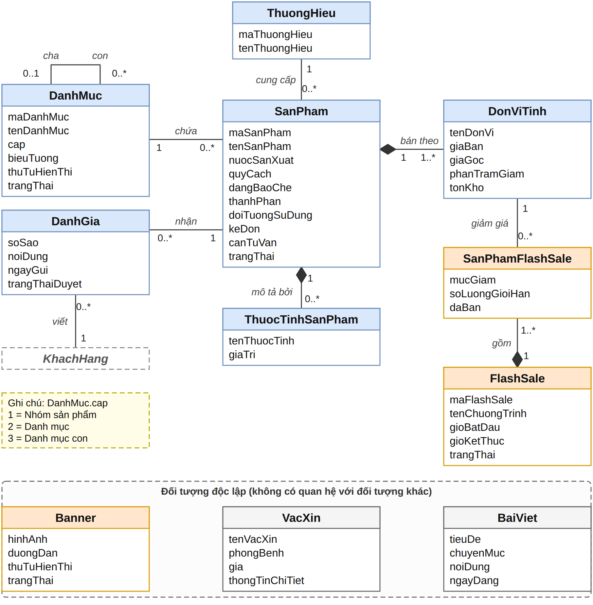

**Hình 2.2: Mô hình đối tượng cụm Danh mục, Sản phẩm và Khuyến mãi**

Đường nối từ DanhMuc về chính nó là quan hệ đệ quy: mỗi danh mục có tối đa một danh mục cha (0..1) và có thể có nhiều danh mục con (0..*). Danh mục cấp 1 (nhóm sản phẩm) không có cha, danh mục cấp 3 (danh mục con) không có con; thuộc tính cap cho biết cấp.

Mỗi sản phẩm thuộc đúng một danh mục cấp 3 (danh mục con). Danh mục chỉ được xóa khi không còn danh mục con và sản phẩm (UC22).

DonViTinh và ThuocTinhSanPham là thành phần của SanPham. Giá, giá gốc, phần trăm giảm và tồn kho gắn với đơn vị tính vì mỗi đơn vị có giá riêng (UC23); giá Flash Sale cũng gắn với đơn vị tính.

Sản phẩm đã phát sinh đơn hàng chỉ được ngừng bán (ẩn), không xóa hẳn, để các đơn cũ vẫn tham chiếu được (UC23).

Điểm đánh giá và số lượt đánh giá hiển thị ở trang chi tiết (FR-14) được tính từ các DanhGia hợp lệ, không lưu riêng.

Thuộc tính riêng theo nhóm (dược chất, loại da, bảo hành...) lưu dạng tên–giá trị trong ThuocTinhSanPham, nên thêm loại thuộc tính mới không phải sửa cấu trúc dữ liệu (NFR-15).

Người dùng và giỏ hàng. Hình 2.3 gồm cây kế thừa của người dùng, liên kết đăng nhập, sổ địa chỉ và giỏ hàng.

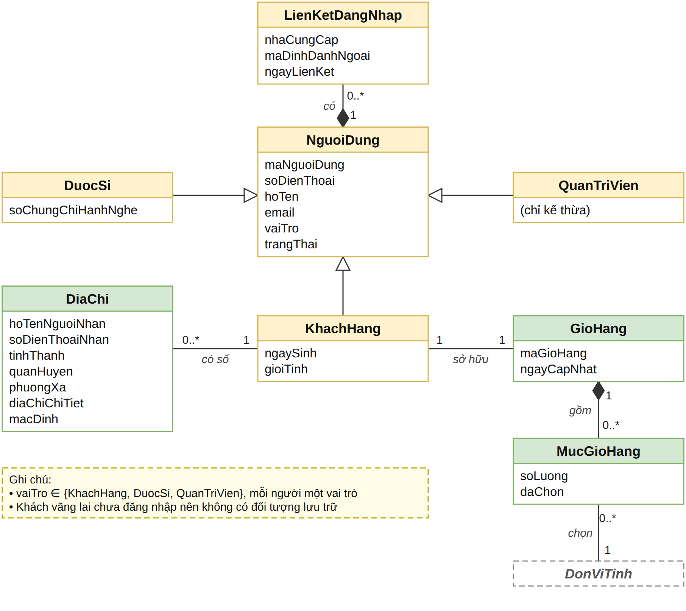

**Hình 2.3: Mô hình đối tượng cụm Người dùng và Giỏ hàng**

NguoiDung là lớp cha của KhachHang, DuocSi và QuanTriVien; thuộc tính vaiTro xác định quyền truy cập (NFR-06, UC26). Mỗi người dùng có đúng một vai trò.

Mỗi khách hàng có đúng một giỏ hàng. Giỏ hàng gồm nhiều mục; mỗi mục chọn một đơn vị tính của sản phẩm và số lượng, nên khách hàng có thể đổi đơn vị tính ngay trong giỏ (FR-22).

Mỗi người dùng có thể có nhiều liên kết đăng nhập (định danh điện tử, Facebook, Google, Apple). Hệ thống chỉ lưu mã định danh do nhà cung cấp trả về để nhận ra người dùng quay lại (FR-02); số điện thoại đăng nhập bằng OTP được lưu ngay ở NguoiDung (FR-01, FR-03).

Sổ địa chỉ gồm nhiều địa chỉ, trong đó có một địa chỉ mặc định.

Đơn hàng và thanh toán. Hình 2.4 gồm đơn hàng cùng các đối tượng đi kèm: chi tiết đơn, giao dịch thanh toán, hóa đơn điện tử, voucher, nhà thuốc nhận hàng và yêu cầu hủy/trả hàng.

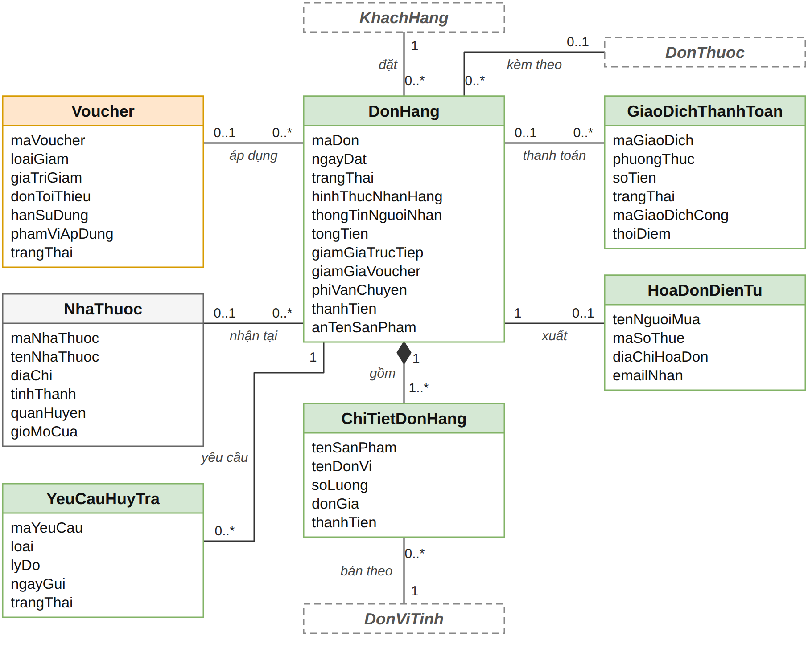

**Hình 2.4: Mô hình đối tượng cụm Đơn hàng và Thanh toán**

ChiTietDonHang lưu bản sao tên sản phẩm, đơn vị tính và đơn giá tại thời điểm đặt; thông tin người nhận cũng được sao chép vào đơn. Nhờ vậy việc đổi giá, ngừng bán hay sửa địa chỉ sau này không làm thay đổi đơn đã đặt (NFR-11, NFR-18).

GiaoDichThanhToan có thể tồn tại trước khi có đơn hàng, vì giao dịch được tạo ở UC13 trước khi UC11 tạo đơn. Giao dịch thất bại hoặc đang chờ đối soát vẫn được lưu để đối chiếu; vì vậy một giao dịch thuộc tối đa một đơn, còn một đơn có thể có nhiều giao dịch.

Một đơn hàng áp dụng tối đa một voucher, nhận tại tối đa một nhà thuốc (khi chọn nhận tại nhà thuốc) và có thể kèm một đơn thuốc đã được dược sĩ xác nhận (khi có thuốc kê đơn).

HoaDonDienTu chỉ tồn tại khi khách hàng yêu cầu xuất hóa đơn điện tử (FR-29).

Mỗi lần khách hàng hủy đơn hoặc trả hàng sinh ra một YeuCauHuyTra gắn với đơn (UC15, FR-36); quản trị viên xử lý yêu cầu và cập nhật trạng thái đơn (UC24, FR-49).

Đơn thuốc, tư vấn và tra cứu thuốc. Hình 2.5 gồm hai cụm: đơn thuốc – tư vấn với dược sĩ và nhóm tra cứu thuốc, dược chất, dược liệu.

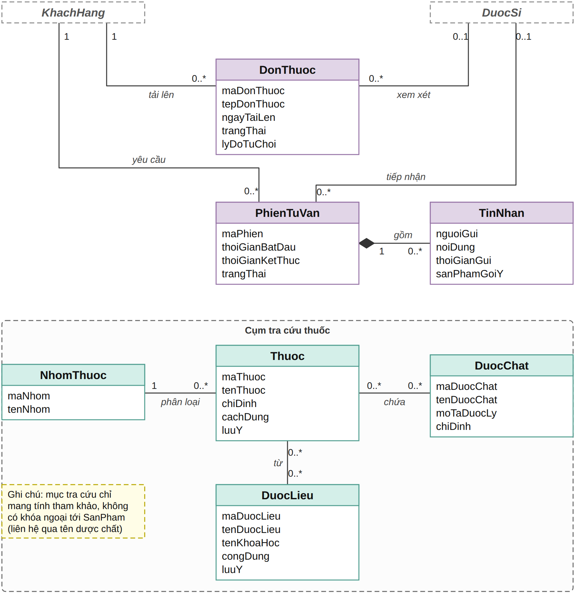

**Hình 2.5: Mô hình đối tượng cụm Đơn thuốc, Tư vấn và Tra cứu thuốc**

Mỗi đơn thuốc do một khách hàng tải lên và được tối đa một dược sĩ xem xét; trạng thái đơn (chờ xem xét, xác nhận, từ chối) quyết định khách hàng có thể đặt thuốc kê đơn hay không (UC11, UC17).

Phiên tư vấn gồm nhiều tin nhắn và có thể chưa có dược sĩ tiếp nhận (UC18).

Thuốc thuộc một nhóm thuốc, chứa nhiều dược chất và có thể bào chế từ nhiều dược liệu (UC08). Thông tin tra cứu chỉ mang tính tham khảo nên không có khóa ngoại tới SanPham; sản phẩm và mục tra cứu được liên hệ qua tên dược chất.

Các đối tượng trên sẽ đóng vai trò lớp Entity trong biểu đồ lớp phân tích ở mục 2.2.3; quan hệ giữa chúng là cơ sở để thiết kế biểu đồ ERD ở mục 3.3.2.

## Hiện thực hóa Use Case (Use-case realizations)

### Các biểu đồ trình tự (Sequence diagrams)

Mục này hiện thực hóa các Use Case trọng tâm bằng biểu đồ trình tự (Sequence Diagram). Với mỗi Use Case, biểu đồ cho thấy các đối tượng phối hợp với nhau theo thứ tự thời gian để thực hiện luồng sự kiện đã mô tả ở mục 1.5.3. Nhóm vẽ chín biểu đồ: tám Use Case trọng tâm (UC03, UC04, UC05, UC06, UC07, UC11, UC22, UC23) và UC13, vì UC11 gọi UC13 (quan hệ «include», Bảng 1.8). Các Use Case hỗ trợ và đơn giản còn lại có luồng ngắn và theo cùng mẫu nên chưa vẽ riêng.

Quy ước đọc biểu đồ:

Mỗi biểu đồ có ba loại đối tượng theo mẫu BCE: Boundary (màn hình trên Website khách hàng hoặc Cổng quản trị – dược sĩ), Control (bộ điều khiển thuộc một phân hệ ở Bảng 2.4, điều phối Use Case) và Entity (đối tượng nghiệp vụ ở mục 2.1.2). Tác nhân đứng ngoài cùng bên trái; hệ thống bên ngoài (Cổng thanh toán) đứng bên phải.

Mũi tên liền là thông điệp yêu cầu; mũi tên nét đứt là kết quả trả về hoặc nội dung hiển thị cho người dùng. Thông điệp viết bằng tiếng Việt; tên đối tượng viết theo kiểu PascalCase như ở Bảng 2.6.

Khung alt là lựa chọn một trong các nhánh, opt là nhánh tùy chọn, loop là lặp lại, ref là tham chiếu sang Use Case khác.

Mỗi biểu đồ vẽ luồng chính cùng các luồng thay thế và ngoại lệ quan trọng; các luồng còn lại được nêu bằng lời dưới biểu đồ.

**Bảng 2.7 liệt kê các biểu đồ và những lớp tham gia, làm cơ sở cho biểu đồ lớp phân tích BCE ở mục 2.2.3.**

**Bảng 2.7: Các biểu đồ trình tự và lớp tham gia**

| Hình | Use Case | Boundary | Control (phân hệ) | Entity |
| --- | --- | --- | --- | --- |
| Hình 2.6 | UC03 – Xem danh mục sản phẩm | ManHinhMenu | DanhMucControl (PH02) | DanhMuc, SanPham |
| Hình 2.7 | UC04 – Xem danh sách sản phẩm theo danh mục | ManHinhDanhSach | DanhSachControl (PH02) | DanhMuc, SanPham, DonViTinh |
| Hình 2.8 | UC05 – Lọc và sắp xếp sản phẩm | ManHinhDanhSach | BoLocControl (PH02) | SanPham, DonViTinh |
| Hình 2.9 | UC06 – Xem chi tiết sản phẩm | ManHinhChiTiet | ChiTietControl (PH02) | SanPham, DonViTinh, DanhGia |
| Hình 2.10 | UC07 – Tìm kiếm sản phẩm | ManHinhTimKiem | TimKiemControl (PH03) | SanPham |
| Hình 2.11 | UC11 – Đặt hàng | ManHinhDatHang | DatHangControl (PH04) | GioHang, DiaChi, DonViTinh, DonHang |
| Hình 2.12 | UC13 – Thanh toán | ManHinhThanhToan | ThanhToanControl (PH05) | GiaoDichThanhToan; hệ thống ngoài: Cổng thanh toán |
| Hình 2.13 | UC22 – Quản lý danh mục | ManHinhQLDanhMuc | QLDanhMucControl (PH02) | DanhMuc, SanPham |
| Hình 2.14 | UC23 – Quản lý sản phẩm | ManHinhQLSanPham | QLSanPhamControl (PH02) | SanPham, DonViTinh, ThuocTinhSanPham |

UC03 – Xem danh mục sản phẩm (Hình 2.6). Người dùng chọn một nhóm sản phẩm trên thanh menu; DanhMucControl lấy danh mục cấp 2, sau đó danh mục con (cấp 3) cùng khối "Bán chạy nhất". Nhánh alt ngoài cùng là luồng thay thế 1a (nhóm Thuốc chuyển sang UC08); nhánh alt trong cùng là ngoại lệ 4a (danh mục chưa có danh mục con hoặc sản phẩm).

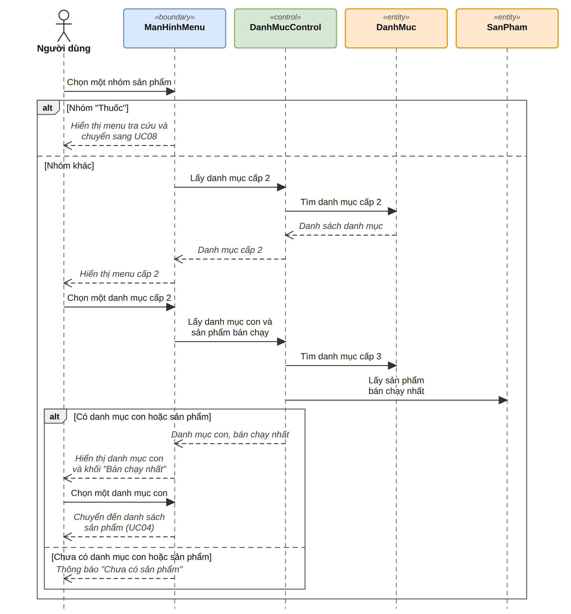

**Hình 2.6: Biểu đồ trình tự UC03 – Xem danh mục sản phẩm**

Các luồng 5a, 5b (Xem thêm; chọn sản phẩm trong khối "Bán chạy nhất") và ngoại lệ 2a (lỗi tải menu) chỉ thay đổi nội dung hiển thị hoặc chuyển sang Use Case khác nên không vẽ riêng.

UC04 – Xem danh sách sản phẩm theo danh mục (Hình 2.7). DanhSachControl lấy thông tin danh mục (đường dẫn phân cấp, bộ lọc phù hợp), danh sách sản phẩm mặc định xếp theo "Bán chạy" và giá của từng đơn vị tính (DonViTinh). Nhánh alt đầu là ngoại lệ 5a (danh mục chưa có sản phẩm); nhánh alt sau là các luồng 6, 6a và 3a (chuyển sang UC06, UC10, UC05).

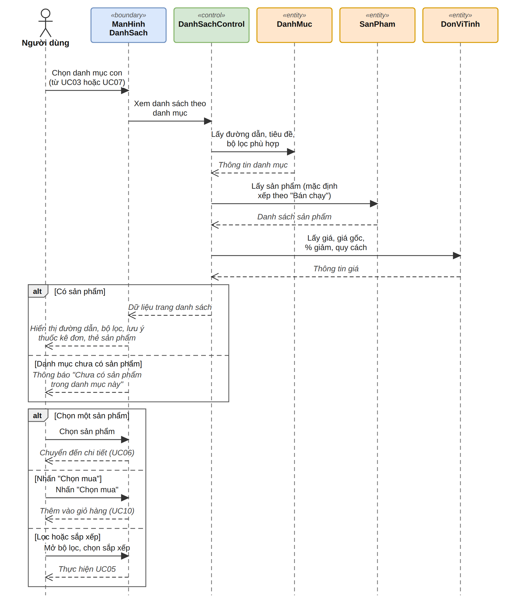

**Hình 2.7: Biểu đồ trình tự UC04 – Xem danh sách sản phẩm theo danh mục**

Ngoại lệ 5b (lỗi tải dữ liệu) và luồng 6b (nhấn đường dẫn phân cấp) không vẽ riêng.

UC05 – Lọc và sắp xếp sản phẩm (Hình 2.8). Mỗi lần người dùng đổi tiêu chí lọc hoặc cách sắp xếp, BoLocControl lọc theo đối tượng sử dụng (SanPham) và khoảng giá (DonViTinh) rồi sắp xếp lại; khung loop biểu diễn việc lặp lại này. Nhánh alt là ngoại lệ 4a (không có sản phẩm thỏa tiêu chí).

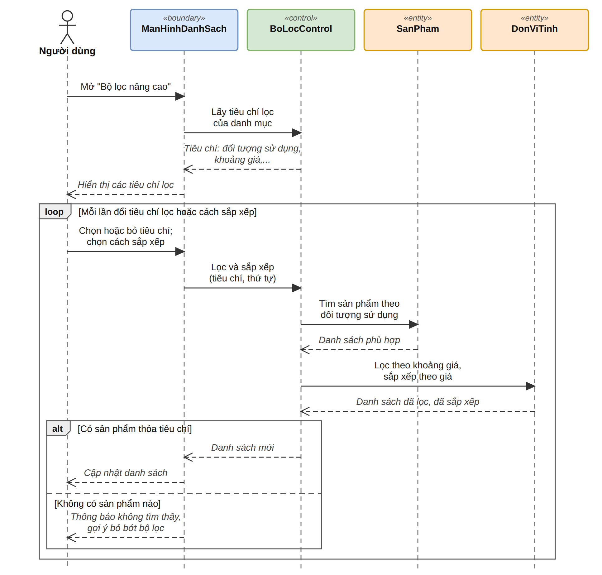

**Hình 2.8: Biểu đồ trình tự UC05 – Lọc và sắp xếp sản phẩm**

Các luồng 3a, 3b, 3c (tìm theo tên trong bộ lọc, bỏ chọn, xem thêm) chỉ thay đổi danh sách lựa chọn hiển thị nên không vẽ riêng.

UC06 – Xem chi tiết sản phẩm (Hình 2.9). ChiTietControl lấy thông tin chung, đơn vị tính và giá, điểm và số lượt đánh giá rồi trả về cho màn hình. Các nhánh thể hiện ngoại lệ *a (sản phẩm không tồn tại hoặc đã ngừng bán), luồng 4a (thuốc kê đơn hoặc cần tư vấn), ngoại lệ 6b (hết hàng) và bước 6 (thêm vào giỏ hàng, tham chiếu UC10).

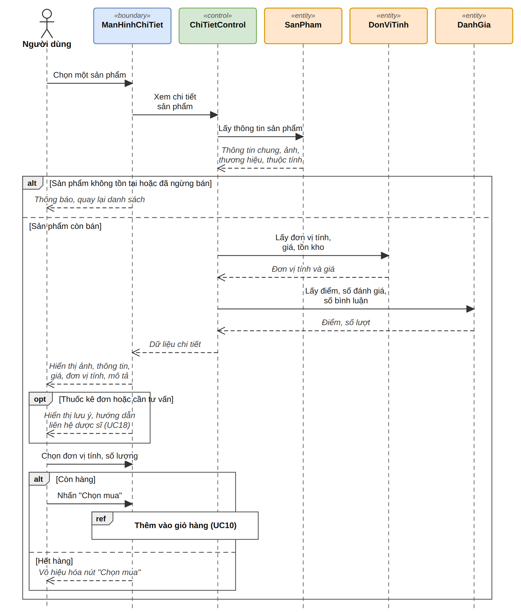

**Hình 2.9: Biểu đồ trình tự UC06 – Xem chi tiết sản phẩm**

Luồng 1a (đổi ảnh chính) và 6a (chuyển sang UC19) không vẽ riêng.

UC07 – Tìm kiếm sản phẩm (Hình 2.10). Khi người dùng nhấn vào thanh tìm kiếm, TimKiemControl trả về từ khóa gợi ý. Người dùng sau đó nhập từ khóa, tìm bằng giọng nói (luồng 3a) hoặc tìm bằng hình ảnh (luồng 3b) ở nhánh alt đầu tiên; mọi cách đều dẫn đến bước tìm kiếm trong SanPham. Nhánh alt cuối là ngoại lệ 6a và 3d (không có kết quả hoặc không nhận diện được ảnh).

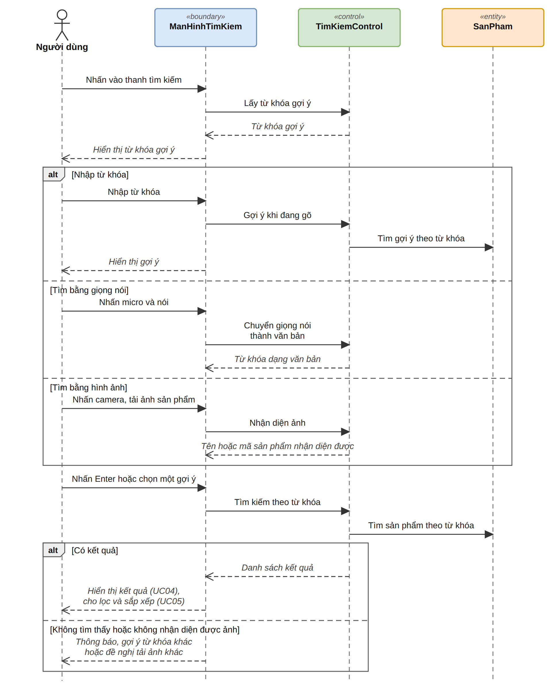

**Hình 2.10: Biểu đồ trình tự UC07 – Tìm kiếm sản phẩm**

Luồng 2a (chọn từ khóa gợi ý) dùng lại bước tìm kiếm; ngoại lệ 3c (không cấp quyền micro hoặc camera) chỉ thông báo và cho nhập tay nên không vẽ riêng.

UC11 – Đặt hàng (Hình 2.11). DatHangControl lấy sản phẩm đã chọn từ giỏ hàng (GioHang) và sổ địa chỉ (DiaChi), tính tiền rồi hiển thị trang đặt hàng. Khi khách hàng nhấn "Hoàn tất", hệ thống kiểm tra địa chỉ, tồn kho và giá; nếu hợp lệ thì thanh toán (tham chiếu UC13). Chỉ khi thanh toán thành công, DonHang mới được tạo, tồn kho được cập nhật và sản phẩm được gỡ khỏi giỏ; nếu thất bại hoặc bị hủy, đơn không được xác nhận và khách hàng chọn lại phương thức (ngoại lệ 9a).

**Hình 2.11: Biểu đồ trình tự UC11 – Đặt hàng**

Ghi chú trong biểu đồ nêu các luồng tùy chọn 5a, 7a, 7b (voucher, hóa đơn điện tử, ẩn tên sản phẩm). Luồng 3a (nhận tại nhà thuốc, UC19) và 5b (miễn phí vận chuyển khi đơn trên 300.000đ) thuộc bước chọn địa chỉ và tính tiền.

UC13 – Thanh toán (Hình 2.12). ThanhToanControl nhận phương thức và số tiền từ DatHangControl. Với tiền mặt khi nhận hàng, chỉ cần ghi nhận vào GiaoDichThanhToan (luồng 1a). Với thanh toán trực tuyến, hệ thống tạo giao dịch, gửi yêu cầu cho Cổng thanh toán, hiển thị mã QR (luồng 2a) hoặc chuyển khách hàng sang cổng; khách hàng xác nhận trên cổng và cổng trả kết quả. Ba nhánh cuối là kết quả thành công, thất bại hoặc hết thời gian (ngoại lệ 4a) và mất kết nối, khi giao dịch chuyển sang trạng thái chờ đối soát (ngoại lệ 4b). Kết quả được trả về UC11.

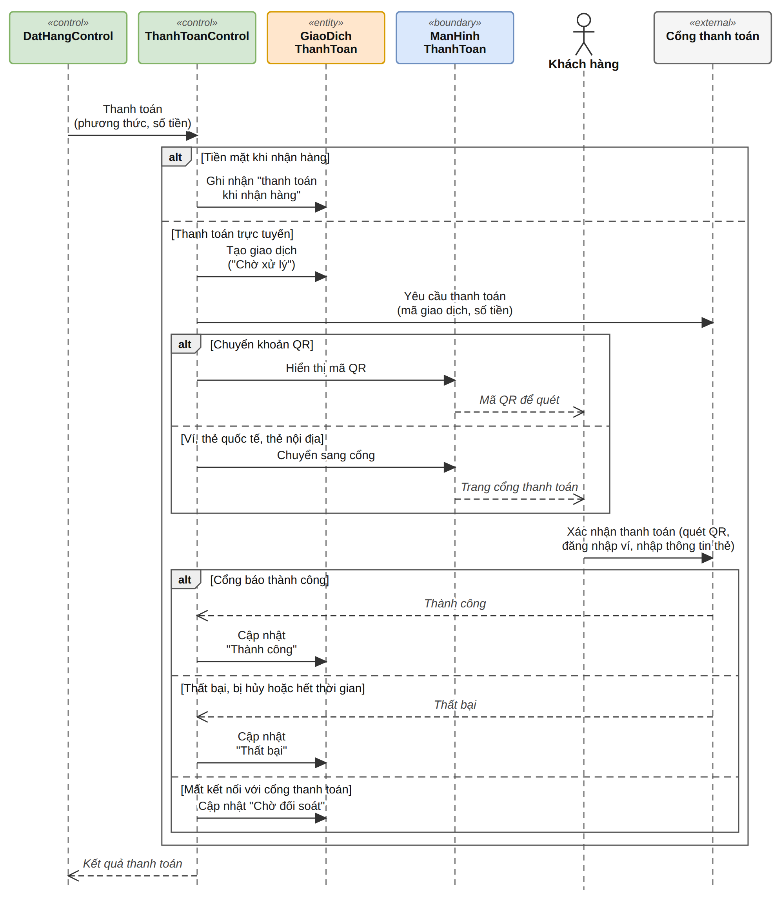

**Hình 2.12: Biểu đồ trình tự UC13 – Thanh toán**

UC22 – Quản lý danh mục (Hình 2.13). QLDanhMucControl lấy cây danh mục từ DanhMuc để hiển thị. Nhánh "Thêm danh mục" kiểm tra tên không trống, không trùng trong cùng danh mục cha và đúng cấp trước khi lưu (bước 6, 7; ngoại lệ 6a). Nhánh "Xóa danh mục" chỉ xóa khi danh mục không còn danh mục con và sản phẩm (luồng 3c, ngoại lệ 3c-1).

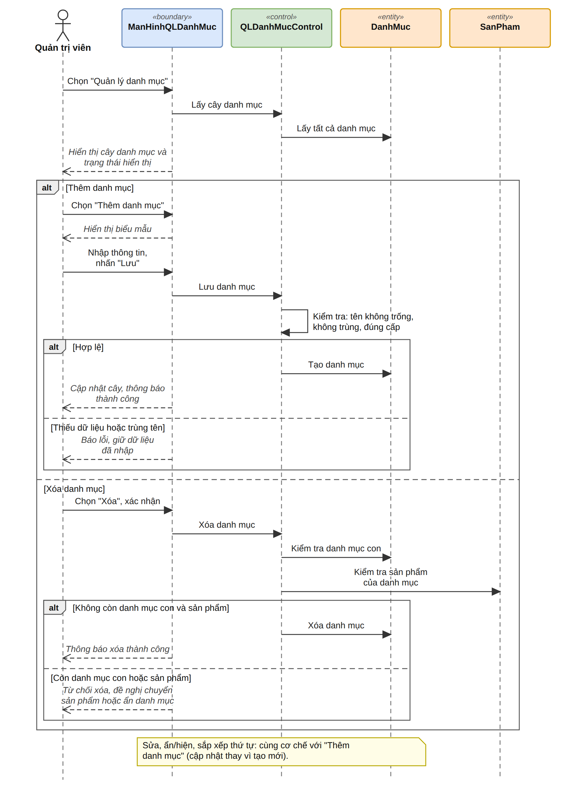

**Hình 2.13: Biểu đồ trình tự UC22 – Quản lý danh mục**

Sửa, ẩn/hiện và sắp xếp thứ tự (luồng 3a, 3b, 3d) dùng cùng cơ chế với thêm danh mục nên được nêu trong ghi chú cuối biểu đồ.

UC23 – Quản lý sản phẩm (Hình 2.14). QLSanPhamControl tìm và hiển thị danh sách sản phẩm. Nhánh "Thêm sản phẩm" kiểm tra trường bắt buộc, mã không trùng và giá lớn hơn 0 rồi tạo SanPham cùng các DonViTinh và ThuocTinhSanPham (bước 9, 10; ngoại lệ 9a, 9b). Nhánh "Xóa sản phẩm" thể hiện quy tắc ở luồng 3c: sản phẩm đã phát sinh đơn hàng chỉ chuyển sang trạng thái ẩn (ngừng bán), không xóa hẳn.

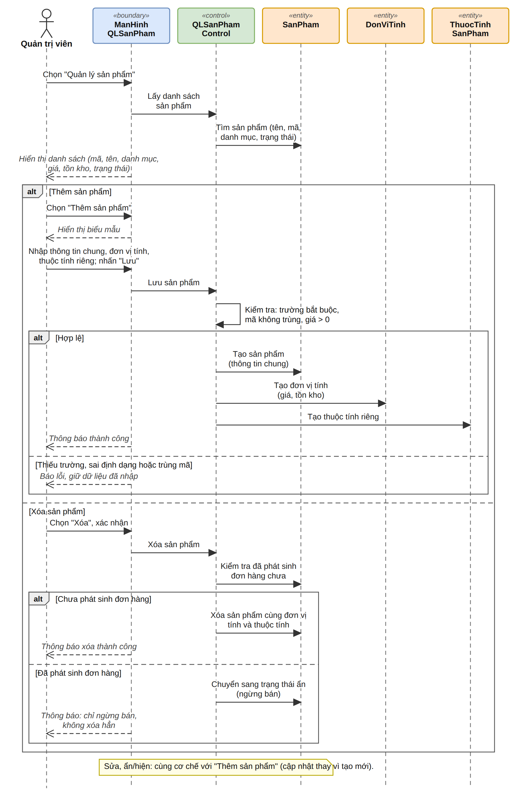

**Hình 2.14: Biểu đồ trình tự UC23 – Quản lý sản phẩm**

Sửa và ẩn/hiện (luồng 3a, 3b) dùng cùng cơ chế với thêm sản phẩm; ngoại lệ 5a (lỗi tải ảnh) do màn hình xử lý nên không vẽ riêng.

Các lớp Boundary, Control và Entity xuất hiện trong chín biểu đồ trên là đầu vào cho biểu đồ lớp phân tích BCE ở mục 2.2.3; tên lớp đã thống nhất với Bảng 2.6 và Bảng 2.7 để dùng lại trực tiếp.

### Các biểu đồ hoạt động (Activity Diagram)

Biểu đồ hoạt động (Activity Diagram) mô tả luồng công việc của từng Use Case: ai làm gì, khi nào rẽ nhánh và kết thúc ra sao. Nếu biểu đồ trình tự (mục 2.2.1) nhấn mạnh thứ tự thông điệp giữa các đối tượng thì biểu đồ hoạt động nhìn Use Case ở mức nghiệp vụ, chia thành hai làn bơi: tác nhân (Người dùng, Khách hàng hoặc Quản trị viên) và Hệ thống. Nhóm vẽ cho tám Use Case trọng tâm (UC03, UC04, UC05, UC06, UC07, UC11, UC22, UC23); UC22 và UC23 mỗi Use Case tách thành hai biểu đồ (thêm, sửa và xóa) cho dễ đọc. Thanh toán (UC13) xuất hiện như một hoạt động trong biểu đồ UC11 vì đã có biểu đồ trình tự riêng ở Hình 2.12.

Quy ước đọc biểu đồ:

Chấm tròn đen là điểm bắt đầu; vòng tròn có chấm đen là điểm kết thúc. Một biểu đồ có thể có nhiều điểm kết thúc, mỗi nhánh một điểm.

Hình chữ nhật bo tròn là một hoạt động: màu vàng thuộc làn tác nhân, màu xanh thuộc làn Hệ thống. Hoạt động có ghi UCxx nghĩa là chuyển sang hoặc gọi Use Case đó.

Hình thoi là điểm rẽ nhánh; điều kiện ghi trong ngoặc vuông trên mũi tên, ví dụ [Có], [Không]. Hai mũi tên cùng đi vào một hoạt động được hiểu là hai nhánh hợp nhất.

Mũi tên quay ngược lên một hoạt động phía trên là vòng lặp (người dùng nhập hoặc chọn lại).

**Bảng 2.8 cho biết mỗi biểu đồ thể hiện những luồng nào của Use Case (đánh số theo mục 1.5.3) và những luồng nào chưa vẽ riêng.**

**Bảng 2.8: Các biểu đồ hoạt động và luồng được thể hiện**

| Hình | Use Case | Luồng được thể hiện | Luồng chưa vẽ riêng |
| --- | --- | --- | --- |
| Hình 2.15 | UC03 – Xem danh mục sản phẩm | Luồng chính; luồng 1a (nhóm Thuốc); ngoại lệ 4a | 5a, 5b, 2a: chỉ đổi nội dung hiển thị hoặc chuyển Use Case |
| Hình 2.16 | UC04 – Xem danh sách sản phẩm theo danh mục | Luồng chính; ngoại lệ 5a; luồng 3a, 6, 6a (chuyển sang UC05, UC06, UC10) | 5b, 6b |
| Hình 2.17 | UC05 – Lọc và sắp xếp sản phẩm | Luồng chính (lặp lại khi đổi tiêu chí); ngoại lệ 4a | 3a, 3b, 3c |
| Hình 2.18 | UC06 – Xem chi tiết sản phẩm | Luồng chính; luồng 4a; ngoại lệ *a và 6b; bước 6 (UC10) | 1a, 6a |
| Hình 2.19 | UC07 – Tìm kiếm sản phẩm | Luồng chính; luồng 3a, 3b; ngoại lệ 3d và 6a | 2a, 3c |
| Hình 2.20 | UC11 – Đặt hàng | Luồng chính; luồng tùy chọn 5a, 7a, 7b; ngoại lệ 8a, 8b, 8c và 9a; thanh toán (UC13) | 3a, 5b |
| Hình 2.21 | UC22 – Quản lý danh mục (thêm, sửa, ẩn/hiện, sắp xếp) | Luồng chính (thêm); luồng 3a, 3b, 3d cùng cơ chế "Lưu"; ngoại lệ 6a | 5a (nhấn "Hủy") |
| Hình 2.22 | UC22 – Quản lý danh mục (xóa) | Luồng 3c; ngoại lệ 3c-1 | — |
| Hình 2.23 | UC23 – Quản lý sản phẩm (thêm, sửa, ẩn/hiện) | Luồng chính (thêm); luồng 3a, 3b cùng cơ chế "Lưu"; ngoại lệ 9a, 9b | 2a, 8a, 5a |
| Hình 2.24 | UC23 – Quản lý sản phẩm (xóa) | Luồng 3c: sản phẩm đã phát sinh đơn hàng chỉ ngừng bán | — |

UC03 – Xem danh mục sản phẩm (Hình 2.15). Người dùng chọn nhóm sản phẩm; hệ thống hiển thị danh mục cấp 2, sau đó danh mục con cùng khối "Bán chạy nhất" rồi chuyển sang UC04. Nhánh rẽ đầu là luồng 1a (nhóm Thuốc), nhánh rẽ sau là ngoại lệ 4a.

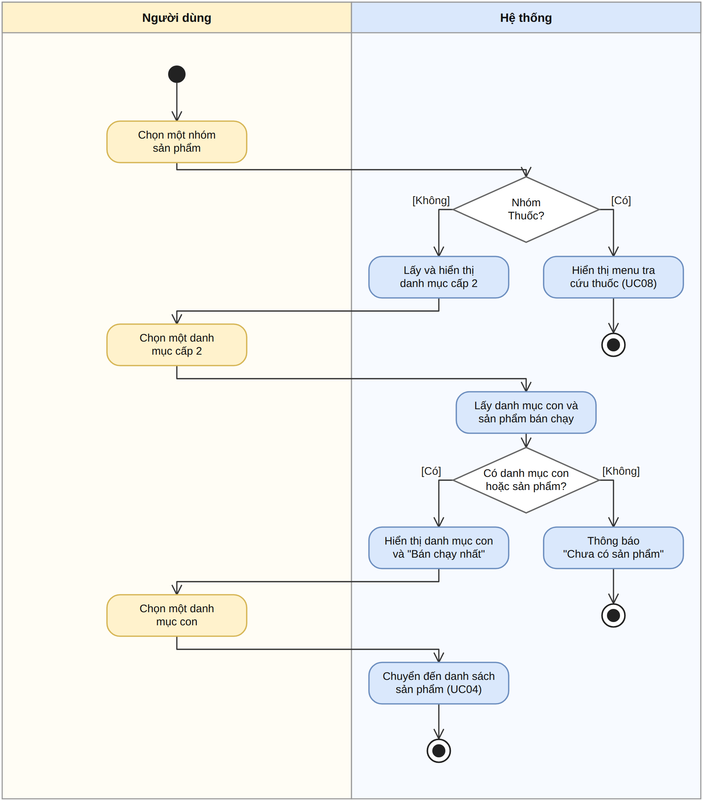

**Hình 2.15: Biểu đồ hoạt động UC03 – Xem danh mục sản phẩm**

UC04 – Xem danh sách sản phẩm theo danh mục (Hình 2.16). Hệ thống lấy thông tin danh mục, danh sách sản phẩm và giá; nếu có sản phẩm thì hiển thị đường dẫn, bộ lọc, lưu ý thuốc kê đơn và thẻ sản phẩm, sau đó chuyển sang UC06, UC10 hoặc UC05 theo lựa chọn của người dùng.

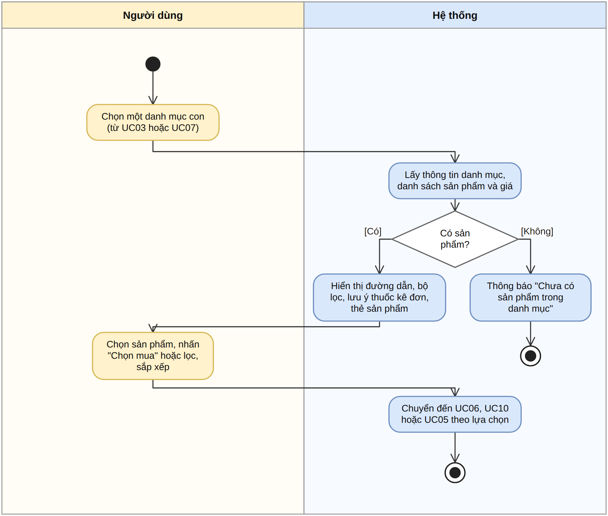

**Hình 2.16: Biểu đồ hoạt động UC04 – Xem danh sách sản phẩm theo danh mục**

UC05 – Lọc và sắp xếp sản phẩm (Hình 2.17). Mỗi lần người dùng đổi tiêu chí lọc hoặc cách sắp xếp, hệ thống lọc, sắp xếp và cập nhật danh sách; mũi tên quay ngược về hoạt động chọn tiêu chí biểu diễn vòng lặp này, còn nhánh [Không] là ngoại lệ 4a (không có sản phẩm thỏa tiêu chí).

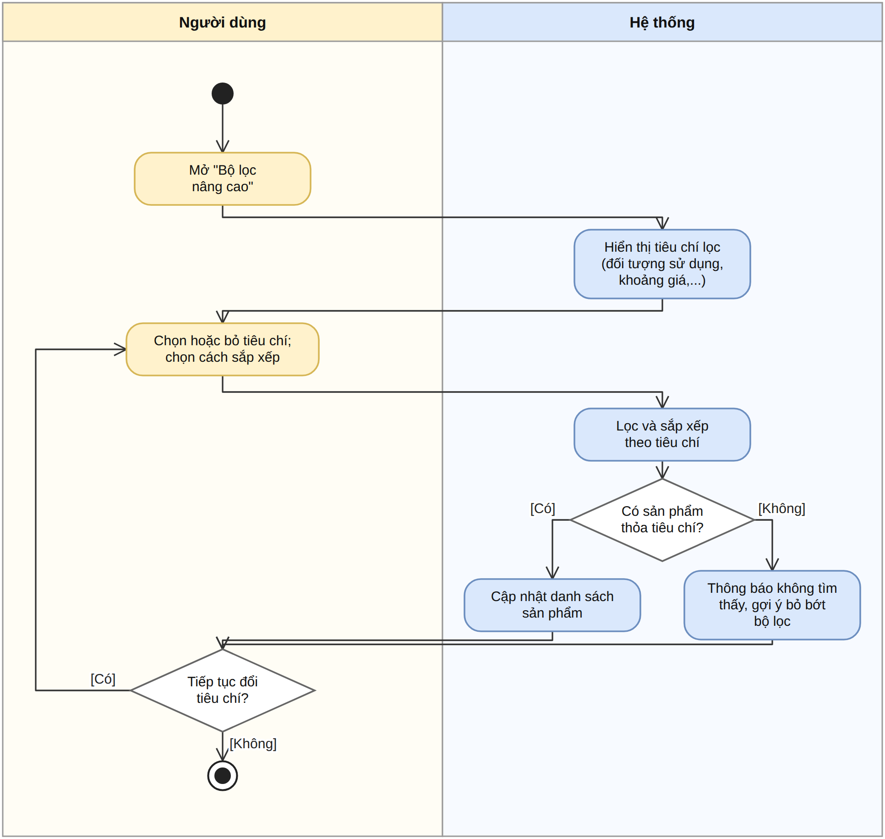

**Hình 2.17: Biểu đồ hoạt động UC05 – Lọc và sắp xếp sản phẩm**

UC06 – Xem chi tiết sản phẩm (Hình 2.18). Sản phẩm không còn bán dẫn đến thông báo và quay lại danh sách. Nếu còn bán, hệ thống hiển thị chi tiết (kèm lưu ý với thuốc kê đơn), người dùng chọn đơn vị tính và số lượng rồi nhấn "Chọn mua" khi còn hàng; hết hàng thì nút "Chọn mua" bị vô hiệu hóa.

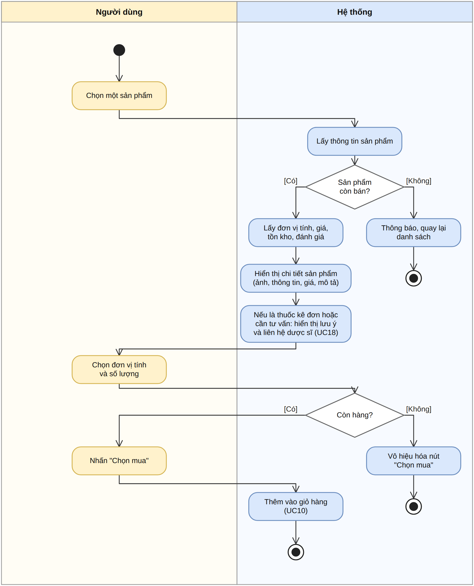

**Hình 2.18: Biểu đồ hoạt động UC06 – Xem chi tiết sản phẩm**

UC07 – Tìm kiếm sản phẩm (Hình 2.19). Người dùng nhập từ khóa, nói vào micro hoặc tải ảnh; hệ thống chuyển giọng nói thành văn bản hoặc nhận diện ảnh khi cần rồi tìm sản phẩm. Hai nhánh rẽ thể hiện trường hợp không có từ khóa hợp lệ (ngoại lệ 3d) và không có kết quả (ngoại lệ 6a).

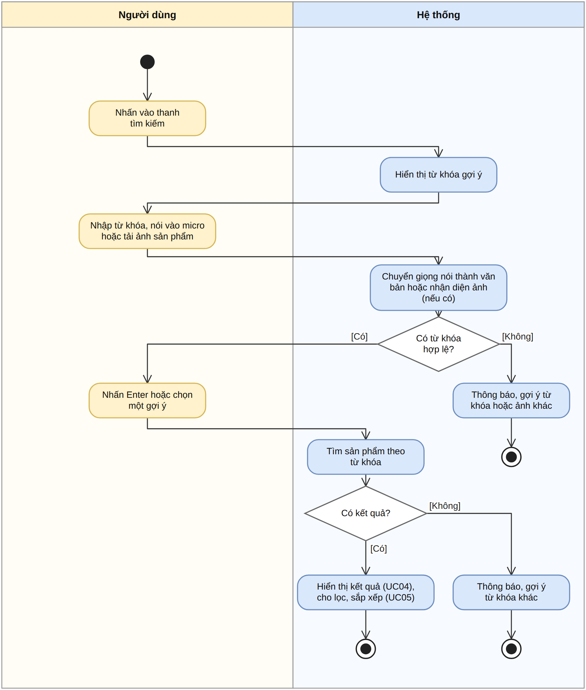

**Hình 2.19: Biểu đồ hoạt động UC07 – Tìm kiếm sản phẩm**

UC11 – Đặt hàng (Hình 2.20). Sau khi kiểm tra địa chỉ, tồn kho, giá và đơn thuốc, hệ thống chuyển sang thanh toán (UC13). Chỉ khi thanh toán thành công mới tạo đơn, cập nhật tồn kho và gỡ sản phẩm khỏi giỏ hàng; hai nhánh lỗi (không hợp lệ, thanh toán thất bại) quay lại bước chọn thông tin để người dùng chỉnh sửa hoặc chọn lại phương thức.

**Hình 2.20: Biểu đồ hoạt động UC11 – Đặt hàng**

UC22 – Quản lý danh mục: thêm, sửa, ẩn/hiện, sắp xếp (Hình 2.21). Bốn thao tác dùng chung một biểu đồ vì cùng cơ chế: quản trị viên chọn thao tác, nhập thông tin rồi lưu; hệ thống kiểm tra tên không trống, không trùng, đúng cấp, sau đó lưu và cập nhật cây hoặc báo lỗi để nhập lại.

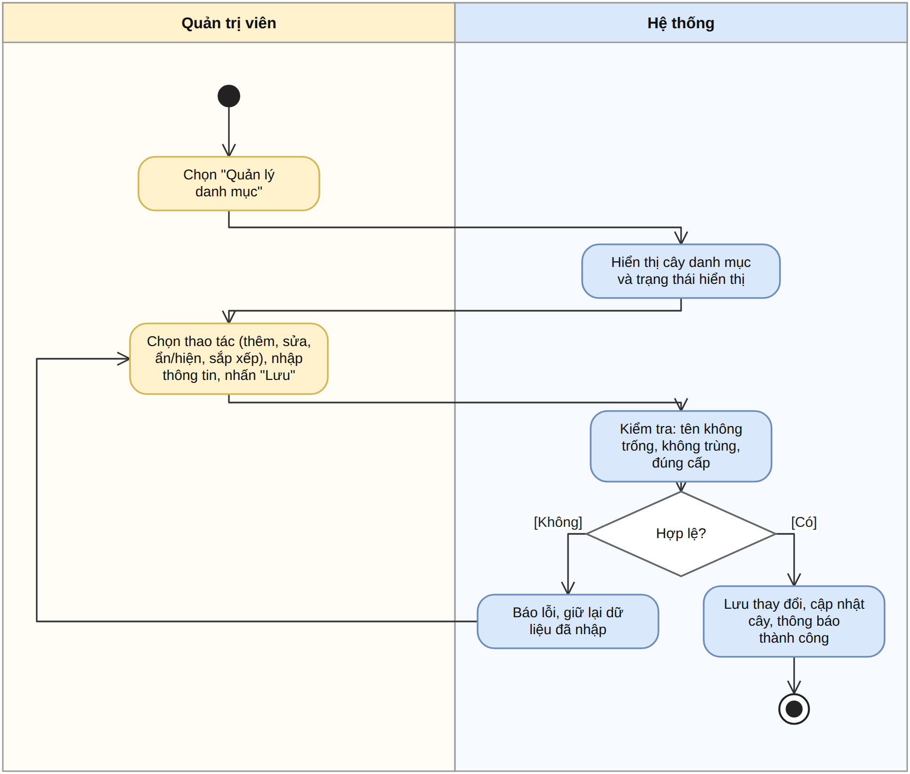

**Hình 2.21: Biểu đồ hoạt động UC22 – Thêm, sửa, ẩn/hiện, sắp xếp danh mục**

UC22 – Quản lý danh mục: xóa (Hình 2.22). Hệ thống chỉ xóa danh mục khi không còn danh mục con và sản phẩm; nếu còn thì từ chối xóa và đề nghị chuyển sản phẩm hoặc ẩn danh mục.

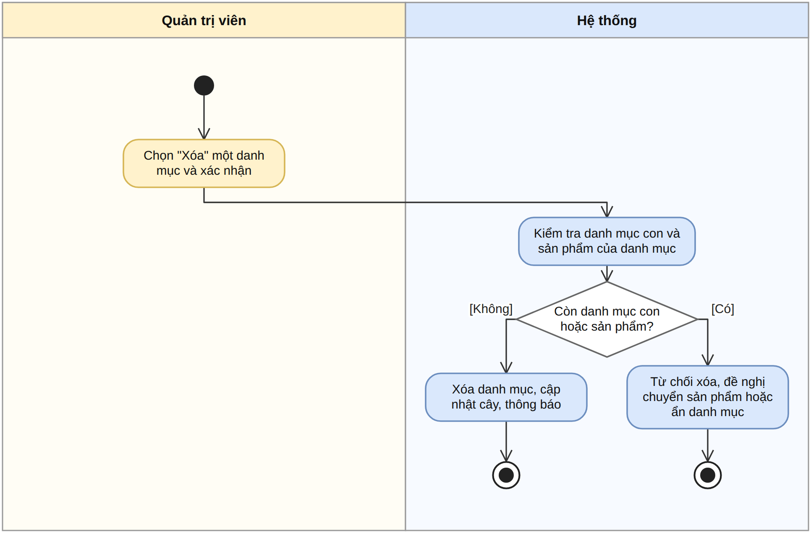

**Hình 2.22: Biểu đồ hoạt động UC22 – Xóa danh mục**

UC23 – Quản lý sản phẩm: thêm, sửa, ẩn/hiện (Hình 2.23). Tương tự UC22: quản trị viên nhập thông tin chung, đơn vị tính và thuộc tính riêng rồi lưu; hệ thống kiểm tra trường bắt buộc, mã không trùng và giá lớn hơn 0 trước khi lưu, nếu không hợp lệ thì báo lỗi và giữ lại dữ liệu đã nhập.

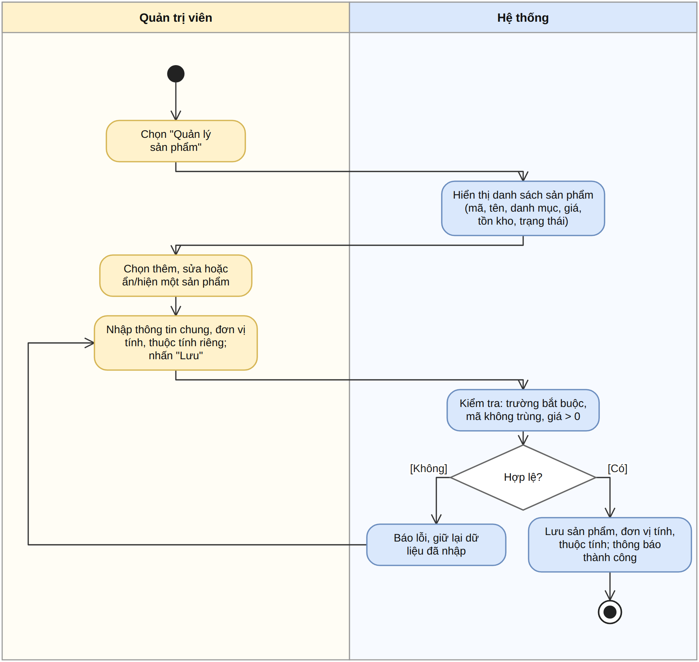

**Hình 2.23: Biểu đồ hoạt động UC23 – Thêm, sửa, ẩn/hiện sản phẩm**

UC23 – Quản lý sản phẩm: xóa (Hình 2.24). Sản phẩm chưa phát sinh đơn hàng được xóa cùng đơn vị tính và thuộc tính; sản phẩm đã phát sinh đơn hàng chỉ chuyển sang trạng thái ẩn (ngừng bán), không xóa hẳn.

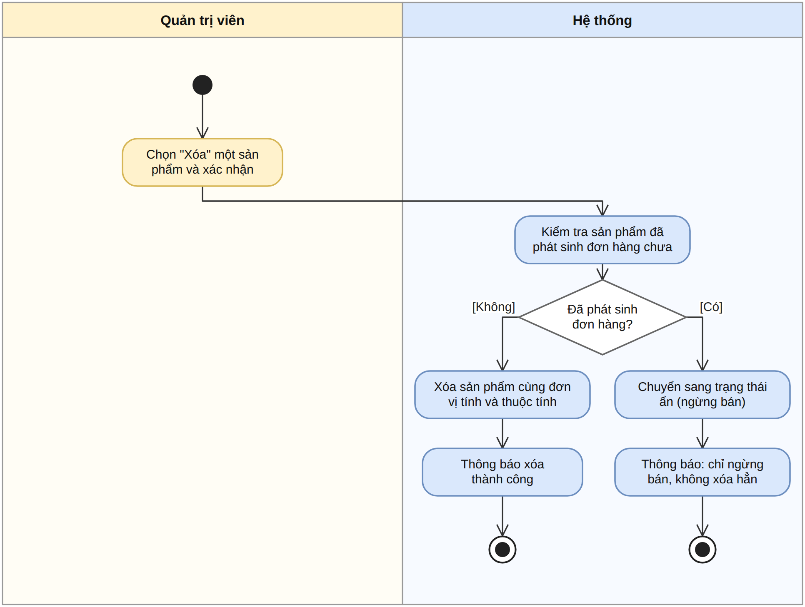

**Hình 2.24: Biểu đồ hoạt động UC23 – Xóa sản phẩm**

Cùng với biểu đồ trình tự ở mục 2.2.1, các biểu đồ hoạt động trên là đầu vào cho biểu đồ lớp phân tích BCE ở mục 2.2.3.

### Các biểu đồ lớp phân tích (Analysis Class Diagram - BCE)

Biểu đồ lớp phân tích (Analysis Class Diagram) chuyển các biểu đồ trình tự ở mục 2.2.1 thành các lớp theo mẫu Boundary – Control – Entity (BCE):

Boundary là lớp giao tiếp giữa tác nhân và hệ thống (màn hình), thuộc tầng Trình bày ở mục 2.1.1 (View và Controller của mẫu MVC).

Control là lớp điều phối Use Case và chứa quy tắc nghiệp vụ, thuộc tầng Nghiệp vụ; mỗi Control thuộc một phân hệ ở Bảng 2.4.

Entity là đối tượng nghiệp vụ đã xác định ở mục 2.1.2 (Bảng 2.6); sau này được ánh xạ thành bảng dữ liệu ở mục 3.3.

Cách xây dựng:

Mỗi lifeline Boundary, Control và Entity trong biểu đồ trình tự trở thành một lớp; mỗi thông điệp gửi đến một lớp trở thành một thao tác của lớp đó.

Tác nhân chỉ liên kết với Boundary; Boundary chỉ gọi Control; Control gọi Entity và có thể gọi Control khác (mũi tên nét đứt). Boundary không gọi trực tiếp Entity, đúng quy tắc phụ thuộc ở mục 2.1.1.

Mỗi Entity chỉ nêu vài thuộc tính chính; danh sách đầy đủ ở Bảng 2.6 và quan hệ giữa các Entity ở Hình 2.2 đến Hình 2.4.

Các lớp được gom thành bốn biểu đồ theo nhóm Use Case: Hình 2.25 (UC03–UC06), Hình 2.26 (UC07), Hình 2.27 (UC11 và UC13), Hình 2.28 (UC22 và UC23).

**Bảng 2.9 mô tả trách nhiệm của các lớp Boundary và Control; các lớp Entity xem Bảng 2.6.**

**Bảng 2.9: Các lớp Boundary và Control**

| Lớp | Loại | Trách nhiệm | Use Case | Phân hệ |
| --- | --- | --- | --- | --- |
| ManHinhMenu | Boundary | Hiển thị menu danh mục nhiều cấp; nhận lựa chọn nhóm sản phẩm và danh mục | UC03 | PH02 |
| ManHinhDanhSach | Boundary | Hiển thị danh sách sản phẩm, bộ lọc và cách sắp xếp; nhận lựa chọn của người dùng | UC04, UC05 | PH02 |
| ManHinhChiTiet | Boundary | Hiển thị chi tiết sản phẩm, đơn vị tính, giá và lưu ý; nhận lựa chọn đơn vị tính và "Chọn mua" | UC06 | PH02 |
| ManHinhTimKiem | Boundary | Nhận từ khóa, giọng nói hoặc ảnh; hiển thị gợi ý và kết quả tìm kiếm | UC07 | PH03 |
| ManHinhDatHang | Boundary | Hiển thị trang đặt hàng; nhận hình thức nhận hàng, địa chỉ, phương thức thanh toán; thông báo kết quả | UC11 | PH04 |
| ManHinhThanhToan | Boundary | Hiển thị mã QR hoặc chuyển khách hàng sang cổng thanh toán | UC13 | PH05 |
| ManHinhQLDanhMuc | Boundary | Hiển thị cây danh mục; nhận thông tin thêm, sửa, xóa danh mục | UC22 | PH02 |
| ManHinhQLSanPham | Boundary | Hiển thị danh sách sản phẩm; nhận thông tin thêm, sửa, xóa sản phẩm | UC23 | PH02 |
| DanhMucControl | Control | Lấy danh mục cấp 2, danh mục con và sản phẩm bán chạy | UC03 | PH02 |
| DanhSachControl | Control | Lấy thông tin danh mục, danh sách sản phẩm và giá | UC04 | PH02 |
| BoLocControl | Control | Lấy tiêu chí lọc; lọc và sắp xếp sản phẩm | UC05 | PH02 |
| ChiTietControl | Control | Lấy thông tin sản phẩm, đơn vị tính, giá và đánh giá | UC06 | PH02 |
| TimKiemControl | Control | Gợi ý từ khóa; chuyển giọng nói thành văn bản; nhận diện ảnh; tìm sản phẩm | UC07 | PH03 |
| DatHangControl | Control | Tính tiền, kiểm tra hợp lệ, gọi thanh toán; tạo đơn, cập nhật tồn kho, gỡ sản phẩm khỏi giỏ | UC11 | PH04 |
| ThanhToanControl | Control | Tạo và cập nhật giao dịch; làm việc với Cổng thanh toán qua Adapter | UC13 | PH05 |
| QLDanhMucControl | Control | Lấy cây danh mục; kiểm tra, lưu và xóa danh mục | UC22 | PH02 |
| QLSanPhamControl | Control | Lấy danh sách; kiểm tra, lưu, xóa hoặc ẩn sản phẩm | UC23 | PH02 |

Duyệt danh mục và sản phẩm – UC03 đến UC06 (Hình 2.25). Ba Boundary tương ứng ba màn hình (menu, danh sách, chi tiết); bốn Control gọi đến bốn Entity DanhMuc, SanPham, DonViTinh và DanhGia. Bộ lọc (UC05) dùng chung màn hình danh sách với UC04.

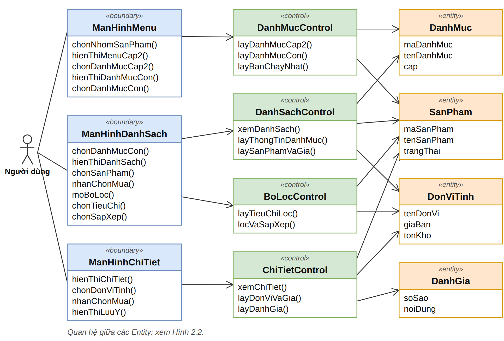

**Hình 2.25: Biểu đồ lớp phân tích BCE – Duyệt danh mục và sản phẩm (UC03–UC06)**

Tìm kiếm sản phẩm – UC07 (Hình 2.26). Một màn hình, một Control và Entity SanPham; TimKiemControl đảm nhiệm cả ba cách tìm (từ khóa, giọng nói, hình ảnh).

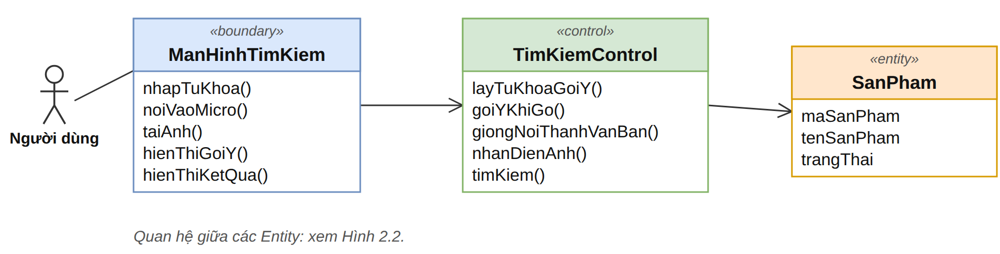

**Hình 2.26: Biểu đồ lớp phân tích BCE – Tìm kiếm sản phẩm (UC07)**

Đặt hàng và thanh toán – UC11, UC13 (Hình 2.27). DatHangControl điều phối việc đặt hàng và gọi ThanhToanControl (mũi tên nét đứt) ở bước thanh toán. ThanhToanControl làm việc với Cổng thanh toán, hệ thống bên ngoài (AC05), nên được vẽ như một lớp «external». Các Entity gồm GioHang, DiaChi, DonViTinh, DonHang, ChiTietDonHang và GiaoDichThanhToan.

**Hình 2.27: Biểu đồ lớp phân tích BCE – Đặt hàng và thanh toán (UC11, UC13)**

Quản trị danh mục và sản phẩm – UC22, UC23 (Hình 2.28). Hai màn hình quản trị dùng chung mẫu thao tác (hiển thị, nhập thông tin, lưu, xóa); mỗi màn hình có một Control riêng kiểm tra dữ liệu trước khi ghi vào Entity.

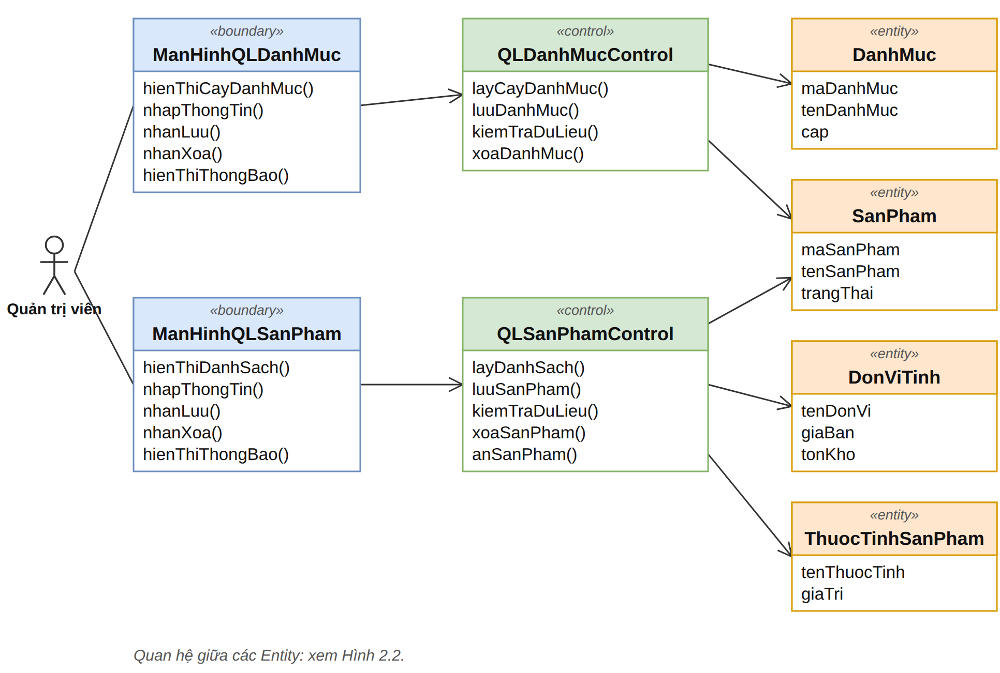

**Hình 2.28: Biểu đồ lớp phân tích BCE – Quản trị danh mục và sản phẩm (UC22, UC23)**

Các lớp Boundary và Control trên sẽ được thiết kế chi tiết thành lớp thiết kế ở mục 3.1.1 và biểu đồ lớp ở mục 3.2; các Entity được ánh xạ sang bảng dữ liệu và biểu đồ ERD ở mục 3.3.

# Thiết kế hệ thống

## Thiết kế cấu trúc hệ thống

### Thiết kế các lớp (Class Design)

**Bảng 3.1 liệt kê 21 nhóm lớp thiết kế. Các lớp Entity thể hiện thuộc tính khóa và kiểu dữ liệu làm cơ sở cho thiết kế cơ sở dữ liệu; các lớp Control thực hiện luồng xử lý của từng Use Case; các lớp Repository che giấu chi tiết truy xuất dữ liệu; các Interface định nghĩa hợp đồng giao tiếp giữa các phân hệ và với hệ thống bên ngoài.**

| STT | Lớp | Loại / phân hệ | Thuộc tính và phương thức chính / trách nhiệm | Use Case |
| --- | --- | --- | --- | --- |
| 1 | DanhMuc | Entity – PH02 | id (PK), ma (UQ), ten, cap, danhMucChaId (FK), thuTuHienThi, trangThai; themCon(), sua(), an()/hien(), xoaKiemTraRangBuoc() | UC03, UC04, UC22 |
| 2 | SanPham | Entity – PH02 | id (PK), ma (UQ), ten, danhMucId (FK), thuongHieuId (FK), thuocKeDon, canTuVan, trangThai; sua(), ngungBan(), kiemTraKeDon() | UC03–UC06, UC22, UC23 |
| 3 | DonViTinh | Entity – PH02, PH04 | id (PK), sanPhamId (FK), tenDonVi, giaBan, giaGoc, tonKho; truTonKho(sl), kiemTraTon(sl) | UC04–UC06, UC11, UC23 |
| 4 | DanhGia | Entity – PH02 | id (PK), sanPhamId (FK), khachHangId (FK), soSao, noiDung, trangThaiDuyet; duyet(), tuChoi() | UC06, UC16 |
| 5 | ThuocTinhSanPham | Entity – PH02 | id (PK), sanPhamId (FK), tenThuocTinh, giaTri; sua(), xoa() | UC23 |
| 6 | GioHang | Entity – PH04 | id (PK), khachHangId (FK, UQ), ngayCapNhat; themMuc(), capNhatSoLuong(), xoaMuc(), tinhTamTinh() | UC10, UC11 |
| 7 | DiaChi | Entity – PH04 | id (PK), khachHangId (FK), hoTen/sdtNguoiNhan, tinhThanh/quanHuyen/phuongXa, macDinh; datMacDinh(), kiemTraHopLe() | UC11 |
| 8 | DonHang | Entity – PH04 | id (PK), maDon (UQ), khachHangId (FK), trangThai, hinhThucNhanHang, voucherId (FK), donThuocId (FK), cacKhoanTien, anTenSanPham; xacNhan(), huy(), yeuCauTraHang(), tinhThanhTien() | UC11, UC14, UC15, UC24 |
| 9 | ChiTietDonHang | Entity – PH04 | id (PK), donHangId (FK), tenSanPham/tenDonVi (SNAP), soLuong, donGia (SNAP); tinhThanhTien() | UC11 |
| 10 | GiaoDichThanhToan | Entity – PH05 | id (PK), maGiaoDich (UQ), donHangId (FK), phuongThuc, soTien, trangThai; taoGiaoDich(), capNhatKetQua(), doiSoat() | UC13 |
| 11 | DanhMucControl, DanhSachControl, BoLocControl, ChiTietControl | Control – PH02 | Điều phối UC03–UC06: lấy cây danh mục, danh sách/giá sản phẩm, lọc–sắp xếp và chi tiết–đánh giá. | UC03–UC06 |
| 12 | TimKiemControl | Control – PH03 | goiYKhiGo(), timKiem(), xepHangKetQua(), giongNoiThanhVanBan(), nhanDienAnh(). | UC07 |
| 13 | DatHangControl | Control – PH04 | moTrangDatHang(), tinhTien(), apDungVoucher(ma), datHang(), taoDon(), truTonKho(). | UC11 |
| 14 | ThanhToanControl | Control – PH05 | thanhToan(), taoGiaoDich(), guiYeuCau(), nhanKetQua(), capNhatGiaoDich(), xuLyTimeout(). | UC13 |
| 15 | QLDanhMucControl, QLSanPhamControl | Control – PH02 | layCayDanhMuc()/layDanhSach(), luuDanhMuc()/luuSanPham(), kiemTraDuLieu(), xoa/an, capNhatTonKho(). | UC22, UC23 |
| 16 | ManHinhMenu, ManHinhDanhSach, ManHinhChiTiet | Boundary – PH02 | Hiển thị menu cây danh mục, danh sách và bộ lọc, chi tiết sản phẩm, đơn vị tính và cảnh báo thuốc kê đơn. | UC03–UC06 |
| 17 | ManHinhTimKiem | Boundary – PH03 | nhapTuKhoa(), noiVaoMicro(), taiAnh(), hienThiGoiY()/hienThiKetQua()/hienThiLichSu(). | UC07 |
| 18 | ManHinhDatHang, ManHinhThanhToan | Boundary – PH04, PH05 | Hiển thị hình thức nhận hàng, địa chỉ, thanh toán, voucher, thông tin đơn thuốc và mã QR/chuyển cổng. | UC11, UC13 |
| 19 | ManHinhQLDanhMuc, ManHinhQLSanPham | Boundary – PH02 | Hiển thị cây danh mục và danh sách sản phẩm; hỗ trợ nhập, lưu, xóa/ẩn và cập nhật tồn kho. | UC22, UC23 |
| 20 | DanhMucRepository, SanPhamRepository, DonHangRepository, GiaoDichRepository | Repository – PH02, PH04, PH05 | Đóng gói truy xuất dữ liệu: findCap2(), findCon(idCha), findByDanhMuc(), findBanChayNhat(), searchFullText(), save(), softDelete(), capNhatTon(), capNhatTrangThai(). | UC03–UC07, UC11, UC13, UC22, UC23 |
| 21 | ICongThanhToan, ITimKiemNangCao | Interface – PH05, PH03 | Hợp đồng tích hợp thanh toán (taoYeuCau, kiemTraKetQua) và tìm kiếm nâng cao (nhanDienAnh, speechToText). | UC07, UC13 |

**Bảng 3.1. Các lớp thiết kế (thuộc tính, phương thức) và Use Case sử dụng**

### Thiết kế hệ thống con và giao diện (Identify subsystems and interfaces)

Hệ thống được chia thành 9 phân hệ theo nhóm chức năng. Mỗi phân hệ công bố giao diện để các phân hệ khác sử dụng thay vì truy cập trực tiếp dữ liệu nội bộ. Các lời gọi đến hệ thống ngoài cũng được đóng gói qua Adapter nhằm giảm phụ thuộc vào nhà cung cấp cụ thể. Bảng 3.2 trình bày phạm vi chức năng, yêu cầu liên quan và những giao diện/lớp chính của từng phân hệ.

**Bảng 3.2. Các phân hệ và giao diện cung cấp**

| Mã | Phân hệ | Use Case | Yêu cầu chức năng | Giao diện / lớp chính |
| --- | --- | --- | --- | --- |
| PH01 | Tài khoản và xác thực | UC01, UC02, UC26 | FR-01–FR-06, FR-51 | INguoiDung (dangNhap, dangKy, doiMatKhau); Adapter xác thực OTP/định danh/mạng xã hội. |
| PH02 | Danh mục và sản phẩm | UC03–UC06, UC16, UC22, UC23 | FR-07–FR-16, FR-37, FR-46–FR-48 | IDanhMuc (layCayDanhMuc, layDanhMucCap2), ISanPham (xemDanhSach, xemChiTiet, locVaSapXep); DanhMucRepository, SanPhamRepository. |
| PH03 | Tìm kiếm và tra cứu | UC07, UC08 | FR-17–FR-21 | ITimKiem (timKiem, goiY, xepHangKetQua), ITimKiemNangCao (nhanDienAnh, speechToText). |
| PH04 | Giỏ hàng và đơn hàng | UC10, UC11, UC14, UC15, UC24 | FR-22–FR-27, FR-29, FR-30, FR-32–FR-36 | IDatHang (tinhTien, datHang, taoDon), IGioHang, DonHangRepository; gọi PH02 để lấy giá/tồn kho, PH06 để tính giảm giá và PH05 để thanh toán. |
| PH05 | Thanh toán | UC13 | FR-31 | IThanhToan (thanhToan, capNhatGiaoDich), ICongThanhToan và Adapter thanh toán, GiaoDichRepository; không lưu số thẻ. |
| PH06 | Khuyến mãi | UC09, UC12, UC25 | FR-28, FR-41, FR-42, FR-50 | IVoucher (kiemTraDieuKien, tinhGiamGia), IFlashSale. |
| PH07 | Đơn thuốc và tư vấn | UC17, UC18 | FR-38–FR-40 | IDonThuoc (taiLen, xacNhan, tuChoi), ITuVan (moPhien, guiTinNhan). |
| PH08 | Thông tin bổ trợ | UC19, UC20, UC21 | FR-43–FR-45 | INhaThuoc, ITiemChung, IBaiViet. |
| PH09 | Thống kê và báo cáo | UC27 | FR-52 | IThongKe (tongHopDoanhThu, sanPhamBanChay); chỉ đọc dữ liệu nghiệp vụ, không chỉnh sửa dữ liệu nguồn. |

Các nguyên tắc giao tiếp giữa phân hệ được áp dụng như sau:

Mỗi phân hệ chỉ sử dụng chức năng của phân hệ khác thông qua interface đã công bố; không truy cập trực tiếp dữ liệu nội bộ của phân hệ đó.

PH04 gọi PH02 để kiểm tra giá và tồn kho, gọi PH06 để áp dụng voucher/khuyến mãi, đồng thời gọi PH05 để xử lý thanh toán.

PH05 tích hợp cổng thanh toán AC05 thông qua ICongThanhToan và Adapter thanh toán; PH01 tích hợp dịch vụ xác thực AC06 thông qua Adapter xác thực.

Mọi thao tác truy xuất dữ liệu được đóng gói trong lớp Repository; lớp nghiệp vụ không chứa câu lệnh SQL.

PH09 chỉ tổng hợp và đọc dữ liệu phục vụ báo cáo, không cập nhật dữ liệu nghiệp vụ

## Thiết kế biểu đồ lớp (Class diagrams)

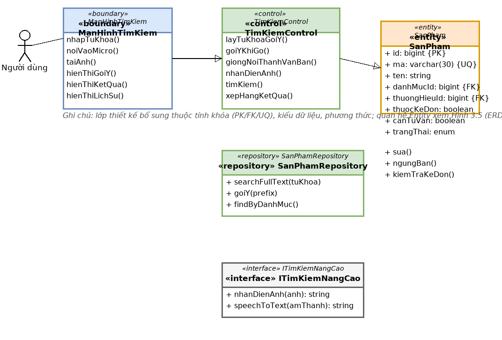

## Thiết kế cơ sở dữ liệu (Database design)

### Danh sách bảng

**Bảng 3.3 liệt kê tên 35 bảng vật lý cùng khóa chính, khóa ngoại và dữ liệu nghiệp vụ chính. Các tên bảng và cột trong cơ sở dữ liệu sử dụng tiếng Việt không dấu theo quy ước đặt tên của thiết kế.**

**Bảng 3.3. Danh sách 35 bảng cơ sở dữ liệu**

| STT | Tên bảng | Khóa chính | Khóa ngoại | Dữ liệu nghiệp vụ chính |
| --- | --- | --- | --- | --- |
| 1 | nguoi_dung | id | — | Tài khoản dùng chung cho khách hàng, dược sĩ và quản trị viên: số điện thoại (UQ), họ tên, email, mật khẩu đã băm, vai trò, trạng thái, ngày tạo. |
| 2 | khach_hang | nguoi_dung_id (PK, FK) | nguoi_dung_id → nguoi_dung.id | Hồ sơ khách hàng theo quan hệ 1–1: ngày sinh, giới tính; dùng chung khóa chính với nguoi_dung. |
| 3 | duoc_si | nguoi_dung_id (PK, FK) | nguoi_dung_id → nguoi_dung.id | Hồ sơ dược sĩ theo quan hệ 1–1: số chứng chỉ hành nghề; dùng chung khóa chính với nguoi_dung. |
| 4 | quan_tri_vien | nguoi_dung_id (PK, FK) | nguoi_dung_id → nguoi_dung.id | Thông tin vai trò quản trị viên, dùng chung khóa chính với nguoi_dung. |
| 5 | dia_chi | id | khach_hang_id → khach_hang.nguoi_dung_id | Sổ địa chỉ: người nhận, số điện thoại, tỉnh/thành, quận/huyện, phường/xã, địa chỉ chi tiết và trạng thái mặc định. |
| 6 | lien_ket_dang_nhap | id | nguoi_dung_id → nguoi_dung.id | Liên kết tài khoản với phương thức đăng nhập ngoài như OTP, định danh điện tử, Facebook, Google hoặc Apple. |
| 7 | danh_muc | id | danh_muc_cha_id → danh_muc.id (tự tham chiếu) | Cây danh mục nhiều cấp: mã (UQ), tên, cấp, biểu tượng, thứ tự hiển thị và trạng thái. |
| 8 | san_pham | id | danh_muc_id → danh_muc.id; thuong_hieu_id → thuong_hieu.id | Thông tin sản phẩm: mã (UQ), tên, nước sản xuất, mô tả, quy cách, thành phần, trạng thái kê đơn/cần tư vấn và trạng thái bán. |
| 9 | thuong_hieu | id | — | Danh mục thương hiệu: mã (UQ), tên thương hiệu. |
| 10 | don_vi_tinh | id | san_pham_id → san_pham.id | Đơn vị bán của sản phẩm: tên đơn vị, giá bán, giá gốc, phần trăm giảm và tồn kho; mỗi đơn vị có giá/tồn riêng. |
| 11 | thuoc_tinh_san_pham | id | san_pham_id → san_pham.id | Thuộc tính động theo từng sản phẩm, lưu theo cặp tên thuộc tính – giá trị. |
| 12 | danh_gia | id | san_pham_id → san_pham.id; khach_hang_id → khach_hang.nguoi_dung_id | Đánh giá sản phẩm: số sao, nội dung, ngày gửi và trạng thái duyệt. |
| 13 | nhom_thuoc | id | — | Danh mục nhóm thuốc tra cứu: mã (UQ), tên nhóm. |
| 14 | thuoc | id | nhom_thuoc_id → nhom_thuoc.id | Thông tin tra cứu thuốc: mã (UQ), tên, chỉ định, cách dùng và lưu ý. |
| 15 | duoc_chat | id | — | Thông tin dược chất: mã (UQ), tên, mô tả dược lý và chỉ định. |
| 16 | duoc_lieu | id | — | Thông tin dược liệu: mã (UQ), tên, tên khoa học, công dụng và lưu ý. |
| 17 | thuoc_duoc_chat | thuoc_id + duoc_chat_id (PK kép) | thuoc_id → thuoc.id; duoc_chat_id → duoc_chat.id | Bảng liên kết cho quan hệ nhiều-nhiều giữa thuốc và dược chất. |
| 18 | thuoc_duoc_lieu | thuoc_id + duoc_lieu_id (PK kép) | thuoc_id → thuoc.id; duoc_lieu_id → duoc_lieu.id | Bảng liên kết cho quan hệ nhiều-nhiều giữa thuốc và dược liệu. |
| 19 | gio_hang | id | khach_hang_id → khach_hang.nguoi_dung_id (UQ) | Giỏ hàng của khách hàng, theo quan hệ một-một; lưu thời điểm cập nhật. |
| 20 | muc_gio_hang | id | gio_hang_id → gio_hang.id; don_vi_tinh_id → don_vi_tinh.id | Một dòng giỏ hàng: đơn vị tính được chọn, số lượng và trạng thái đã chọn để đặt hàng. |
| 21 | don_hang | id | khach_hang_id; nha_thuoc_id (NULL); voucher_id (NULL); don_thuoc_id (NULL) | Đơn hàng: mã đơn (UQ), ngày đặt, trạng thái, hình thức nhận, thông tin người nhận, các khoản tiền và tùy chọn ẩn tên sản phẩm. |
| 22 | chi_tiet_don_hang | id | don_hang_id → don_hang.id | Các dòng sản phẩm của đơn hàng; lưu tên sản phẩm, đơn vị tính, số lượng, đơn giá và thành tiền tại thời điểm đặt (snapshot). |
| 23 | giao_dich_thanh_toan | id | don_hang_id → don_hang.id (có thể NULL khi COD) | Giao dịch thanh toán: mã giao dịch (UQ), phương thức, số tiền, trạng thái, mã giao dịch từ cổng và thời điểm. |
| 24 | hoa_don_dien_tu | id | don_hang_id → don_hang.id | Thông tin xuất hóa đơn điện tử: tên người mua, mã số thuế, địa chỉ và email nhận. |
| 25 | yeu_cau_huy_tra | id | don_hang_id → don_hang.id | Yêu cầu hủy/trả hàng: mã (UQ), loại yêu cầu, lý do, ngày gửi và trạng thái xử lý. |
| 26 | flash_sale | id | — | Đợt Flash Sale: mã (UQ), tên chương trình, thời gian bắt đầu/kết thúc và trạng thái. |
| 27 | san_pham_flash_sale | id | flash_sale_id → flash_sale.id; don_vi_tinh_id → don_vi_tinh.id | Sản phẩm/đơn vị tính thuộc một đợt Flash Sale, gồm mức giảm, số lượng giới hạn và số lượng đã bán. |
| 28 | voucher | id | — | Mã ưu đãi: mã (UQ), loại và giá trị giảm, đơn tối thiểu, hạn dùng, phạm vi áp dụng và trạng thái. |
| 29 | banner | id | — | Banner trang chủ: hình ảnh, đường dẫn, thứ tự hiển thị và trạng thái. |
| 30 | don_thuoc | id | khach_hang_id; duoc_si_id → duoc_si | Đơn thuốc khách hàng tải lên: tệp URL, ngày tải, trạng thái xem xét và lý do từ chối. |
| 31 | phien_tu_van | id | khach_hang_id; duoc_si_id → duoc_si | Phiên tư vấn giữa khách hàng và dược sĩ: mã (UQ), thời gian bắt đầu/kết thúc và trạng thái. |
| 32 | tin_nhan | id | phien_tu_van_id → phien_tu_van.id; san_pham_goi_y_id → san_pham.id (NULL) | Tin nhắn trong phiên tư vấn: người gửi, nội dung, thời điểm gửi và sản phẩm được gợi ý (nếu có). |
| 33 | nha_thuoc | id | — | Thông tin nhà thuốc: mã (UQ), tên, địa chỉ, tỉnh/thành, quận/huyện và giờ mở cửa. |
| 34 | bai_viet | id | — | Bài viết sức khỏe: tiêu đề, chuyên mục, nội dung và ngày đăng. |
| 35 | vac_xin | id | — | Thông tin vắc xin: tên, bệnh phòng ngừa, giá và thông tin chi tiết. |

### Biểu đồ ERD (Entity Relationship Diagram)

## Thiết kế giao diện

3.4.1 Nguyên tắc và tiêu chuẩn thiết kế

Màu sắc chủ đạo: Xanh dương (tạo cảm giác tin cậy, y tế) và Trắng (nền). Các nút kêu gọi hành động (Call to Action - CTA) như "Chọn mua", "Thanh toán" sử dụng màu nổi bật (Cam hoặc Xanh dương đậm).

Typography: Sử dụng font chữ không chân (Sans-serif) như Roboto hoặc Arial, kích thước tối thiểu 14px cho nội dung thường để đảm bảo người lớn tuổi dễ đọc.

Tính đáp ứng (Responsive): Giao diện tự động co giãn và sắp xếp lại bố cục, tương thích với cả 3 kích thước màn hình: Desktop (≥1024px), Tablet (768px - 1023px) và Mobile (≤767px).

Tính nhất quán: Các thành phần header, footer, thanh tìm kiếm và biểu tượng giỏ hàng được giữ nguyên vị trí trên mọi trang của khách hàng.

3.4.2 Giao diện phía Khách hàng

1. Giao diện Trang chủ và Menu Danh mục (Tương ứng UC03, UC07)

Bố cục Header: Logo (trái), Thanh tìm kiếm ở giữa (hỗ trợ icon micro và camera), Cụm chức năng (Đăng nhập, Giỏ hàng) bên phải.

Menu Navigation: Thanh menu ngang chứa 5 nhóm sản phẩm chính (Thực phẩm chức năng, Dược mỹ phẩm, Thuốc, Chăm sóc cá nhân, Thiết bị y tế). Khi hover/click sẽ xổ ra Mega Menu với danh mục cấp 2 bên trái và cấp 3 bên phải.

Nội dung chính: Banner trượt (Carousel), Khung Flash Sale (có đồng hồ đếm ngược), Khối Sản phẩm bán chạy.

[Ghi chú: Chụp ảnh màn hình] Chụp trực tiếp trang chủ và trạng thái đang mở Mega menu từ website nhathuoclongchau.com.vn. Dùng công cụ đánh dấu (khung đỏ) làm nổi bật thanh tìm kiếm và thanh menu.

2. Giao diện Trang danh sách sản phẩm và Bộ lọc (Tương ứng UC04, UC05)

Breadcrumb: Trang chủ / Nhóm sản phẩm / Danh mục / Danh mục con.

Bộ lọc: Các checkbox lọc theo Đối tượng sử dụng, Mức giá, Thương hiệu. Combo-box sắp xếp (Bán chạy, Giá cao, Giá thấp).

Lưới sản phẩm (Grid): Hiển thị các thẻ (Card) sản phẩm. Mỗi thẻ gồm: Ảnh, Nhãn giảm giá (%), Tên, Giá bán, Giá gốc (gạch ngang), Đơn vị tính và Nút "Chọn mua".

[Ghi chú: Vẽ bằng Draw.io] Vẽ Wireframe cấu trúc trang danh sách. Khối bộ lọc bên trái (25% chiều rộng), lưới sản phẩm 3x3 hoặc 4x4 bên phải (75% chiều rộng).

3. Giao diện Trang chi tiết sản phẩm (Tương ứng UC06)

Phần trên (Top section):

Trái: Gallery ảnh sản phẩm (1 ảnh to, các ảnh thumbnail nhỏ bên dưới).

Phải: Tên sản phẩm, Mã SP, Đánh giá sao, Giá bán, Lựa chọn Đơn vị tính (Radio button/Nút bấm), Lựa chọn Số lượng (- / +), và 2 nút bấm lớn: "Chọn mua" (thêm vào giỏ) và "Tìm nhà thuốc".

Khung cảnh báo: "Lưu ý: Sản phẩm này cần dược sĩ tư vấn" (hiển thị màu đỏ/cam).

[Ghi chú: Vẽ bằng Draw.io] Vẽ Wireframe tập trung vào khu vực thao tác chọn đơn vị tính, số lượng và nút "Chọn mua" để làm rõ luồng UX.

Phần dưới (Bottom section): Các tab (Mô tả, Thành phần, Hướng dẫn sử dụng, Đánh giá/Bình luận).

4. Giao diện Trang Giỏ hàng và Thanh toán (Tương ứng UC10, UC11, UC13)

Trang Giỏ hàng:

Bảng danh sách: Checkbox chọn SP, Ảnh, Tên, Cột tùy chỉnh số lượng (- / +), Cột chọn Đơn vị tính, Thành tiền từng món, Icon Xóa.

Khung tổng kết (Fixed bên phải): Tạm tính, Khung nhập/chọn Voucher, Tổng tiền, Nút "Mua hàng".

Trang Đặt hàng (Checkout):

Khối Địa chỉ: Tab chọn "Giao tận nơi" (Form nhập địa chỉ) hoặc "Nhận tại nhà thuốc" (Combobox chọn khu vực).

Khối Phương thức thanh toán: Các radio button (Tiền mặt, MoMo, ZaloPay, Thẻ tín dụng, Chuyển khoản QR).

Tùy chọn phụ: Checkbox "Yêu cầu xuất hóa đơn công ty" và "Ẩn tên sản phẩm".

5. Giao diện Quản lý Đơn thuốc và Tư vấn (Tương ứng UC17, UC18)

Màn hình chat (Cửa sổ Pop-up góc phải dưới): Khung lịch sử tin nhắn, ô nhập văn bản, nút đính kèm ảnh, nút gửi.

Danh sách đơn thuốc cá nhân: Bảng liệt kê các đơn thuốc đã tải lên (Ngày, Hình ảnh tệp, Trạng thái: Chờ duyệt/Đã xác nhận/Từ chối).

[Ghi chú: Vẽ bằng Draw.io] Vẽ Wireframe cho cửa sổ Chat tư vấn với dược sĩ và màn hình tải đơn thuốc (do phần này cần thể hiện luồng tải tệp tin và phản hồi trạng thái).

3.4.3 Giao diện phía Quản trị (Cổng quản trị - Đề xuất)

Do phần quản trị không được public trên website thực tế, nhóm đề xuất thiết kế giao diện dựa trên kiến trúc hệ thống đã phân tích ở phần 2.

1. Bố cục chung trang Quản trị (Admin Layout)

Sidebar (Trái): Thanh điều hướng cố định (Dashboard, Quản lý Danh mục, Quản lý Sản phẩm, Quản lý Đơn hàng, Quản lý Người dùng, Khuyến mãi).

Top bar (Trên): Tên/Avatar Quản trị viên, Thông báo, Nút Đăng xuất.

Main Content (Giữa): Không gian làm việc chính, hiển thị bảng dữ liệu hoặc form điền.

2. Giao diện Quản lý Sản phẩm (Tương ứng UC23)

Trang Danh sách: Thanh tìm kiếm, Bộ lọc trạng thái (Đang bán/Đã ẩn). Bảng dữ liệu gồm các cột: Mã SP, Tên, Hình ảnh, Danh mục, Tồn kho, Trạng thái, Cột thao tác (Sửa/Xóa).

Modal/Trang Thêm mới Sản phẩm:

Form nhập liệu chia thành các nhóm: Thông tin cơ bản (Tên, Thương hiệu), Phân loại (Chọn danh mục cha/con), Hình ảnh (Khu vực kéo thả tệp), Đơn vị tính (Nút "Thêm đơn vị tính" để sinh ra form điền giá/tồn kho tương ứng), Các thuộc tính riêng.

Nút hành động: "Lưu lại", "Hủy bỏ".

3. Giao diện Quản lý Đơn hàng (Tương ứng UC24)

Bảng điều khiển: Hiển thị các Tab trạng thái đơn (Tất cả / Đang xử lý / Đang giao / Đã giao / Hủy/Trả hàng).

Chi tiết đơn hàng: Hiển thị thông tin người mua, danh sách sản phẩm đã đặt, lịch sử thanh toán, và các nút chuyển đổi trạng thái (Ví dụ: Nút "Xác nhận & Giao hàng").

# Kết luận

4.1. Tổng kết các kết quả đạt được của đồ án

- Đồ án "Phân tích và Thiết kế Phần mềm hệ thống Website Nhà thuốc FPT Long Châu" đã hoàn thành các mục tiêu đề ra, bám sát các phương pháp luận chuẩn về Phân tích và Thiết kế Hướng đối tượng (Object-Oriented Analysis and Design - OOAD) kết hợp ngôn ngữ mô hình hóa UML. Cụ thể, nhóm đã thực hiện được các nội dung trọng tâm sau:

1. Khảo sát và Xác định yêu cầu :

- Khảo sát thực tế luồng nghiệp vụ trên hệ thống thực tế Nhà thuốc FPT Long Châu - Đủ thuốc giá tốt

- Xây dựng hệ thống thuật ngữ chuẩn (Glossary) và phân loại chi tiết các yêu cầu chức năng (52 yêu cầu FR) lẫn yêu cầu phi chức năng (18 yêu chuẩn NFR có tiêu chí đo lường rõ ràng).

- Mô hình hóa hệ thống bằng sơ đồ Use Case tổng quát, xác định rõ các tác nhân (Khách Vãng Lai, Khách hàng, Dược sĩ, Quản trị viên và các hệ thống bên ngoài) cùng 27 Use Case phân theo các mức độ trọng tâm, hỗ trợ và đơn giản.

2. Phân tích hệ thống (Chương 2):

- Thiết kế kiến trúc mức cao theo mô hình phân lớp (Layered Architecture) kết hợp phân hệ monolith, đảm bảo tính tách biệt giữa các tầng Trình bày, Nghiệp vụ, Truy cập dữ liệu và Dữ liệu.

- Xác định danh mục 33 đối tượng nghiệp vụ cốt lõi (Entity) chia thành 7 cụm, làm nền tảng cho thiết kế dữ liệu và lập trình.

- Hiện thực hóa các Use Case trọng tâm thông qua hệ thống Biểu đồ trình tự (Sequence Diagrams), Biểu đồ hoạt động (Activity Diagrams) và Biểu đồ lớp phân tích theo mẫu BCE (Boundary – Control – Entity).

3. Thiết kế hệ thống (Chương 3):

- Xây dựng mô hình thiết kế kiến trúc hệ thống con, giao diện, biểu đồ lớp thiết kế chi tiết.

- Thiết kế cơ sở dữ liệu quan hệ hoàn chỉnh với danh sách bảng chi tiết và Biểu đồ thực thể kết hợp (ERD).

- Xây dựng quy chuẩn giao diện (UI/UX Guidelines) và thiết kế sơ đồ luồng màn hình (Screen Flow) cùng các khung giao diện (Wireframe) trực quan cho các chức năng chính.

4.2. Đánh giá ưu điểm và hạn chế của hệ thống thiết kế

- Ưu điểm:

- Tính thực tiễn cao: Phản ánh sát thực tế nghiệp vụ của một chuỗi nhà thuốc lớn, đặc biệt xử lý tốt các bài toán đặc thù như quản lý đa đơn vị tính (Hộp, Vỉ,...), phân loại thuốc kê đơn (Rx) cần tư vấn dược sĩ, kiểm soát tồn kho và cơ chế đặt hàng linh hoạt.

- Tính mở rộng và bảo trì tốt: Kiến trúc phân hệ rõ ràng giúp dễ dàng bổ sung các nhóm sản phẩm mới, phương thức thanh toán mới hoặc nâng cấp thành hệ thống vi dịch vụ (microservices) trong tương lai mà không ảnh hưởng đến lõi hệ thống.

- Bảo mật và an toàn dữ liệu: Đề xuất các giải pháp bảo mật toàn diện (HTTPS, phân quyền theo vai trò, mã hóa thông tin nhạy cảm, tích hợp cổng thanh toán an toàn không lưu số thẻ).

- Hạn chế:

- Giới hạn về dữ liệu và quyền tiếp cận thực tế: Do đồ án được thực hiện trong khuôn khổ môn học và nhóm sinh viên chỉ khảo sát hệ thống thông qua giao diện người dùng công khai (Nhà thuốc FPT Long Châu - Đủ thuốc giá tốt), nên các nghiệp vụ quản trị chiều sâu, cơ chế bảo mật hệ thống cấp độ doanh nghiệp, hoặc hệ thống kho vận – chuỗi cung ứng thực tế bên dưới chủ yếu dựa trên quá trình nghiên cứu tài liệu, suy luận logic và đề xuất mang tính giả định của nhóm chứ chưa được kiểm chứng trực tiếp trên hệ thống nội bộ của doanh nghiệp.

- Thời gian và nguồn lực có hạn: Vì thời gian thực hiện đồ án học phần ngắn và nguồn lực sinh viên tập trung vào các chức năng trọng tâm (duyệt danh mục, sản phẩm, giỏ hàng, đặt hàng), nên một số phân hệ phụ trợ hoặc quy mô lớn (như hệ thống tiêm chủng chi tiết, tích hợp cổng thanh toán thực tế với ngân hàng, hoặc ứng dụng di động) mới chỉ dừng lại ở mức độ mô hình hóa khái niệm, chưa thể hiện đầy đủ độ phức tạp kỹ thuật khi triển khai thực tế.

# Tài liệu tham khảo

- Giáo Trình: Bài giảng môn Phân tích và Thiết kế Phần mềm, TS. Trương Đức Phương, Trường Công nghệ Thông tin Phenikaa, 2026.

- FPT Long Châu, Website chính thức của hệ thống Nhà thuốc FPT Long Châu, truy cập tháng 10/2026 tại địa chỉ: Nhà thuốc FPT Long Châu - Đủ thuốc giá tốt

- OWASP Foundation, OWASP Top 10 Web Application Security Risks, tài liệu kỹ thuật trực tuyến về bảo mật ứng dụng web, truy cập tại: OWASP Top 10 | OWASP Foundation

- Bộ Y tế, Luật Dược số 105/2016/QH13 quy định về hoạt động kinh doanh dược và thương mại điện tử dược phẩm.
